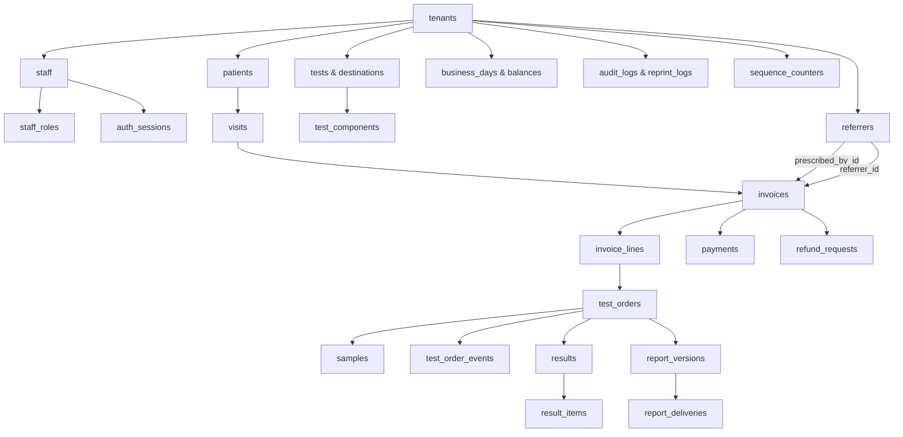

# MedScope DCMS — Database & Schema Specification

## 1. Engine & Topology

- **Engine:** PostgreSQL 18 (`127.0.0.1:5432`)
- **Database:** `medscope_dcms`
- **User:** `medscope_app`
- **Migration Engine:** Alembic (SQLAlchemy 2.0 ORM)
- **Current Alembic Head:** `b9e41d82f05a` (`prompt09_role_based_auth.py`)
- **Table Count:** Exactly 28 tables (27 domain entities + 1 `alembic_version` tracking table)



---

## 2. Table Catalog (27 Domain Entities, 28 Tables Total in PostgreSQL)

### Platform & Organization
1. `tenants`: Primary multi-tenant accounts (`id` UUID PK, `slug` UK, `name`, `active`, `default_sample_route` [`QUICK`, `FULL`], `created_at`).
2. `staff`: Clinic employees (`id` PK, `tenant_id` FK, `username` UK, `display_name`, `role` enum [`RECEPTIONIST`, `ADMIN`, `LAB_TECH`, `CASHIER`, `OWNER`], `department` [`Hematology`, `Biochemical Tests`, `Administration`, `Front Desk`], `email`, `phone`, `address`, `active`, `password_hash`, `failed_attempts`, `locked_at`, `last_login_at`, `password_changed_at`).
3. `staff_roles`: Multi-role assignment mapping (`id` PK, `tenant_id` FK, `staff_id` FK to `staff(id)` ON DELETE CASCADE, `role` enum, `assigned_at`, `assigned_by_id` FK; unique constraint on `(staff_id, role)`).
4. `auth_sessions`: Stateful server-side session storage (`id` PK, `tenant_id` FK, `session_token_hash` UK [SHA-256], `staff_id` FK to `staff(id)` ON DELETE CASCADE, `acting_role` enum, `created_at`, `last_activity_at`, `expires_at`, `is_revoked`, `revoked_at`, `revoked_by_id` FK, `revocation_reason`, `user_agent`, `ip_address`).

### Patient Intake & Clinical Referrers
5. `patients`: Permanent patient registry (`id` PK, `tenant_id` FK, `patient_code` UK, `name`, `phone`, `alternate_phone`, `gender`, `address`, `created_at`).
6. `visits`: Encounter visits (`id` PK, `tenant_id` FK, `patient_id` FK, `visit_number` UK, `age_value`, `age_unit`, `age_days`, `gender`, `created_by_id` FK, `created_at`).
7. `referrers`: Referring physicians and third-party contacts (`id` PK, `tenant_id` FK, `name`, `degree`, `designation`, `institution`, `phone`, `specialty`, `referrer_type` [`Doctor`, `Consultant`, `Professor`, `Institution`, `Clinic`, `Agent`], `commission_rate` [confidential write-only], `commission_type` [`PERCENTAGE`, `AMOUNT`], `active`).

### Laboratory Catalog & Workstations
8. `test_destinations`: Workstations / rooms (`id` PK, `tenant_id` FK, `name`, `destination_type` [`Technician`, `Room`, `Lab`], `department`, `active`).
9. `tests`: Diagnostic investigation catalog (`id` PK, `tenant_id` FK, `code` UK, `name`, `short_name`, `alternate_names`, `department`, `price`, `sample_type`, `default_assignee`, `turnaround_hours`, `performing_role` [`LAB_TECH`, `DOCTOR`], `requires_doctor` [boolean], `report_template` [`NUMERIC_TABLE`, `NARRATIVE`, `CULTURE_SENSITIVITY`, `HISTOPATHOLOGY`], `approval_rule` [`TECHNICIAN_FINAL`, `DOCTOR_REQUIRED`, `BOTH_SIGNATURES`], `is_outsourced` [boolean], `active`). **Scale:** 1,250 active clinical tests under tenant `center-seba-01` across 10 diagnostic departments.
10. `test_components`: Individual measurable components/analytes belonging to a test profile (`id` PK, `tenant_id` FK, `test_id` FK, `name`, `unit`, `ref_min`, `ref_max`, `critical_min`, `critical_max`, `impossible_min`, `impossible_max`, `sort_order`, `active`).

### Billing, Payments & Ledgers
11. `invoices`: Master invoice charges (`id` PK, `tenant_id` FK, `invoice_no` UK, `patient_id` FK, `visit_id` FK, `prescribed_by_id` FK [Doctor only], `referrer_id` FK [Doctor/Third Party], `status`, `payment_status`, `refund_status` [`NO_REFUND`, `REFUND_PENDING`, `PARTIALLY_REFUNDED`, `FULLY_REFUNDED`, `REFUND_REJECTED`], `gross`, `discount`, `net`, `paid`, `due`, `refund_due`, `urgent`, `created_at`, `created_by_id` FK).
12. `invoice_lines`: Line items (`id` PK, `tenant_id` FK, `invoice_id` FK, `test_id` FK, `test_code_snapshot`, `test_name_snapshot`, `department_snapshot`, `unit_price_snapshot`, `discount_type`, `discount_value`, `discount_amount`, `net_price`, `urgent`, `status`, `is_locked` [boolean, Module 12 sample lock], `locked_at`, `locked_reason`).
13. `payments`: Payment receipts (`id` PK, `tenant_id` FK, `invoice_id` FK, `amount`, `method`, `reference`, `change_amount`, `business_day_id` FK, `received_at`, `received_by_id` FK).

### Laboratory Operations & Workflow
14. `test_orders`: Diagnostic lab orders (`id` PK, `tenant_id` FK, `invoice_line_id` FK UK, `status` [`UNASSIGNED`, `ASSIGNED`, `PENDING`, `SAMPLE_PENDING`, `IN_PROGRESS`, `AWAITING_DOCTOR`, `COMPLETED`, `CANCELLED`, `REJECTED`, `SPOILED`], `outcome` [`NOT_PERFORMED` under D15, null], `urgent` [boolean], `department`, `performing_role`, `turnaround_hours`, `sample_route` [`QUICK`, `FULL`], `patient_followup_required`, `patient_contact_status`, `patient_contacted_at`, `patient_contact_notes`, `culture_stage`, `outsourced_status`, `outsourced_lab_name`, `outsourced_sent_at`, `outsourced_received_at`, `outsourced_ref_no`, `assigned_destination`, `assigned_to_id` FK, `assigned_at`, `assigned_by_id` FK, `created_at`).
15. `assignment_history`: Workstation and staff routing audit (`id` PK, `tenant_id` FK, `test_order_id` FK, `previous_assignee`, `new_assignee`, `reason`, `changed_by_id` FK, `changed_at`).
16. `samples`: Specimen collection records (`id` PK, `tenant_id` FK, `test_order_id` FK UK, `sample_code` UK, `temp_sample_id` [offline barcode], `sample_type`, `status` [`COLLECTED`, `REJECTED`, `SPOILED`], `collected_at`, `collected_by_id` FK, `rejected_at`, `rejected_by_id` FK, `rejection_reason`, `rejection_notes`).
17. `test_order_events`: Append-only operational lifecycle history (`id` PK, `tenant_id` FK, `test_order_id` FK, `event_type`, `stage`, `description`, `notes`, `actor_id` FK, `actor_name`, `actor_role`, `created_at`).
18. `results`: Master clinical result record (`id` PK, `tenant_id` FK, `test_order_id` FK UK, `status` [`DRAFT`, `ENTERED`], `entered_by_id` FK, `entered_at`, `findings`, `impression`, `comments`, `ultrasound_data` JSON, `created_at`, `updated_at`).
19. `result_items`: Individual component results snapshotted at time of entry (`id` PK, `result_id` FK, `test_component_id` FK, `component_name_snapshot`, `numeric_value`, `text_value`, `unit_snapshot`, `ref_min_snapshot`, `ref_max_snapshot`, `critical_min_snapshot`, `critical_max_snapshot`, `flag` [`LOW`, `HIGH`, `CRITICAL`, `NORMAL`, null], `sort_order`).
20. `report_versions`: Final diagnostic reports (`id` PK, `tenant_id` FK, `test_order_id` FK, `report_no` UK, `version`, `status`, `authorized`, `findings_summary`, `issued_at`, `issued_by_id` FK).
21. `report_deliveries`: Handover events (`id` PK, `tenant_id` FK, `report_version_id` FK, `delivered_to_name`, `delivered_to_phone`, `delivered_to_relation`, `delivered_with_due`, `due_release_reason`, `delivered_at`, `delivered_by_id` FK).

### Financial Gating & Drawer Lifecycle
22. `refund_requests`: Pre-sample and D15 Not Performed refund requests (`id` PK, `tenant_id` FK, `invoice_id` FK, `invoice_line_id` FK, `request_type` [`PRE_SAMPLE_CANCELLATION`, `D15_NOT_PERFORMED`], `amount`, `reason`, `status` [`PENDING_ADMIN_APPROVAL`, `APPROVED`, `REJECTED`, `COMPLETED`], `requested_by_id` FK, `requested_at`, `reviewed_by_id` FK, `reviewed_at`, `review_notes`, `disbursed_at`, `disbursed_by_id` FK, `disbursement_method`, `disbursement_reference`).
23. `business_days`: Operational day status (`id` PK, `tenant_id` FK, `day_number`, `business_date`, `status`, `opening_float`, `opening_balance`, `total_received_today`, `total_refunds`, `current_balance`, `opened_at`, `opened_by_id` FK, `closed_at`, `closed_by_id` FK).
24. `business_day_channel_balances`: Balances by channel (`id` PK, `business_day_id` FK, `channel`, `opening_balance`, `received_amount`, `current_balance`).

### Concurrency & Audit Control
25. `sequence_counters`: Concurrency-safe monotonic numbers (`id` PK, `tenant_id`, `seq_type`, `year_month`, `current_val`, `updated_at`).
26. `audit_logs`: Detailed system audit ledger (`id` PK, `tenant_id`, `actor_id`, `acting_role`, `action`, `entity_type`, `entity_id`, `before_value`, `after_value`, `created_at`).
27. `reprint_logs`: Invoice/report reprint audit records (`id` PK, `tenant_id`, `entity_type`, `entity_id`, `reprinted_by_id` FK, `reason`, `reprinted_at`).

---

## 3. Migration History & Alembic Evolution

| Revision ID | Description | Operations Performed | Reversibility |
| :--- | :--- | :--- | :--- |
| `5e7d6e556c9d` | Initial Receptionist Slice | Created initial 21 domain tables, indexes, constraints, and sequences. | Full downgrade |
| `c94589ffc4ee` | Add `prescribed_by_id` to Invoices | Added `prescribed_by_id` nullable integer column with foreign key to `referrers(id)` and index `ix_invoices_prescribed_by_id`. | Full downgrade |
| `bdc0201a1170` | Add `refund_status` to Invoices | Added `refund_status` VARCHAR(50) column with server default `NO_REFUND`, index `ix_invoices_refund_status`, and automated data backfill for existing partially and fully refunded invoices. | Full downgrade |
| `e05b9b1a2c3d` | Prompt 05 Catalog Routing & Worklist | Added Test Catalog readiness fields (`turnaround_hours`, `performing_role`, `requires_doctor`, `report_template`, `approval_rule`, `is_outsourced`) to `tests`; added `department` and index to `staff`; added `default_sample_route` to `tenants`; added operational tracking (`urgent`, `department`, `performing_role`, `turnaround_hours`, `sample_route`) to `test_orders`. | Full downgrade |
| `f16c024d3e4a` | Prompt 06 Specimen Lifecycle & Line Locks | Added line locks (`is_locked`, `locked_at`, `locked_reason`) to `invoice_lines`; added specimen audit fields (`temp_sample_id`, `rejected_at`, `rejected_by_id`, `rejection_reason`, `rejection_notes`) to `samples`; added tracking & extensions (`patient_followup_required`, `patient_contact_status`, `culture_stage`, `outsourced_status`, etc.) to `test_orders`; created append-only `test_order_events` table. | Full downgrade |
| `a7d834bc912e` | Prompt 07 Module 13 Results & Module 12 Fixes | Created `test_components`, `results`, `result_items` tables with indexes and unique constraints; added `outcome` column to `test_orders`; added `request_type`, `disbursed_at`, `disbursed_by_id`, `disbursement_method`, `disbursement_reference` to `refund_requests`. (Prompt 07C aligned ORM models with `uq_results_test_order_id` and CASCADE onDelete; zero new migrations required). | Full downgrade |
| `b9e41d82f05a` | Prompt 09 Role-Based Auth & Session Transport | Added security columns to `staff` (`password_hash`, `failed_attempts`, `locked_at`, `last_login_at`, `password_changed_at`); created `staff_roles` with `(staff_id, role)` unique constraint; seeded `staff_roles` from existing `staff.role`; created `auth_sessions` table with SHA-256 token hash indexing. | Full downgrade |

> [!NOTE] Prompt 10 Schema Review
> Prompt 10 (Branded Landing Page & Animated Login UI) is a pure client-side design implementation. Zero database migrations or schema alterations were required. Current head remains `b9e41d82f05a`.

### Safe Migration & Inspection Commands:
```powershell
python -m alembic -c backend/alembic.ini heads
python -m alembic -c backend/alembic.ini current
python -m alembic -c backend/alembic.ini check
python -m alembic -c backend/alembic.ini upgrade head
```

---

## 4. Key Indices & Database Constraints

1. **Single Open Business Day:**
   ```sql
   CREATE UNIQUE INDEX idx_business_day_single_open ON business_days(tenant_id) WHERE status = 'OPEN';
   ```
2. **Prescribed By Foreign Key:**
   ```sql
   ALTER TABLE invoices ADD CONSTRAINT fk_invoices_prescribed_by_id FOREIGN KEY (prescribed_by_id) REFERENCES referrers (id);
   CREATE INDEX ix_invoices_prescribed_by_id ON invoices (prescribed_by_id);
   ```
3. **Monotonic Sequence Uniqueness:**
   ```sql
   CREATE UNIQUE INDEX uq_seq_tenant_type_ym ON sequence_counters(tenant_id, seq_type, year_month);
   ```
4. **High-Speed Search Indices:**
   - `idx_patients_phone_name ON patients(phone, name);`
   - `idx_invoices_status_created ON invoices(tenant_id, payment_status, created_at);`
   - `idx_test_orders_status ON test_orders(tenant_id, status);`
   - `idx_reports_authorized_status ON report_versions(tenant_id, authorized, issued_at);`

---

## 5. Active Data Volume & Diagnostic Catalog Scale

As of November 2026, the primary operational tenant `center-seba-01` hosts **1,250 active clinical tests** in PostgreSQL, fully indexed by `(tenant_id, code)` and `(tenant_id, name)`:

| Department | Active Tests | Typical Turnaround | Primary Template |
| :--- | :---: | :---: | :--- |
| **Clinical Pathology** | 469 | 2 - 6 hours | `NUMERIC_TABLE` |
| **Biochemistry** | 265 | 4 - 8 hours | `NUMERIC_TABLE` |
| **Microbiology & Parasitology** | 187 | 24 - 48 hours | `CULTURE_SENSITIVITY` |
| **Endocrinology & Immunology** | 136 | 6 - 24 hours | `NUMERIC_TABLE` |
| **Hematology** | 71 | 2 - 4 hours | `NUMERIC_TABLE` |
| **Histopathology & Cytopathology** | 45 | 48 - 72 hours | `NARRATIVE` |
| **Ultrasonography (USG)** | 34 | 1 - 2 hours | `NARRATIVE` (Requires Doctor) |
| **X-Ray & Radiology** | 13 | 2 - 4 hours | `NARRATIVE` |
| **Serology & Immunology** | 3 | 4 - 6 hours | `NUMERIC_TABLE` |
| **Cardiology & Neuro Diagnostics** | 2 | 1 - 2 hours | `NARRATIVE` |
| **Total Active Catalog** | **1,250** | | |

### Multi-Tenant Isolation Invariant
All test catalog items, staff, patients, invoices, test orders, and financial transactions enforce strict tenant scoping via `tenant_id = 'center-seba-01'`. The database layer strictly validates that all queries and joins are scoped to `actor.tenant_id`. Any manually imported records must specify the active tenant ID (`center-seba-01`) to be accessible in the user interface.

---

## 6. Test Database Isolation & Forensic Audit (Prompt 08)

### 6.1 Isolated Test Database Architecture
- **Database Identity:** `medscope_test` running under PostgreSQL 18, owned by user `medscope_app`.
- **Full Migration Compatibility:** Verified clean migration from `<base>` through single head `a7d834bc912e` using `backend/alembic/env.py` (which honors `ALEMBIC_DATABASE_URL`).
- **Hard Safety Guard:** `tests/conftest.py` inspects the normalized database target (`TEST_DATABASE_URL`). If the target resolves to `medscope_dcms` (even under `localhost` vs `127.0.0.1`), pytest immediately aborts with `pytest.UsageError` (Exit code 4).
- **Deterministic Seeding:** Pytest fixture initializes tenant `center-seba-01`, staff members, 25 diagnostic tests, test destinations, referrers, and CBC test components before test execution.
- **Execution Mode:** Pure in-process execution using FastAPI's `TestClient` with database dependency overrides. All port 8000 network probing is eliminated.

### 6.2 Primary Database Forensic Audit & Backup
- **Binary Pre-Audit Backup:** `backups/medscope_dcms_pre_prompt08.dump` (191,737 bytes, generated via `pg_dump -F c -b -v`). Note: This dump was taken before Prompt 09 and lacks auth tables (`staff_roles`, `auth_sessions`).
- **Audit Findings:** Forensic read-only analysis of `medscope_dcms` identified 106 test patients, 93 test referrers, 180 test invoices, 189 test lines, 146 test payments, 76 test refund requests, 189 test orders, 121 test events, 22 test samples, 3 test results, 46 test audit logs, 50 test reprint logs.
- **Read-Only Invariant:** Zero writes or deletions were executed against `medscope_dcms`. Detailed candidate breakdown and dependency mapping are documented in `report/TEST_RECORD_CANDIDATES.md`.

---

## 7. Test Data Cleanup SQL Script (`backend/scripts/sql/cleanup_test_data.sql`, Prompt 10B)

### 7.1 Purpose & Execution Environment
A dedicated, self-contained standard PostgreSQL script for execution directly by the owner inside the **pgAdmin Query Tool**. The script purges fake test-created rows from the primary database `medscope_dcms` without risking operational integrity or deleting legitimate QA data.

### 7.2 Safety Invariants & Architecture
1. **Zero Range Deletions:** Never uses ID ranges (e.g., `invoices.id >= 6` is strictly prohibited). All candidate selections use exact test name patterns (`E2E Patient%`, `Refund Patient%`, `Dr. E2E Test%`, etc.), automated reason strings, or strict foreign-key child cascading.
2. **Strict Entity Protection:**
   - Platform/Auth: `staff`, `staff_roles`, `auth_sessions` (owner login accounts are preserved 100%).
   - Clinical Catalog: `tests` (1,250 tests), `test_components`, `test_destinations`.
   - Sequences & Meta: `sequence_counters` (never reset; numbering gaps are standard), `alembic_version`.
   - Operations: `business_days`, `business_day_channel_balances`.
   - Baseline Seed Records: Patients 1..12, Referrers 1..10, Invoices SD-000001..000008 and SD-000137.
   - Legitimate Manual QA Records: Patients 19, 50, 57, 99; Referrers 17, 45, 46 (plus referrers 11, 31, 35 referenced by legitimate QA invoices); Invoices SD-000031, SD-000066, SD-000099, SD-000135, SD-000136.
3. **Four Script Sections:**
   - *Section 1: Header Comments:* Scope, protected entities, step-by-step fresh backup instructions (`.dump` custom format), old dump incompatibility warning, and restore procedure.
   - *Section 2: Configuration & PREVIEW (read-only):* Temp table `_cleanup_config` (`include_medium`, default `TRUE`), candidate temp tables per entity, preview summary result sets per table/tier, and list of kept protected entities.
   - *Section 3: Deletion Transaction:* `BEGIN;` followed by `DO $$ ... $$` executing deletions in topological order, emitting `RAISE NOTICE` for row counts per table, and inserting a single summary audit log `TEST_DATA_CLEANUP`.
   - *Section 4: Post-Checks & Default ROLLBACK:* Automated orphan checks across all foreign keys, kept entity count assertions (16 patients, 16 referrers, 14 invoices), business day balance notice, ending with `ROLLBACK;` (switch to `COMMIT;` to persist).

### 7.3 Topological Deletion Sequence (Zero Foreign-Key Violations)
`audit_logs` -> `reprint_logs` -> `report_deliveries` -> `report_versions` -> `result_items` -> `results` -> `samples` -> `assignment_history` -> `test_order_events` -> `refund_requests` -> `test_orders` -> `payments` -> `invoice_lines` -> `invoices` -> `visits` -> `referrers` -> `patients` -> `audit_logs` summary insert.

### 7.4 Cash Drawer & Business Day Balance Policy
Inspection revealed that Day 2 stored cash received (70,430 Taka) diverges from the raw payment sum (72,830 Taka) by 2,400 Taka due to historical pre-seeded floats/untracked adjustments. Per Prompt 10B Section 4 safety rules: because recomputation does not equal stored value, balances are left **untouched** with a warning notice printed in script output.

### 7.5 Candidate Deletion Counts
| Table Name | High Tier | Medium Tier | Total to Delete | Current Total | Remaining Legitimate |
| :--- | :---: | :---: | :---: | :---: | :---: |
| `patients` | 135 | 0 | 135 | 151 | 16 |
| `referrers` | 115 | 0 | 115 | 131 | 16 |
| `invoices` | 70 | 139 | 209 | 223 | 14 |
| `visits` | 70 | 139 | 209 | 223 | 14 |
| `invoice_lines` | 79 | 139 | 218 | 266 | 48 |
| `payments` | 39 | 112 | 151 | 166 | 15 |
| `test_orders` | 79 | 139 | 218 | 266 | 48 |
| `test_order_events` | 48 | 105 | 153 | 169 | 16 |
| `assignment_history` | 57 | 98 | 155 | 178 | 23 |
| `samples` | 13 | 16 | 29 | 38 | 9 |
| `results` | 0 | 3 | 3 | 5 | 2 |
| `result_items` | 0 | 0 | 0 | 0 | 0 |
| `report_versions` | 0 | 0 | 0 | 6 | 6 |
| `report_deliveries` | 0 | 0 | 0 | 4 | 4 |
| `refund_requests` | 30 | 48 | 78 | 80 | 2 |
| `reprint_logs` | 9 | 39 | 48 | 92 | 44 |
| `audit_logs` | 213 | 374 | 587 | 659 | 72 |


