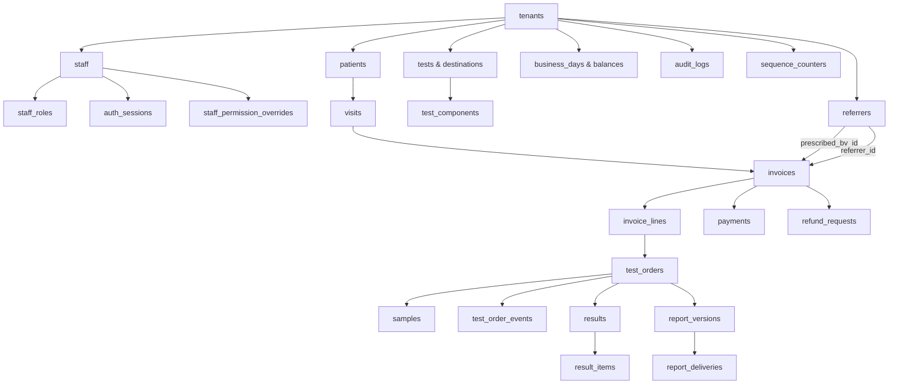

# MedScope DCMS — Database & Schema Specification

## 1. Engine & Topology

- **Engine:** PostgreSQL 18 (`127.0.0.1:5432`)
- **Database:** `medscope_dcms`
- **User:** `medscope_app`
- **Migration Engine:** Alembic (SQLAlchemy 2.0 ORM)
- **Current Alembic Head:** `a19b5c7d9e31` (`prompt19b_audit_immutable_fold_reprints.py`), single head (before it `f9a2c4d6e8b1`, Prompt 18 accounting journal and day close). **Prompt 10F was reviewed with no schema change** (`alembic heads` = `f3c9a1d7e5b2`, `alembic check` = "No new upgrade operations detected."); all 10F rules (Ready definition, sample rule, empty-room demotion, Assigned Tests view, permission defaults) live in code, not in the schema.
- **Table Count:** Exactly 39 tables in `medscope_dcms` (38 domain entities + 1 `alembic_version` tracking table), counted from `information_schema` in Prompt 18

> **Schema change policy.** Every schema/DDL change (new columns, new tables, relations, indexes, constraints) is made **only** through an Alembic migration. The Alembic head is the single source of truth for the schema. Seeding and cleanup scripts (`backend/scripts/seed.py`, `backend/scripts/sql/cleanup_test_data.sql`) are development/testing utilities outside the Alembic chain. They never change the schema and are not product features.

> **Data volumes.** The project is in its development phase. `medscope_dcms` holds development/QA data, and its record counts vary constantly. Exact row counts in this document are point-in-time snapshots, marked as such, not current facts. Structural facts (table count, columns, Alembic head) are verifiable from code.



---

## 2. Table Catalog (34 Domain Entities, 35 Tables Total in PostgreSQL)

### Platform & Organization
1. `tenants`: Primary multi-tenant accounts (`id` UUID PK, `slug` UK, `name`, `active`, `default_sample_route` [`QUICK`, `FULL`], `created_at`).
2. `staff`: Clinic employees (`id` PK, `tenant_id` FK, `username` UK, `display_name`, `role` [`RECEPTIONIST`, `ADMIN`, `LAB_TECH`, `CASHIER`, `OWNER`, `DOCTOR` (Prompt 10E); no DB constraint on the value, validated against `ROLES`], `department` [free text, no longer used by routing], `lab_section` [Prompt 10D: room code from `backend/app/core/lab_sections.py`, LAB_TECH only; Prompt 10E: **required** for LAB_TECH — CHECK `chk_staff_lab_tech_has_section` (`role <> 'LAB_TECH' OR lab_section IS NOT NULL`) where all rows comply], `email`, `phone`, `address`, `active`, `password_hash`, `failed_attempts`, `locked_at`, `last_login_at`, `password_changed_at`). `staff.role` is the user's single role (Prompt 10D).
3. `staff_roles`: Multi-role assignment mapping (`id` PK, `staff_id` FK to `staff(id)` ON DELETE CASCADE, `role`, `is_primary`, `created_at`; unique constraint `uq_staff_roles_staff_id_role` on `(staff_id, role)`; Prompt 10D: unique constraint `uq_staff_roles_staff_id` = exactly one role row per user).
4. `auth_sessions`: Stateful server-side session storage (`id` PK, `session_token_hash` UK [SHA-256], `staff_id` FK to `staff(id)` ON DELETE CASCADE, `tenant_id`, `acting_role`, `created_at`, `expires_at`, `last_seen_at`, `revoked_at` [null = active], `user_agent`, `ip_address`).

### Patient Intake & Clinical Referrers
5. `patients`: Permanent patient registry (`id` PK, `tenant_id` FK, `patient_code` UK, `name`, `phone`, `alternate_phone`, `gender`, `address`, `created_at`). No age column; Prompt 10E: the API exposes the latest visit age (`last_age_value`, `last_age_unit`) for prefill, and Finalize updates `gender` from the form.
6. `visits`: Encounter visits (`id` PK, `tenant_id` FK, `patient_id` FK, `visit_number` UK, `age_value`, `age_unit` [`years`, `months`, `days`], `age_days`, `gender` [`Male`, `Female`, `Other`], `created_by_id` FK, `created_at`). Prompt 10E: values come from the invoice form (no default age 30 / Male); `age_days` = value × 365 / 30 / 1.
7. `referrers`: Referring physicians and third-party contacts (`id` PK, `tenant_id` FK, `name`, `degree`, `designation`, `institution`, `phone`, `specialty`, `referrer_type` [`Doctor`, `Consultant`, `Professor`, `Institution`, `Clinic`, `Agent`], `commission_rate` [confidential write-only], `commission_type` [`PERCENTAGE`, `AMOUNT`], `active`).

### Laboratory Catalog & Workstations
8. `test_destinations`: Workstations / rooms (`id` PK, `tenant_id` FK, `name`, `destination_type` [`Technician`, `Room`, `Lab`], `department`, `active`).
9. `tests`: Diagnostic investigation catalog (`id` PK, `tenant_id` FK, `code` UK, `name`, `short_name`, `alternate_names`, `department`, `price`, `sample_type`, `default_assignee`, `turnaround_hours`, `performing_role` [`LAB_TECH`, `DOCTOR`], `requires_doctor` [boolean], `report_template` [`NUMERIC_TABLE`, `NARRATIVE`, `CULTURE_SENSITIVITY`, `HISTOPATHOLOGY`], `approval_rule` [`TECHNICIAN_FINAL`, `DOCTOR_REQUIRED`, `BOTH_SIGNATURES`], `is_outsourced` [boolean], `lab_section` [Prompt 10E: room code or NULL = no room; indexed; backfilled from the mapping], `active`). Prompt 10E normalized "None"/"N/A" strings to NULL; **Prompt 10F (owner decision A5)** reversed the meaning in code: NULL/empty `sample_type` on a non-imaging test now means a sample IS required, and only the explicit markers `None`/`N/A`/`NA`/`No sample` mean no sample (`backend/app/core/samples.py`; no data change — the owner fills `sample_type` himself). **Scale:** 1,250 active clinical tests under tenant `center-seba-01` across 10 diagnostic departments.
10. `test_components`: Individual measurable components/analytes belonging to a test profile (`id` PK, `tenant_id` FK, `test_id` FK, `code`, `name`, `unit`, `impossible_min`, `impossible_max`, `sort_order`, `active`, `created_at`). Reference ranges and critical limits are **not** here: they live in `reference_range_versions` (see below).

### Billing, Payments & Ledgers
11. `invoices`: Master invoice charges (`id` PK, `tenant_id` FK, `invoice_no` UK, `patient_id` FK, `visit_id` FK, `prescribed_by_id` FK [Doctor only], `referrer_id` FK [Doctor/Third Party], `status`, `payment_status`, `refund_status` [`NO_REFUND`, `REFUND_PENDING`, `REFUND_APPROVED`, `PARTIALLY_REFUNDED`, `FULLY_REFUNDED`, `REFUND_REJECTED`], `gross`, `discount`, `net`, `paid`, `due`, `refund_due`, `urgent`, `urgent_fee` [Prompt 10E: integer ≥ 0, default 0, CHECK `chk_invoice_urgent_fee_nonneg`; computed by the backend; part of `net`; never refunded], `created_at`, `created_by_id` FK, `draft_payload` JSON [Prompt 10D], `finalized_at` [Prompt 10D]). Prompt 10D: `status` is `DRAFT` or `CONFIRMED`; a DRAFT has `visit_id` NULL (column now nullable), a placeholder `invoice_no` `DRAFT-xxxxxxxxxx`, `due` = 0 and no lines.
12. `invoice_lines`: Line items (`id` PK, `tenant_id` FK, `invoice_id` FK, `test_id` FK, `test_code_snapshot`, `test_name_snapshot`, `department_snapshot`, `unit_price_snapshot`, `discount_type`, `discount_value`, `discount_amount`, `net_price`, `urgent`, `urgent_fee` [Prompt 10E: fee snapshot for this line, informational], `status`, `is_locked` [boolean, Module 12 sample lock], `locked_at`, `locked_reason`).
13. `payments`: Payment receipts (`id` PK, `tenant_id` FK, `invoice_id` FK, `amount`, `method` [`CASH`, `BKASH`, `NAGAD`, `ROCKET`, `POS_CARD`, `BANK_TRANSFER`, `OTHER`; validated in code, no DB constraint], `reference`, `channel_detail` [Prompt 10E: typed channel name, required for `OTHER`], `change_amount`, `business_day_id` FK, `received_at`, `received_by_id` FK).

### Laboratory Operations & Workflow
14. `test_orders`: Diagnostic lab orders (`id` PK, `tenant_id` FK, `invoice_line_id` FK UK, `status` [`UNASSIGNED`, `ASSIGNED`, `PENDING`, `SAMPLE_PENDING`, `IN_PROGRESS`, `AWAITING_DOCTOR`, `COMPLETED`, `CANCELLED`, `REJECTED`, `SPOILED`], `outcome` [`NOT_PERFORMED` under D15, null], `urgent` [boolean], `department`, `performing_role`, `turnaround_hours`, `sample_route` [`QUICK`, `FULL`], `patient_followup_required`, `patient_contact_status`, `patient_contacted_at`, `patient_contact_notes`, `culture_stage`, `outsourced_status`, `outsourced_lab_name`, `outsourced_sent_at`, `outsourced_received_at`, `outsourced_ref_no`, `lab_section` [Prompt 10E: the room the order is routed to; indexed; drives technician visibility], `assigned_destination` [room name; never an id since 10E], `assigned_to_id` FK [since 10E: who acted, not used for visibility], `assigned_at`, `assigned_by_id` FK, `created_at`).
15. `assignment_history`: Workstation and staff routing audit (`id` PK, `tenant_id` FK, `test_order_id` FK, `previous_assignee`, `new_assignee`, `reason`, `changed_by_id` FK, `changed_at`).
16. `samples`: Specimen collection records (`id` PK, `tenant_id` FK, `test_order_id` FK UK, `sample_code` UK, `temp_sample_id` [offline barcode], `sample_type`, `status` [`COLLECTED`, `REJECTED`, `SPOILED`], `collected_at`, `collected_by_id` FK, `rejected_at`, `rejected_by_id` FK, `rejection_reason`, `rejection_notes`).
17. `test_order_events`: Append-only operational lifecycle history (`id` PK, `tenant_id` FK, `test_order_id` FK, `event_type`, `stage`, `description`, `notes`, `actor_id` FK, `actor_name`, `actor_role`, `created_at`).
18. `results`: Master clinical result record (`id` PK, `tenant_id` FK, `test_order_id` FK UK, `status` [`DRAFT`, `ENTERED`], `entered_by_id` FK, `entered_at`, `findings`, `impression`, `comments`, `ultrasound_data` JSON, `created_at`, `updated_at`).
19. `result_items`: Individual component results snapshotted at time of entry (`id` PK, `result_id` FK, `test_component_id` FK, `component_name`, `component_code`, `value`, `numeric_value`, `unit`, `reference_range`, `ref_min`, `ref_max`, `critical_min`, `critical_max`, `impossible_min`, `impossible_max`, `flag` [`LOW`, `HIGH`, `CRITICAL`, `NORMAL`, null], `comment`, `sort_order`, `reference_range_version_id` FK -> `reference_range_versions` (nullable; null on results saved before D24), `range_match` [`MATCHED`, `FALLBACK_ANY`, `NO_BAND`, null]). The range columns hold the values used at entry and never change afterwards.
20. `report_versions`: Final diagnostic reports (`id` PK, `tenant_id` FK, `test_order_id` FK, `report_no`, `version`, `status`, `authorized`, `findings_summary`, `issued_at`, `issued_by_id` FK, and since Prompt 16 `result_id` FK, `approval_rule`, `doctor_approval_id` FK, `content_snapshot` JSON, `signatures` JSON). See the Final Reports section below.
21. `report_deliveries`: Handover events (`id` PK, `tenant_id` FK, `report_version_id` FK, `delivered_to_name`, `delivered_to_phone`, `delivered_to_relation`, `delivered_with_due`, `due_release_reason`, `delivered_at`, `delivered_by_id` FK).

### Financial Gating & Drawer Lifecycle
22. `refund_requests`: Pre-sample and D15 Not Performed refund requests (`id` PK, `tenant_id` FK, `invoice_id` FK, `invoice_line_id` FK, `request_type` [`PRE_SAMPLE_CANCELLATION`, `D15_NOT_PERFORMED`], `amount`, `reason`, `status` [`PENDING_ADMIN_APPROVAL`, `APPROVED`, `REJECTED`, `COMPLETED`], `requested_by_id` FK, `requested_at`, [Prompt 10D: status `COMPLETED` = approved with a zero refund, so nothing to disburse; `DISBURSED` = paid out. Prompt 10E: `amount` = `max(0, retained_paid − net_after)`, computed by the server and recomputed at approval], `reviewed_by_id` FK, `reviewed_at`, `review_notes`, `disbursed_at`, `disbursed_by_id` FK, `disbursement_method`, `disbursement_reference`).
23. `business_days`: Operational day status (`id` PK, `tenant_id` FK, `day_number`, `business_date`, `status`, `opening_float`, `opening_balance`, `total_received_today`, `total_refunds`, `current_balance`, `opened_at`, `opened_by_id` FK, `closed_at`, `closed_by_id` FK).
24. `business_day_channel_balances`: Balances by channel (`id` PK, `business_day_id` FK, `channel`, `opening_balance`, `received_amount`, `current_balance`). Prompt 10E: one row per channel incl. `ROCKET` and `OTHER` (single bucket); a missing row is created safely when money arrives.

### Concurrency & Audit Control
25. `sequence_counters`: Concurrency-safe monotonic numbers (`id` PK, `tenant_id`, `seq_type`, `year_month`, `current_val`, `updated_at`).
26. `audit_logs`: Detailed system audit ledger (`id` PK, `tenant_id`, `actor_id`, `acting_role`, `action`, `entity_type`, `entity_id`, `before_value`, `after_value`, `created_at`).
27. *(removed in Prompt 19B)* print and reprint events are `INVOICE_REPRINTED` / `REPORT_REPRINTED` rows in `audit_logs`.
28. `staff_permission_overrides` (Prompt 10D): per-user permission grant/revoke on top of the role defaults (`id` PK, `tenant_id`, `staff_id` FK to `staff(id)` ON DELETE CASCADE, `permission_key`, `granted` boolean, `changed_by_id` FK, `changed_at`; unique `(staff_id, permission_key)`). Money keys are ignored for LAB_TECH and DOCTOR.
29. `reference_range_versions` (Prompt 14): versioned reference ranges by sex and age band; described in full in the Reference Range Versions section below.
30. `doctor_approvals` (Prompt 15, D22): the doctor-side signature on a test order (see the Doctor Approvals section below).
31. `notification_log` (Prompt 16): placeholder report-ready SMS rows (see the Final Reports section below).
32. `tenant_settings` (Prompt 17): owner-editable center settings (see Dues and Settings below).
33. `due_writeoffs` (Prompt 17): patient-due write-off records, kept apart from discounts.
34. `doctor_balance_entries` (Prompt 17): source rows for a doctor's two separate balances.
35. `accounts` (Prompt 18): chart of accounts, seeded per tenant (see Accounting below).
36. `journal_entries` (Prompt 18): one balanced, append-only double-entry event.
37. `journal_lines` (Prompt 18): the debit / credit lines of an entry.
38. `day_movements` (Prompt 18): bank deposit, owner withdrawal and small expense taken from the day's cash.

---

## 3. Migration History & Alembic Evolution

| Revision ID | Description | Operations Performed | Reversibility |
| :--- | :--- | :--- | :--- |
| `5e7d6e556c9d` | Initial Receptionist Slice | Created initial 21 domain tables, indexes, constraints, and sequences. | Full downgrade |
| `c94589ffc4ee` | Add `prescribed_by_id` to Invoices | Added `prescribed_by_id` nullable integer column with foreign key to `referrers(id)` and index `ix_invoices_prescribed_by_id`. | Full downgrade |
| `bdc0201a1170` | Add `refund_status` to Invoices | Added `refund_status` VARCHAR(50) column with server default `NO_REFUND`, index `ix_invoices_refund_status`, and automated data backfill for existing partially and fully refunded invoices. | Full downgrade |
| `e05b9b1a2c3d` | Prompt 05 Catalog Routing & Worklist | Added Test Catalog readiness fields (`turnaround_hours`, `performing_role`, `requires_doctor`, `report_template`, `approval_rule`, `is_outsourced`) to `tests`; added `department` and index to `staff`; added `default_sample_route` to `tenants`; added operational tracking (`urgent`, `department`, `performing_role`, `turnaround_hours`, `sample_route`) to `test_orders`. | Full downgrade |
| `f16c024d3e4a` | Prompt 06 Specimen Lifecycle & Line Locks | Added line locks (`is_locked`, `locked_at`, `locked_reason`) to `invoice_lines`; added specimen audit fields (`temp_sample_id`, `rejected_at`, `rejected_by_id`, `rejection_reason`, `rejection_notes`) to `samples`; added tracking & extensions (`patient_followup_required`, `patient_contact_status`, `culture_stage`, `outsourced_status`, etc.) to `test_orders`; created append-only `test_order_events` table. | Full downgrade |
| `a7d834bc912e` | Prompt 07 Module 13 Results & Module 12 Fixes | Created `test_components`, `results`, `result_items` tables with indexes and unique constraints; added `outcome` column to `test_orders`; added `request_type`, `disbursed_at`, `disbursed_by_id`, `disbursement_method`, `disbursement_reference` to `refund_requests`. (Prompt 07C aligned ORM models with `uq_results_test_order_id` and CASCADE onDelete; zero new migrations required). | Full downgrade |
| `b9e41d82f05a` | Prompt 09 Role-Based Auth & Session Transport | Added security columns to `staff` (`password_hash`, `failed_attempts`, `locked_at`, `last_login_at`, `password_changed_at`); created `staff_roles` with `(staff_id, role)` unique constraint; seeded `staff_roles` from existing `staff.role`; created `auth_sessions` table with SHA-256 token hash indexing. | Full downgrade |

| `c3d10a7f2b61` | Prompt 10D Invoice Drafts | `invoices.visit_id` made nullable; added `invoices.draft_payload` (JSON) and `invoices.finalized_at`. Additive; existing rows untouched. | Downgrade requires no visit-less DRAFT rows |
| `d7e5a91c4f02` | Prompt 10D Single Role & Permissions | Data step: every multi-role account keeps its primary role and each extra role row is **moved** (UPDATE, no delete) to a new single-role account (`<role>_<suffix>`, password hash copied, `ACCOUNT_SPLIT_SINGLE_ROLE` audit row); added `uq_staff_roles_staff_id`, `staff.lab_section` (+ index), and table `staff_permission_overrides`. Resyncs the `staff` / `staff_roles` / `audit_logs` id sequences first (seed inserts explicit ids). | Schema downgrade only; split accounts are not merged back |
| `e8b2f4a6c1d3` | Prompt 10E Invoice / Payment / Sample | Data: `tests.sample_type` "None"/"N/A"/"" → NULL; zero-balance `business_day_channel_balances` rows for missing channels (ROCKET, OTHER) on OPEN days. Schema: `payments.channel_detail`, `invoices.urgent_fee` (+ CHECK ≥ 0), `invoice_lines.urgent_fee`. Additive. | Schema downgrade; normalized NULLs and channel rows are kept |
| `a19b5c7d9e31` | Prompt 19B Audit Log Append-only and Reprints Folded In (Module 23) | Data and triggers only, no column change: copies every `reprint_logs` row into `audit_logs` (idempotent), drops `reprint_logs`, adds the append-only triggers on `audit_logs` (UPDATE, DELETE, TRUNCATE refused). See the Prompt 19B section below. | Recreates `reprint_logs` from the audit rows and drops the triggers; audit rows are never deleted |
| `f9a2c4d6e8b1` | Prompt 18 Accounting Journal and Day Close (Modules 21 / 22) | Creates `accounts`, `journal_entries`, `journal_lines`, `day_movements`; adds five nullable columns to `business_days` (`closing_expected_cash`, `variance_reason`, `reopened_at`, `reopened_by_id` FK `staff`, `reopen_reason`). Hand-written: append-only triggers and a deferred balanced-entry constraint trigger. No existing row changes. | Downgrade drops the triggers, functions, columns and tables. |
| `e5d7a2c9b138` | Prompt 17 Dues, Settings, Doctor Balances (Modules 17 / 18) | Creates `tenant_settings`, `due_writeoffs`, `doctor_balance_entries`; adds `invoices.written_off` (integer, server default 0, so existing invoices read 0). Purely additive, nothing existing altered. | Downgrade drops the three tables and the column (write-offs and settings would be lost; take a dump first). |
| `d2b6f8a1c439` | Prompt 16 Final Reports (Module 14) | Extends `report_versions` with `result_id`, `approval_rule`, `doctor_approval_id`, `content_snapshot`, `signatures` (all nullable, named FKs); partial unique index `uq_report_versions_final_per_order` (one `FINAL_AUTHORIZED` row per test order); trigger `trg_report_versions_immutable` + function `report_versions_immutable()`; adds `results.updated_by_id`; creates `notification_log`. Additive; seeded rows keep NULL in the new columns. | Downgrade drops the trigger, function, index, columns and table (Final snapshots and notification rows would be lost; take a dump first). |
| `c9a4e7b2d815` | Prompt 15 Doctor Approvals (D22) | Creates `doctor_approvals`; adds `staff.doctor_profile_id` and `test_orders.assigned_doctor_id` (both nullable, named FKs to `referrers`, the latter indexed). Purely additive. | Downgrade drops the two columns and the table (approval rows would be lost; take a dump first). |
| `b7e3d91c5a24` | Prompt 14 Reference Range Versions (D24) | Creates `reference_range_versions`; adds `result_items.reference_range_version_id` (named FK) and `result_items.range_match`; copies every component range into version 1; verifies counts and values; then drops `ref_min`, `ref_max`, `critical_min`, `critical_max`, `reference_range_text` from `test_components`. Downgrade re-adds the columns and restores them from the current any-sex / age-0 band. |
| `a4d8c2e6f1b7` | Prompt 11 Soft Delete | `deleted_at`, `deleted_by_id`, `delete_reason` (+ index on `deleted_at`) on `staff`, `referrers`, `tests`; all nullable. |
| `f3c9a1d7e5b2` | Prompt 10E Rooms & Routing | `tests.lab_section` (+ index, backfilled from the mapping), `test_orders.lab_section` (+ index); LAB_TECH rows without a room get one from their department when it maps; CHECK `chk_staff_lab_tech_has_section` added only when every row complies (prints the blocking rows otherwise). Existing orders are re-routed by `backend/scripts/reroute_orders_to_rooms.py`, not by the migration. | Full schema downgrade |

> [!NOTE] Prompt 10 Schema Review
> Prompt 10 (Branded Landing Page & Animated Login UI) is a pure client-side design implementation. Zero database migrations or schema alterations were required. (Head after Prompt 10D: `d7e5a91c4f02`; after Prompt 10E: `f3c9a1d7e5b2`.)
>
> **Prompt 10F:** no migration. Reviewed with `alembic heads` (single head `f3c9a1d7e5b2`), `alembic current` (dev DB at head) and `alembic check` ("No new upgrade operations detected."). New audit `action` values written by 10F (no schema impact, `audit_logs.action` is free text): `ORDER_UNASSIGNED_ROOM_EMPTY`; new `test_order_events.event_type`: `ROOM_EMPTIED`.

### Safe Migration & Inspection Commands:
```powershell
python -m alembic -c backend/alembic.ini heads
python -m alembic -c backend/alembic.ini current
python -m alembic -c backend/alembic.ini check
python -m alembic -c backend/alembic.ini upgrade head
```

---

## 4. Key Indices & Database Constraints

1. **Single Open Business Day:**
   ```sql
   CREATE UNIQUE INDEX idx_business_day_single_open ON business_days(tenant_id) WHERE status = 'OPEN';
   ```
2. **Prescribed By Foreign Key:**
   ```sql
   ALTER TABLE invoices ADD CONSTRAINT fk_invoices_prescribed_by_id FOREIGN KEY (prescribed_by_id) REFERENCES referrers (id);
   CREATE INDEX ix_invoices_prescribed_by_id ON invoices (prescribed_by_id);
   ```
3. **Monotonic Sequence Uniqueness:**
   ```sql
   CREATE UNIQUE INDEX uq_seq_tenant_type_ym ON sequence_counters(tenant_id, seq_type, year_month);
   ```
4. **High-Speed Search Indices:**
   - `idx_patients_phone_name ON patients(phone, name);`
   - `idx_invoices_status_created ON invoices(tenant_id, payment_status, created_at);`
   - `idx_test_orders_status ON test_orders(tenant_id, status);`
   - `idx_reports_authorized_status ON report_versions(tenant_id, authorized, issued_at);`
   - Prompt 10E: `ix_tests_lab_section`, `ix_test_orders_lab_section`.
5. **Prompt 10E constraints:**
   - `chk_invoice_urgent_fee_nonneg`: `CHECK (urgent_fee >= 0)` on `invoices`.
   - `chk_staff_lab_tech_has_section`: `CHECK (role <> 'LAB_TECH' OR lab_section IS NOT NULL)` on `staff` — present in `medscope_dcms`; **not** added in `medscope_test`, where 5 leftover LAB_TECH test users (created by earlier test runs) have no room. The user service enforces the rule everywhere.

---

## 5. Active Data Volume & Diagnostic Catalog Scale

As of November 2026, the primary operational tenant `center-seba-01` hosts **1,250 active clinical tests** in PostgreSQL, fully indexed by `(tenant_id, code)` and `(tenant_id, name)`:

| Department | Active Tests | Typical Turnaround | Primary Template |
| :--- | :---: | :---: | :--- |
| **Clinical Pathology** | 469 | 2 - 6 hours | `NUMERIC_TABLE` |
| **Biochemistry** | 265 | 4 - 8 hours | `NUMERIC_TABLE` |
| **Microbiology & Parasitology** | 187 | 24 - 48 hours | `CULTURE_SENSITIVITY` |
| **Endocrinology & Immunology** | 136 | 6 - 24 hours | `NUMERIC_TABLE` |
| **Hematology** | 71 | 2 - 4 hours | `NUMERIC_TABLE` |
| **Histopathology & Cytopathology** | 45 | 48 - 72 hours | `NARRATIVE` |
| **Ultrasonography (USG)** | 34 | 1 - 2 hours | `NARRATIVE` (Requires Doctor) |
| **X-Ray & Radiology** | 13 | 2 - 4 hours | `NARRATIVE` |
| **Serology & Immunology** | 3 | 4 - 6 hours | `NUMERIC_TABLE` |
| **Cardiology & Neuro Diagnostics** | 2 | 1 - 2 hours | `NARRATIVE` |
| **Total Active Catalog** | **1,250** | | |

### Multi-Tenant Isolation Invariant
All test catalog items, staff, patients, invoices, test orders, and financial transactions enforce strict tenant scoping via `tenant_id = 'center-seba-01'`. The database layer strictly validates that all queries and joins are scoped to `actor.tenant_id`. Any manually imported records must specify the active tenant ID (`center-seba-01`) to be accessible in the user interface.

---

## 6. Test Database Isolation & Forensic Audit (Prompt 08)

### 6.1 Isolated Test Database Architecture
- **Database Identity:** `medscope_test` running under PostgreSQL 18, owned by user `medscope_app`.
- **Full Migration Compatibility:** Verified clean migration from `<base>` through single head `a7d834bc912e` using `backend/alembic/env.py` (which honors `ALEMBIC_DATABASE_URL`).
- **Hard Safety Guard:** `tests/conftest.py` inspects the normalized database target (`TEST_DATABASE_URL`). If the target resolves to `medscope_dcms` (even under `localhost` vs `127.0.0.1`), pytest immediately aborts with `pytest.UsageError` (Exit code 4).
- **Deterministic Seeding:** Pytest fixture initializes tenant `center-seba-01`, staff members, 25 diagnostic tests, test destinations, referrers, and CBC test components before test execution.
- **Execution Mode:** Pure in-process execution using FastAPI's `TestClient` with database dependency overrides. All port 8000 network probing is eliminated.

### 6.2 Primary Database Forensic Audit & Backup
- **Binary Pre-Audit Backup:** `backups/medscope_dcms_pre_prompt08.dump` (191,737 bytes, generated via `pg_dump -F c -b -v`). Note: This dump was taken before Prompt 09 and lacks auth tables (`staff_roles`, `auth_sessions`).
- **Audit Findings (historical snapshot at Prompt 08; counts no longer current):** Forensic read-only analysis of `medscope_dcms` identified 106 test patients, 93 test referrers, 180 test invoices, 189 test lines, 146 test payments, 76 test refund requests, 189 test orders, 121 test events, 22 test samples, 3 test results, 46 test audit logs, 50 test reprint logs.
- **Read-Only Invariant (Prompt 08 only):** Prompt 08 executed zero writes or deletions against `medscope_dcms`. The test data was later removed by the Prompt 10B cleanup script (see §7). Detailed candidate breakdown and dependency mapping are documented in `report/TEST_RECORD_CANDIDATES.md`.

---

## 7. Test Data Cleanup SQL Script (`backend/scripts/sql/cleanup_test_data.sql`, Prompt 10B)

### 7.0 Status (corrected in Prompt 10C)
- **Current state (checked in Prompt 19B):** the script and its `backend/scripts/sql/` folder are **no longer on disk**, and nothing under `backend/` deletes from `audit_logs`. Since Prompt 19B the database would refuse such a delete anyway (append-only triggers), so sections 7.1 to 7.5 describe a utility that cannot be rerun as written.
- **Nature:** A development/testing utility only. It is **not** part of the schema, **not** part of the Alembic chain, and **not** a product feature.
- **Executed and committed:** The owner ran the script and **committed** it on the main development database `medscope_dcms` on **2026-11-11**. Evidence: an `audit_logs` row with action `TEST_DATA_CLEANUP` (id 826), whose `after_value` records the per-table deletion counts. The earlier "dry-run only / zero mutations" wording described only the Prompt 10B implementation session, not what happened afterwards.
- **On-disk file vs executed copy:** The file on disk currently ends with `ROLLBACK;` and has `-- COMMIT;` commented out. The executed copy must have differed (switched to `COMMIT`), or the file was restored afterwards. The on-disk file is therefore **not** proven to be exactly what was run.
- **Version control:** The file is git-ignored (`.gitignore` rule `*.sql`) and exists only locally. A fresh clone will not contain it.
- **Side effect left behind:** `business_day_channel_balances.received_amount` was not recomputed (by design, see §7.4). The stored drawer/channel balances in the dev DB no longer match the remaining `payments` rows. Reconciliation is pending and is not part of any implemented feature.

### 7.1 Purpose & Execution Environment
A dedicated, self-contained standard PostgreSQL script for execution directly by the owner inside the **pgAdmin Query Tool**. The script purges fake test-created rows from the primary database `medscope_dcms` without risking operational integrity or deleting legitimate QA data.

### 7.2 Safety Invariants & Architecture
1. **Zero Range Deletions:** Never uses ID ranges (e.g., `invoices.id >= 6` is strictly prohibited). All candidate selections use exact test name patterns (`E2E Patient%`, `Refund Patient%`, `Dr. E2E Test%`, etc.), automated reason strings, or strict foreign-key child cascading.
2. **Strict Entity Protection:**
   - Platform/Auth: `staff`, `staff_roles`, `auth_sessions` (owner login accounts are preserved 100%).
   - Clinical Catalog: `tests` (1,250 tests), `test_components`, `test_destinations`.
   - Sequences & Meta: `sequence_counters` (never reset; numbering gaps are standard), `alembic_version`.
   - Operations: `business_days`, `business_day_channel_balances`.
   - Baseline Seed Records: Patients 1..12, Referrers 1..10, Invoices SD-000001..000008 and SD-000137.
   - Legitimate Manual QA Records: Patients 19, 50, 57, 99; Referrers 17, 45, 46 (plus referrers 11, 31, 35 referenced by legitimate QA invoices); Invoices SD-000031, SD-000066, SD-000099, SD-000135, SD-000136.
3. **Four Script Sections:**
   - *Section 1: Header Comments:* Scope, protected entities, step-by-step fresh backup instructions (`.dump` custom format), old dump incompatibility warning, and restore procedure.
   - *Section 2: Configuration & PREVIEW (read-only):* Temp table `_cleanup_config` (`include_medium`, default `TRUE`), candidate temp tables per entity, preview summary result sets per table/tier, and list of kept protected entities.
   - *Section 3: Deletion Transaction:* `BEGIN;` followed by `DO $$ ... $$` executing deletions in topological order, emitting `RAISE NOTICE` for row counts per table, and inserting a single summary audit log `TEST_DATA_CLEANUP`.
   - *Section 4: Post-Checks & Default ROLLBACK:* Automated orphan checks across all foreign keys, kept-entity count assertions (sized to the protected set at the time the script was written; dev/QA data, counts vary), business day balance notice, ending with `ROLLBACK;` by default (switch to `COMMIT;` to persist).

### 7.3 Topological Deletion Sequence (Zero Foreign-Key Violations)
`audit_logs` -> `reprint_logs` -> `report_deliveries` -> `report_versions` -> `result_items` -> `results` -> `samples` -> `assignment_history` -> `test_order_events` -> `refund_requests` -> `test_orders` -> `payments` -> `invoice_lines` -> `invoices` -> `visits` -> `referrers` -> `patients` -> `audit_logs` summary insert.

### 7.4 Cash Drawer & Business Day Balance Policy
At the time of Prompt 10B, the stored business-day cash received already diverged from the raw payment sum because of historical pre-seeded floats/untracked adjustments. Per Prompt 10B Section 4 safety rules, the script leaves balances **untouched** and prints a warning notice. Because the deletions were later committed (§7.0), the stored drawer/channel balances in the dev DB are now stale relative to the remaining payments.

### 7.5 Candidate Deletion Counts
Per-table counts are not kept here, because the dev/QA data changes constantly. The point-in-time counts are recorded in two places: the Prompt 10B preview (historical report `report/PROMPT_10B_IMPLEMENTATION_REPORT.md`, tracked at commit `a6c0243`) and, for the run that was actually committed, the `after_value` of the `TEST_DATA_CLEANUP` audit row (id 826). The script deletes by evidence-based patterns, never by ID ranges, so re-running it later would select different counts.

---

## 8. Prompt 10D Development Data Changes (dev DB `medscope_dcms`)

- **Backup first:** `backups/medscope_dcms_pre_prompt10d.dump` (custom-format `pg_dump`, git-ignored) was taken before applying `d7e5a91c4f02`.
- **Migrations applied:** `c3d10a7f2b61` and `d7e5a91c4f02` (additive; single head; `alembic check` clean).
- **Account split (by the migration):** `reception_fatima` keeps RECEPTIONIST and the CASHIER role moved to new `cashier_fatima`; `admin_tariq` keeps ADMIN and the OWNER role moved to new `owner_tariq`. Both new accounts reuse the existing development password (hash copied, never printed). Earlier audit rows are unchanged.
- **Lab section users** (`backend/scripts/provision_prompt10d_users.py --apply`, idempotent): `tech_kamal` → HEMATOLOGY (Room 101), `tech_nasrin` → BIOCHEMISTRY (Room 102), new `tech_micro` → MICROBIOLOGY (Room 105), new `tech_usg` → ULTRASONOGRAPHY (Room 204). The new users have no `department`, so routing is unchanged.

## 9. Prompt 10E Development Data Changes (dev DB `medscope_dcms`)

- **Backup first:** `backups/medscope_dcms_pre_prompt10e.dump` (custom-format `pg_dump`, git-ignored) before applying the migrations.
- **Migrations applied:** `e8b2f4a6c1d3` and `f3c9a1d7e5b2` (single head; `alembic check` clean). Effects: 4 `sample_type = 'None'` tests → NULL; the open business day got `OTHER` and `ROCKET` rows; catalog rooms: Biochemistry 280, Hematology 74, Microbiology 188, Ultrasonography 37, no room 671; the CHECK on `staff` was added (every LAB_TECH already had a room).
- **One-off re-route** (`python -m backend.scripts.reroute_orders_to_rooms`, dry run, then `--apply`): 40 open (non-completed, non-cancelled) orders considered, 34 changed, one `ORDER_REROUTED_TO_ROOM` audit row each (ids 884–917). Status moves: ASSIGNED→ASSIGNED 24, ASSIGNED→UNASSIGNED 2, UNASSIGNED→ASSIGNED 1, AWAITING_DOCTOR and REJECTED kept (7). Raw destination ids ("6", "2", …) left in open orders: 0. Completed and cancelled orders were not touched.
- **Open orders per room after re-route:** Biochemistry 17, Hematology 3, Microbiology 5, Ultrasonography 5, no room 10 (7 UNASSIGNED + 3 doctor-routed AWAITING_DOCTOR, visible to Admin/Owner and the doctor queue). Active technicians: Biochemistry 1, Hematology 1, Microbiology 2, Ultrasonography 1.

## Prompt 11 — Soft Delete Columns (migration `a4d8c2e6f1b7`)

- **Columns (nullable, no data changed):** `deleted_at` (timestamptz), `deleted_by_id` (FK `staff.id`), `delete_reason` (varchar 500) on each of `staff`, `referrers`, `tests`; index `ix_<table>_deleted_at` on each for the "exclude soft-deleted" filters. NULL `deleted_at` = not deleted; independent of the existing `active` flag (a deleted user is additionally forced `active = false` by the service).
- **No other schema change:** the Audit Log viewer reuses `audit_logs`; the draft discard deletes the `invoices` row (no child rows by design). Doctors share `referrers` with 3rd parties.
- **Chain:** `… → e8b2f4a6c1d3 → f3c9a1d7e5b2 → a4d8c2e6f1b7` (single head). Before: `f3c9a1d7e5b2`. After: `a4d8c2e6f1b7`; `alembic check` clean. Backup: `backups/medscope_dcms_pre_prompt11.dump` (git-ignored).
- Table count unchanged (29).

## Prompt 12 — Reviewed, No Schema Change

No migration. `alembic heads` = `a4d8c2e6f1b7` (single head, unchanged), `alembic current` (dev DB) = `a4d8c2e6f1b7`, `alembic check` = "No new upgrade operations detected." The imaging lock change is a trigger change: the existing `invoice_lines.is_locked`, `locked_at`, `locked_reason` columns represent "locked at result completion" and the owner unlock clears them. No enum or column changed. `medscope_dcms` was not touched.

## Reference Range Versions (Prompt 14, migration `b7e3d91c5a24`)

- **Table `reference_range_versions`:** `id` PK, `tenant_id`, `test_component_id` FK -> `test_components.id`, `sex` (`ANY`/`MALE`/`FEMALE`), `age_days_min` (>= 0), `age_days_max` (NULL = no upper limit), `ref_min`, `ref_max`, `critical_min`, `critical_max` (floats, nullable), `reference_range_text`, `version_no`, `is_current`, `effective_from`, `retired_at`, `retired_by_id` FK staff, `created_by_id` FK staff, `created_at`, `change_note`. Indexes: `ix_reference_range_versions_tenant_id`, `ix_reference_range_versions_test_component_id`, `idx_range_version_comp_current (tenant_id, test_component_id, is_current)`, and the partial unique index `uq_range_version_current_band (test_component_id, sex, age_days_min) WHERE is_current`.
- **Relationships:** one component has many versions (`TestComponent.range_versions`); `result_items.reference_range_version_id` points at the version used (traceability only: the result item stores its own copy of the values).
- **Rows are immutable history:** a change inserts a new row with `version_no + 1` and sets the old row `is_current = false`, `retired_at`; nothing is updated in place or deleted.
- **Migration:** `down_revision` `a4d8c2e6f1b7`, head before `a4d8c2e6f1b7`, head after `b7e3d91c5a24` (single). Autogenerate was reviewed by hand: its plain column drop would have lost every range, so a data step copies each `test_components` row into version 1 (sex ANY, age 0..no limit, same values, `effective_from` = the component's `created_at`), checks `components = versions` and that no value differs, and only then drops the five columns; the unnamed foreign key was given a name. Existing `result_items` rows are untouched (version id and match type stay NULL).
- **Dev DB (`medscope_dcms`) result:** 26 components -> 26 version-1 bands, 26 with reference values and 26 with critical limits, all values identical; 18 existing result items untouched. A `pg_dump` was taken first: `backups/medscope_dcms_pre_prompt14.dump` (git-ignored). The migration ran against `medscope_test` through the test session and was exercised both ways (downgrade restored all 27 component ranges, upgrade re-created 27 versions).

## Refund Requests and Cancellation Statuses (no dedicated columns)

`refund_requests.request_type` (`PRE_SAMPLE_CANCELLATION`, `D15_NOT_PERFORMED`) and `.status` (`PENDING_ADMIN_APPROVAL`, `APPROVED`, `COMPLETED`, `REJECTED`, `DISBURSED`) are free `String(50)` columns. A pre-lock cancellation is created `APPROVED` (refund due) or `COMPLETED` (0) with `reviewed_by_id` NULL and `review_notes` stating that no approval step applied; `disbursed_*` and `disbursement_*` are filled only by the separate disburse call. Whole-invoice cancellation writes one row per cancelled line (`invoice_line_id` is NOT NULL). The line cancellation state shown to users is derived from `invoice_lines.status` plus the newest refund row for the line. The open business day is `business_days.status = 'OPEN'`; its open/closed state is exposed without money fields.

## Doctor Approvals (Prompt 15, migration `c9a4e7b2d815`)

- **Table `doctor_approvals`:** `id` PK, `tenant_id`, `test_order_id` FK -> `test_orders.id` (**unique**: one approval per test order), `result_id` FK -> `results.id`, `approval_rule` (`DOCTOR_REQUIRED` / `BOTH_SIGNATURES`, the rule at the time), `doctor_id` FK -> `referrers.id` (the doctor the approval is attributed to), `doctor_name` and `doctor_registration_no` (**snapshots**, so a later profile edit never changes what was approved), `approved_by_user_id` FK -> `staff.id` (the login that actually clicked), `approved_by_role`, `is_attestation` (true = staff recorded it on the doctor's behalf), `notes` (optional, 500), `approved_at`. Indexes on `tenant_id`, `doctor_id`, `approved_by_user_id`, and (`tenant_id`, `doctor_id`). Append-only: no update or delete path exists.
- **New columns:** `staff.doctor_profile_id` (nullable FK -> `referrers.id`; links a DOCTOR login to its doctor profile, i.e. the referrers row that holds the name and registration number) and `test_orders.assigned_doctor_id` (nullable, indexed FK -> `referrers.id`; the doctor whose sign-off queue the order is in).
- **Relation to the technician sign-off:** the technician's sign-off stays on `results.entered_by_id` / `entered_at` (Module 13) and is never overwritten. `TestOrder.result` and `TestOrder.doctor_approval` are both one-to-one from the same test order, so a both-signature test shows the technician (result) and the doctor (approval) side by side.
- **Status instead of a new flag:** no `doctor_approved_at` column was added. An approval moves the order to the existing `COMPLETED` status, and the row in `doctor_approvals` is the record. Finalization reads it (see Final Reports below): the approval creates the Final report in the same transaction.
- **Migration:** `down_revision` `b7e3d91c5a24`; head before `b7e3d91c5a24`, after `c9a4e7b2d815` (single). Autogenerate was reviewed by hand: the two unnamed foreign keys were given names (the generated downgrade would have failed). Round trip downgrade/upgrade verified on `medscope_test`. Applied to `medscope_dcms` after `backups/medscope_dcms_pre_prompt15.dump`; no existing row changed (0 approval rows; the dev DOCTOR user `doc` has no profile link yet).

## Final Reports (Prompt 16, migration `d2b6f8a1c439`)

- **`report_versions` was extended, not recreated.** It already existed (Prompt 04 / seed) with six seeded rows used by delivery. New nullable columns: `result_id` (FK `results`), `approval_rule`, `doctor_approval_id` (FK `doctor_approvals`), `content_snapshot` (JSON: the money-free result preview as it was at finalization, built from the result items' own D24 range snapshots), `signatures` (JSON: technician name / role / time, and for doctor rules the doctor name, registration number, approval time, who recorded it and `is_attestation`). Existing columns keep their meaning: `status = FINAL_AUTHORIZED` is the Final state, `issued_at` / `issued_by_id` are the finalization time and user, `version` is always 1 until Module 15. The seeded rows have NULL in all new columns (no snapshot is invented for them).
- **Draft** is not a report row: it is `results.status = DRAFT`. A report row exists only when Final.
- **One Final report per test order:** partial unique index `uq_report_versions_final_per_order` on `test_order_id` where `status = 'FINAL_AUTHORIZED'`.
- **Immutability:** the trigger `trg_report_versions_immutable` rejects any UPDATE that changes `test_order_id`, `report_no`, `version`, `findings_summary`, `issued_at`, `issued_by_id`, `result_id`, `approval_rule`, `doctor_approval_id`, `content_snapshot` or `signatures`, for any writer; the ORM adds a `before_update` guard. `status` and `authorized` are not covered (later Superseded / Cancelled handling). Changing the underlying result, test or reference ranges afterwards never touches the stored report.
- **`results.updated_by_id`** (nullable FK `staff`): who saved the result last; used for the edit-conflict message and as the technician signature. `entered_by_id` stays the first saver.
- **`notification_log`:** `id`, `tenant_id`, `kind` (`REPORT_READY_SMS`), `status` (`PENDING_INTEGRATION`), `report_version_id` FK, `patient_id` FK, `note`, `created_at`. No phone number and no message text are stored; nothing is sent.
- **Migration:** `down_revision` `c9a4e7b2d815`; head before `c9a4e7b2d815`, after `d2b6f8a1c439` (single). Autogenerate was reviewed by hand: three unnamed foreign keys were named (the generated downgrade would have failed) and the trigger was added by hand. Round trip downgrade/upgrade verified on `medscope_test`. Applied to `medscope_dcms`; the six seeded report versions kept NULL in the new columns.

## Dues, Settings and Doctor Balances (Prompt 17, migration `e5d7a2c9b138`)

- **`tenant_settings`:** `id` PK, `tenant_id`, `key`, `value` (text), `updated_by_id` FK `staff`, `updated_at`; unique (`tenant_id`, `key`). Known keys and defaults are in `settings_service`: `report_hold_when_due` (`true`), `cash_variance_tolerance` (`0`, Prompt 18) and `writeoff_admin_limit` (`500`). A missing row means the default. No rows exist until the Owner edits a value.
- **`due_writeoffs`:** `id` PK, `tenant_id`, `invoice_id` FK, `patient_id` FK, `amount` (whole Taka), `reason` (500), `status` (`APPLIED`, `PENDING_OWNER`, `REJECTED`), `admin_limit_at_request`, `requested_by_id` FK, `requested_by_role`, `decided_by_id` FK (nullable), `decided_at`, `decision_note`, `created_at`. Indexes on tenant, invoice, patient, status. It is a bad-debt record: it has no link to discounts and nothing in it is ever added to `invoices.discount`.
- **`invoices.written_off`:** total written off on the bill. The due is kept as a running value: payments and write-offs subtract from `due`; for a bill with write-offs and no refunds `due = net - paid - written_off`. The refund cancellation rule subtracts `written_off`.
- **`doctor_balance_entries`:** `id` PK, `tenant_id`, `referrer_id` FK, `kind` (`WHOLESALE_RECEIVABLE` or `PROFESSIONAL_FEE_PAYABLE`), `amount` (signed whole Taka), `source_type`, `source_ref`, `note`, `created_by_id`, `created_at`; index (`tenant_id`, `referrer_id`, `kind`). Append-only source rows; the two kinds are summed separately and never together. No application code writes it yet (Modules 20 / 28).
- **Aging is derived:** the 0-7 / 8-30 / 31-90 / over 90 day bucket is computed from `invoices.created_at` on every request; no age or bucket column is stored.
- **Migration:** `down_revision` `d2b6f8a1c439`; head before `d2b6f8a1c439`, after `e5d7a2c9b138` (single). Autogenerate was reviewed by hand (no unnamed constraint, purely additive). Round trip downgrade/upgrade verified on `medscope_test`. `medscope_dcms`: `pg_dump` taken first (`backups/medscope_dcms_pre_prompt17.dump`, confirmed to contain none of the new objects), then upgraded; the 24 invoices read `written_off = 0`.

## Accounting Journal and Day Close (Prompt 18, migration `f9a2c4d6e8b1`)

- **`accounts`:** `id` PK, `tenant_id`, `code` (unique per tenant), `name`, `type` (`ASSET`, `LIABILITY`, `EQUITY`, `REVENUE`, `EXPENSE`), `is_active`. Seeded per tenant on first posting from `accounting_service.CHART`: 1010 Cash, 1020 bKash, 1030 Nagad, 1040 Rocket, 1050 Card, 1060 Bank, 1070 Other channel, 1200 Patient receivable, 2100 Refunds payable, 3100 Owner drawings, 4000 Test revenue, 4010 Urgent fee revenue, 4900 Discount given (contra-revenue, debit balance), 5000 Operating expense, 5100 Bad debt, 5200 Cash variance.
- **`journal_entries`:** `id` PK, `tenant_id`, `entry_date` (Dhaka date), `business_day_id` FK (nullable: a payment taken with no open day), `event_type`, `source_type` / `source_id` (the invoice, payment, line, refund, write-off, day or movement behind it; not a foreign key), `memo`, `reverses_entry_id` (self FK, unique: an entry is reversed at most once), `is_adjustment`, `created_by_id` FK `staff`, `created_at`. Indexes on (`tenant_id`, `entry_date`) and (`tenant_id`, `source_type`, `source_id`).
- **`journal_lines`:** `id` PK, `entry_id` FK, `account_id` FK, `debit`, `credit` (whole Taka; a CHECK requires exactly one side positive), `referrer_id` FK (nullable, reserved for a later commission module; nothing writes it).
- **Append-only and balanced in the database:** trigger `trg_journal_lines_append_only` refuses every UPDATE and DELETE; `trg_journal_entries_append_only` refuses DELETE and any UPDATE except re-pointing `created_by_id`; the deferred constraint trigger `trg_journal_entry_balanced` refuses at commit an entry whose debit total differs from its credit total. A reversal is a new entry.
- **`day_movements`:** `id` PK, `tenant_id`, `business_day_id` FK, `kind` (`BANK_DEPOSIT`, `OWNER_WITHDRAWAL`, `EXPENSE`), `amount` (CHECK above 0), `note`, `journal_entry_id` FK, `created_by_id` FK, `created_at`.
- **`business_days`:** status is now `OPEN`, `CLOSED` or `REOPENED` (the one-open-day partial unique index still concerns `OPEN` only). New: `closing_expected_cash`, `variance_reason`, `reopened_at`, `reopened_by_id`, `reopen_reason`. The existing `closing_cash_counted` and `closing_variance` (and per-channel `closing_counted`, `variance`) are now written at close.
- **Not backfilled:** the migration creates empty tables; earlier bills and payments have no entries.
- **Migration:** `down_revision` `e5d7a2c9b138`; head before `e5d7a2c9b138`, after `f9a2c4d6e8b1` (single). Autogenerate was reviewed by hand (additive; the unnamed `reopened_by_id` foreign key was given its PostgreSQL default name so the downgrade works). Round trip downgrade / upgrade verified on `medscope_test`; `alembic check` reports no new operations. `pg_dump` taken first: `backups/medscope_dcms_pre_prompt18.dump`.

## Audit Log: Append-only and Reprints Folded In (Prompt 19B, migration `a19b5c7d9e31`)

- **Append-only in the database:** triggers `trg_audit_logs_no_update_delete` (per row) and `trg_audit_logs_no_truncate` (per statement) on `audit_logs` call `audit_logs_append_only()`, which raises for UPDATE, DELETE and TRUNCATE. No bypass or exception path exists in the trigger. No column changed.
- **`reprint_logs` dropped.** The migration first copied every row into `audit_logs` (`INVOICE_REPRINTED` / `REPORT_REPRINTED`, original time kept as `created_at`, acting role `UNKNOWN` because the old table never stored one, reason in the text) and is idempotent (a later upgrade does not copy a row twice). Downgrade drops the triggers and recreates `reprint_logs` from the audit rows; the audit rows themselves are never deleted.
- **Dev DB (`medscope_dcms`):** `pg_dump` taken first, `backups/medscope_dcms_pre_prompt19b.dump` (git-ignored); 591 audit rows + 49 reprint rows became 640 audit rows (49 with role `UNKNOWN`). Head before `f9a2c4d6e8b1`, after `a19b5c7d9e31` (single). Round trip downgrade / upgrade verified on `medscope_test`; `alembic check` reports no new operations.
- **Test database only:** the fixture clean-up helpers in `tests/fixture_cleanup.py` hard-delete throwaway fixture users and referrers in `medscope_test` and, for that purpose alone, switch the audit triggers off inside their own transaction (the database name is asserted first and the triggers are switched back on before the helper returns). Nothing under `backend/` can do this.
- **Limit worth knowing:** the trigger stops every normal writer, but the owner of the table (the `medscope_app` role) or a superuser could still disable or drop the trigger. Tighter database roles are outside this prompt.
