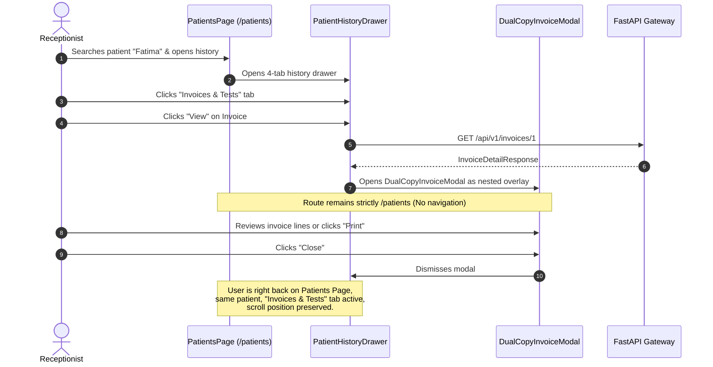

# MedScope DCMS — Operational Workflows & UI/API Wiring Matrix

## 1. End-to-End Clinical & Operational Lifecycle

```
[ Patient Arrival ]
       │
       ▼
[ 1. Patient Intake ] ─── (Search MRN/Phone -> Inline Create if New)
       │
       ▼
[ 2. Referral Attribution ] ─── (Prescribed By: Doctor Only | Referred By: Doctor / Third Party)
       │                        └── Inline Add Doctor / Referrer with Write-Only Commission Input
       ▼
[ 3. Investigation Selection ] ─── (Search Catalog -> Deduplicated Suggestions -> Add Lines)
       │                            └── Selected tests removed from suggestion dropdown
       ├─── % or ৳ Line Discount (Up to Test Price) OR Master Discount (Supersedes Line Discounts)
       ▼
[ 4. Two-Stage Creation Flow ]
       │
       ├── Stage 1: Generate Preview (Pure In-Memory Calculation)
       │   └── Renders A4 Landscape Dual-Copy Modal (Patient Copy & Office/Lab Copy)
       │       ├── Option A: "Back & Correct" -> Returns to Form with All State Intact
       │       └── Option B: "Save [and Print]" -> Transactional Commit & Permanent Invoice No.
       ▼
[ 5. Form Reset & Dual-Copy Print ]
       │   ├── Form resets to clean state with Paid Amount = ৳0
       │   └── Saved invoice retained in preview context for printing (or later reprint)
       ▼
[ 6. Splitting the Work & Routing ] ─── (One Test Order per test line -> Smart routing by Department & Role)
       │                                  ├── Role = LAB_TECH & Dept Match -> Assigned to Technician Queue
       │                                  ├── Requires Doctor / Ultrasound -> Status: AWAITING_DOCTOR
       │                                  └── No Matching Staff -> Status: UNASSIGNED (Visible to Admin/Reception)
       ▼
[ 7. Specimen Collection & Line Lock (Module 12) ] ─── (Full Route: Phlebotomist | Quick Route: Technician)
       │                                  ├── Starts Laboratory Clock: Elapsed time from sample collection
       │                                  ├── Generates printable Code 128 thermal barcode label (50mm x 30mm)
       │                                  ├── Offline Barcode Reconciliation: Supports temporary offline IDs
       │                                  ├── Triggers reagent stock consumption boundary (deferred to Module 16)
       │                                  └── Appends immutable SAMPLE_COLLECTED event to operational history
       │
       * CANCEL / REFUND LOCK ENGAGED: InvoiceLine.is_locked = True (Ordinary cancellations strictly barred) *
       │
       ▼
[ 8. Test Execution & Specimen Lifecycle ]
       │
       ├── Case A: Standard Test Execution ──> (IN_PROGRESS -> COMPLETED)
       │
       ├── Case B: Spoiled / Rejected Specimen (D15 Rule)
       │   ├── Mandatory rejection reason recorded -> Status: REJECTED / SPOILED
       │   ├── Patient Contact Follow-up: Flagged for call (CALLED, RECOLLECTION_AGREED, REFUND_REQUESTED)
       │   └── D15 Rule Enforced: Line remains locked; no free re-runs; recollection requires new bill line
       │
       ├── Case C: Radiology & Imaging (No Biological Sample)
       │   ├── Technician records scan executed -> Status: AWAITING_DOCTOR (Line locks at scan completion)
       │   └── Visiting physician / radiologist reviews and authorizes
       │
       ├── Case D: Culture & Sensitivity Multi-Stage Lifecycle
       │   └── Stepwise progression: INCUBATING (24h/48h) -> PRELIMINARY -> FINAL
       │
       └── Case E: Outside Referral Laboratory
           └── Outsourced dispatch (SENT) -> Specimen receipt & results (RECEIVED)
       ▼
[ 9. Diagnostic Report Handover ]
       │
       ├── Due Balance == 0 ──> Standard Delivery to Patient/Relation
       │
       └── Due Balance > 0 ──> DUE HOLD ENGAGED
                                   │
                                   ├── Option A: Settle Due at Counter -> Instant Release
                                   └── Option B: Admin Due Override with Recorded Reason
```

---

## 2. Comprehensive UI/API Wiring Matrix

| UI View / Screen | Action / Trigger | Backend API Endpoint | HTTP Method | Data Contract & Behavior |
| :--- | :--- | :--- | :---: | :--- |
| **Global Header** | Inline Global Search (`Ctrl+F`) | `/api/v1/search?q={query}` | `GET` | Replaces modal search. Directly typed in header `<input id="medscope-global-search">`. Anchored dropdown groups matches across Patients, Invoices, Tests, Reports. |
| **Global Header** | Dev Staff Switcher | Stateless Header Change | - | Emulates switching `X-Staff-Id` and `X-Staff-Role` between Fatima Akter (Receptionist ID 1) and Tariqul Islam (Admin ID 2). |
| **Dashboard** | KPI Metric Tiles | `/api/v1/dashboard/summary` | `GET` | Fetches today's active patient intake, gross revenue, net collection, outstanding dues, ready reports. |
| **Dashboard** | Recent Invoices Card | `/api/v1/dashboard/recent-invoices` | `GET` | Renders latest 10 generated invoices. Clicking an invoice opens the dual-copy view modal. |
| **Patients Page** | Directory Search | `/api/v1/patients?q={query}` | `GET` | Debounced live search by patient full name, phone number, or MRN code. |
| **Patients Page** | Register Patient Modal | `/api/v1/patients` | `POST` | Validates duplicate phone; generates monotonic MRN; preserves draft state. |
| **Patients Page** | Patient History Drawer | `/api/v1/patients/{id}/history` | `GET` | Returns 4-tab history: Visits & Summary, Invoices & Tests, Payments & Receipts, Specimens & Reports. |
| **Patients Page** | View Past Invoice (Nested) | `/api/v1/invoices/{id}` | `GET` | Opens past invoice as nested `DualCopyInvoiceModal` overlay. Closing returns to `/patients` history tab without route redirect. |
| **New Invoice** | Search Prescriber Doctor | `/api/v1/referrers?type=Doctor` | `GET` | Autocomplete dropdown strictly filtered to medical doctors. |
| **New Invoice** | Inline Add Doctor | `/api/v1/referrers` | `POST` | Creates medical doctor with optional confidential write-only commission rate. Stripped on return. |
| **New Invoice** | Inline Add Referrer | `/api/v1/referrers` | `POST` | Creates doctor or third-party referrer with confidential write-only commission rate. Stripped on return. |
| **New Invoice** | Load / Search Test Catalog | `/api/v1/tests?limit=2500` | `GET` | Fetches full active catalog (1,250 tests); enables instant in-memory autocomplete, department chips, and deduplication (selected tests omitted from suggestions). |
| **New Invoice** | Two-Stage Preview Trigger | Pure Local State | - | Validates draft lines; opens A4 Landscape Dual-Copy modal in non-final preview mode. |
| **New Invoice** | Final Save & Commit | `/api/v1/invoices` | `POST` | Persists invoice, assigns permanent monotonic number, updates drawer balance (if paid > 0), resets form to clean state with ৳0 paid. |
| **Invoices Page** | Search & Date Filters | `/api/v1/invoices` | `GET` | Multi-criteria search with user-friendly status filter dropdown (`All Payments`, `Paid`, `Unpaid`, `Partial Due`, `Partially Refunded`, `Fully Refunded`) masking PostgreSQL columns. Displays standardized payment labels and separate `Refund Status` badge. |
| **Invoices Page** | View / Reprint Invoice | `/api/v1/invoices/{id}/reprint` | `POST` | Increments reprint count, logs single audit event, opens `DualCopyInvoiceModal` with `DUPLICATE` watermark. |
| **Dues Page** | Outstanding Dues List | `/api/v1/dues?q={query}` | `GET` | Lists all invoices with `due_amount > 0`. Filterable by patient name/phone. |
| **Dues Page** | Settle Due Modal | `/api/v1/payments` | `POST` | Collects payment against due balance; prevents overpayment (`amount <= due`); updates invoice to `PAID` once due reaches 0. |
| **Assignments** | Unassigned Orders Queue | `/api/v1/assignments/unassigned` | `GET` | Lists clinical test orders awaiting bench assignment. STAT urgent orders prioritized at top. |
| **Assignments** | Assign Station (Single/Bulk) | `/api/v1/assignments/assign` | `POST` | Routes orders to target laboratory workstation. |
| **My Work (Lab)** | Technician Worklist Queue | `/api/v1/worklist` | `GET` | Strictly financial-free operational queue. Renders Patient details, Test metadata, Patient clock, Lab clock, TAT, STAT & Late indicators. |
| **My Work (Lab)** | Quick Route Sample Taken | `/api/v1/worklist/{id}/sample-taken` | `POST` | Records collection timestamp; locks invoice line against cancellation; triggers stock boundary; logs `SAMPLE_COLLECTED` lifecycle event; starts Lab Clock. |
| **My Work (Lab)** | Print Barcode Label | `/api/v1/worklist/{id}/barcode` | `GET` | Generates Code 128 vector SVG barcode label payload for specimen tubes (50mm x 30mm thermal label). |
| **My Work (Lab)** | Reject / Spoil Specimen | `/api/v1/worklist/{id}/reject-sample` | `POST` | Records mandatory rejection reason; marks task `REJECTED`/`SPOILED`; preserves line lock; flags patient for follow-up. |
| **My Work (Lab)** | Patient Call Follow-up | `/api/v1/worklist/{id}/patient-contact` | `POST` | Records outcome of patient follow-up (`CALLED`, `RECOLLECTION_AGREED`, `REFUND_REQUESTED`). Enforces no free re-runs. |
| **My Work (Lab)** | Perform Imaging Scan | `/api/v1/worklist/{id}/imaging-performed` | `POST` | Records scan execution for radiology/USG tests; locks line for doctor interpretation; moves order to `AWAITING_DOCTOR`. |
| **My Work (Lab)** | Culture Stage Transition | `/api/v1/worklist/{id}/culture-stage` | `POST` | Progresses multi-stage culture workflow (`INCUBATING` -> `PRELIMINARY` -> `FINAL`). |
| **My Work (Lab)** | Outsourced Dispatch / Receive | `/api/v1/worklist/{id}/outsourced` | `POST` | Logs external referral laboratory dispatch (`SENT`) or specimen receipt (`RECEIVED`) with tracking numbers. |
| **My Work (Lab)** | View Lifecycle Timeline | `/api/v1/worklist/{id}/events` | `GET` | Fetches chronological append-only operational lifecycle history and event audit trail. |
| **My Work (Lab)** | Order Status Transition | `/api/v1/worklist/{id}/status` | `POST` | Transitions task status between `IN_PROGRESS`, `AWAITING_DOCTOR`, and `COMPLETED`. Enforces Prompt 06 invariants (no completing before sample). |
| **My Work (Lab)** | Enter Clinical Results | `/api/v1/worklist/{id}/result` | `POST` | Opens `ResultEntryModal` (`NUMERIC_TABLE`, `NARRATIVE`, structured `ULTRASOUND`); validates impossible physiological limits (HTTP 400 rejection); live calculates flags (`LOW`, `HIGH`, `CRITICAL`, `NORMAL`, `None`); snapshots reference ranges (D24 invariant); supports Draft and Entered modes. |
| **My Work (Lab)** | Submit D15 Refund Request | `/api/v1/worklist/{id}/d15-refund-request` | `POST` | Lab Tech submits D15 Not Performed refund exception for rejected/spoiled specimen line; queues request to Admin under `PENDING_ADMIN_APPROVAL`. |
| **My Work (Lab)** | Workbench Summary Tiles | `/api/v1/worklist/summary` | `GET` | Fetches aggregated KPIs for the technician workbench. |
| **Refunds Page** | Request Refund Modal | `/api/v1/refunds` | `POST` | Front desk initiates pre-sample refund; verifies specimen has not been collected; puts request in `PENDING_ADMIN_APPROVAL`. |
| **Refunds Page** | Admin Review Refund | `/api/v1/refunds/review/{id}` | `POST` | Approves or rejects refund. Receptionist role receives HTTP 403 Forbidden. Admin approval marks request `APPROVED` and invoice `REFUND_APPROVED` (awaiting cashier disbursement). |
| **Invoices / Refunds** | Disburse Approved Refund | `/api/v1/refunds/{id}/disburse` | `POST` | Cashier/Receptionist/Admin disburses approved payout to patient via specified channel (`CASH`, `BKASH`, `NAGAD`, `ROCKET`, `CARD`, `BANK_TRANSFER`); records transaction reference, disburser ID, updates drawer ledger, and reverses referrer commission. |
| **Reports Page** | Deliverable Reports List | `/api/v1/reports/deliverable` | `GET` | Lists authorized finalized reports. Reports with unpaid dues display `DUE HOLD` indicator. |
| **Reports Page** | Handover Report Modal | `/api/v1/reports/deliver/{id}` | `POST` | Records recipient name, phone, and relation. Strictly rejected with HTTP 400 if invoice has outstanding due. |
| **Reports Page** | Admin Due Override | `/api/v1/reports/deliver/{id}` | `POST` | Emergency release requiring mandatory recorded justification; logged under Admin staff ID. |
| **Business Day** | Open Day Modal | `/api/v1/business-day/open` | `POST` | Staff inputs morning cash float; initializes channel balances; sets status to `OPEN`. |
| **Business Day** | Close Day Action | `/api/v1/business-day/close` | `POST` | Reconciles collections against physical drawer cash. Receptionist & Cashier receive HTTP 403 Forbidden; requires Admin/Owner PIN. |
| **Profile Page** | Update Profile | `/api/v1/profile` | `PUT` | Updates display name and phone number. Staff role remains strictly immutable. |

---

## 3. Two-Stage Creation Flow & Dual-Copy Print Sequence

```mermaid
sequenceDiagram
    autonumber
    actor Rec as Receptionist
    participant UI as NewInvoicePage (React)
    participant Modal as DualCopyInvoiceModal
    participant API as FastAPI Gateway
    participant DB as PostgreSQL 18

    Rec->>UI: Selects Patient, Prescriber, Referrer, Tests, Discounts
    UI->>UI: Defaults Paid Amount = ৳0 (or user adjusts)
    Rec->>UI: Clicks "Generate Preview"
    UI->>Modal: Opens with draft state (Non-Final Preview Mode)
    Note over Modal: Displays Patient Copy & Office Copy<br/>Watermark: "PREVIEW - NOT AN INVOICE"

    alt Receptionist needs corrections
        Rec->>Modal: Clicks "Back & Correct"
        Modal->>UI: Closes modal; returns to form
        Note over UI: All form state, tests, and discounts 100% intact
    else Receptionist confirms invoice
        Rec->>Modal: Clicks "Save Invoice" or "Save & Print"
        Modal->>API: POST /api/v1/invoices (InvoiceConfirmRequest)
        API->>DB: Assigns monotonic invoice_no, creates lines & orders
        DB-->>API: Persisted Invoice Entity
        API-->>Modal: Returns InvoiceDetailResponse
        Modal->>UI: Triggers form reset (all fields clean, paid = ৳0)
        Modal->>Modal: Switches to official saved mode
        opt Save & Print clicked
            Modal->>Rec: Automatically opens native browser print dialog
        end
    end
```

---

## 4. Patient History In-Context Overlay Workflow


