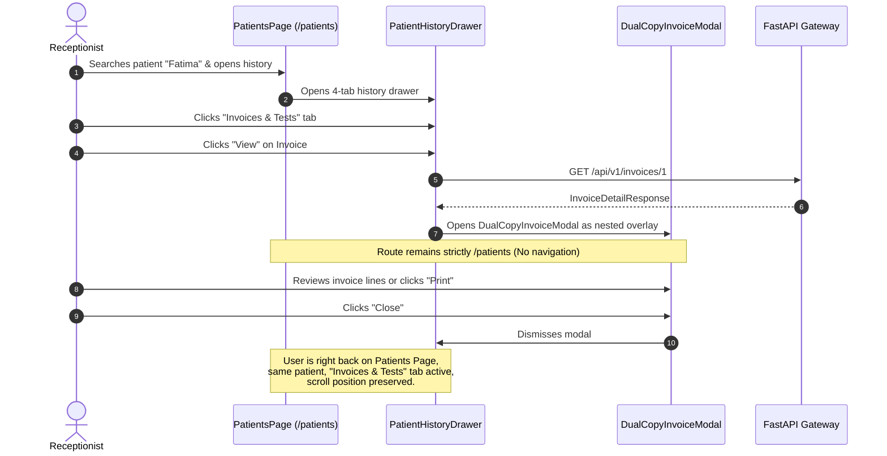
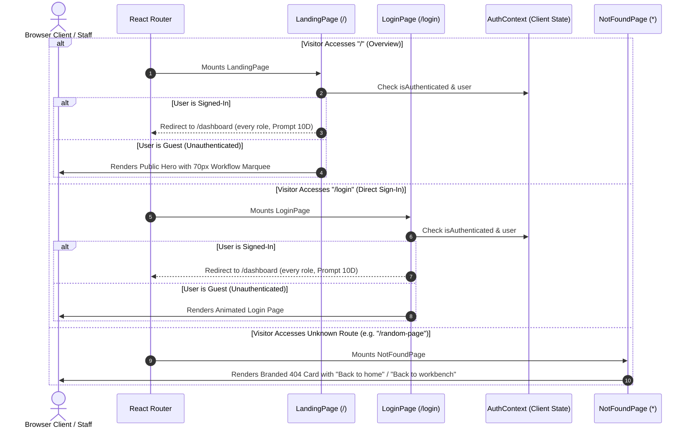
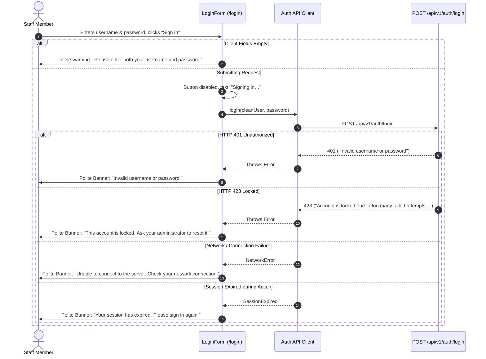
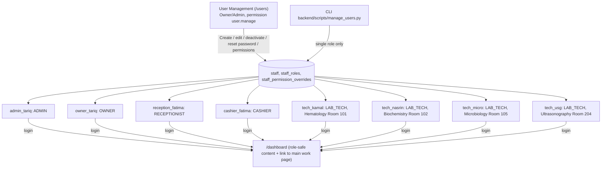

# MedScope DCMS — Operational Workflows & UI/API Wiring Matrix

## 1. End-to-End Clinical & Operational Lifecycle

```
[ Patient Arrival ]
       │
       ▼
[ 1. Patient Intake ] ─── (Search MRN/Phone -> Inline Create if New)
       │                    └── Visit age (years/months/days) + gender, prefilled from the patient,
       │                        required to Finalize (no default age 30 / Male)          [Prompt 10E]
       ▼
[ 2. Referral Attribution ] ─── (Prescribed By: Doctor Only | Referred By: Doctor / Third Party)
       │                        └── Inline Add Doctor / Referrer with Write-Only Commission Input
       ▼
[ 3. Investigation Selection ] ─── (Search Catalog -> Deduplicated Suggestions -> Add Lines)
       │                            └── Selected tests removed from suggestion dropdown
       ├─── % or ৳ Line Discount (Up to Test Price) OR Master Discount (Supersedes Line Discounts)
       ├─── Urgent line: fee = max(৳100, 20% of price), computed by the backend, never discounted [Prompt 10E]
       ├─── Payment channel: Cash, bKash, Nagad, Rocket, Card (POS_CARD), Bank Transfer, Other (+ typed name) [10E]
       ▼
[ 4. Two-Stage Creation Flow ]
       │
       ├── Stage 1: Generate Preview (Pure In-Memory Calculation)
       │   └── Renders A4 Landscape Dual-Copy Modal (Patient Copy & Office/Lab Copy)
       │       ├── Option A: "Back & Correct" -> Returns to Form with All State Intact
       │       ├── Option B: "Save Draft" -> DRAFT invoice (placeholder DRAFT- number, no operational effect;
       │       │             reopen later via Invoices -> "Continue Draft")            [Prompt 10D]
       │       └── Option C: "Finalize [& Print]" -> Transactional Commit & Permanent SD- Invoice No.  [Prompt 10D]
       ▼
[ 5. Form Reset & Dual-Copy Print ]
       │   ├── Form resets to clean state with Paid Amount = ৳0
       │   └── Saved invoice retained in preview context for printing (or later reprint)
       ▼
[ 6. Splitting the Work & Routing ] ─── (One Test Order per line -> routed to a ROOM, never one technician) [Prompt 10E]
       │                                  ├── Room = tests.lab_section (mapping: Hematology 101, Biochemistry 102,
       │                                  │   Microbiology 105, Ultrasonography 204)
       │                                  ├── Requires Doctor / Ultrasound -> Status: AWAITING_DOCTOR (room recorded)
       │                                  ├── Outsourced -> PENDING (room recorded)
       │                                  ├── Room has an active LAB_TECH -> ASSIGNED: every technician of the room sees it
       │                                  └── Empty room / no room -> UNASSIGNED (Admin/Owner); released automatically
       │                                      when a technician joins the room; Admin/Owner can reassign rooms
       │                                      until COMPLETED (worklist.reassign; Assign Tests > Assigned Tests [10F])
       │                                      Room loses its last technician -> its assigned-only orders go back to
       │                                      UNASSIGNED (room kept, audited) [10F]
       ▼
[ 7. Specimen Collection & Line Lock (Module 12) ] ─── (Full Route: Phlebotomist | Quick Route: Technician)
       │                                  ├── [10F] Required for every non-imaging test unless the catalog says
       │                                  │   None / N/A / NA / No sample; NULL sample_type = required
       │                                  ├── Starts Laboratory Clock: Elapsed time from sample collection
       │                                  ├── Generates printable Code 128 thermal barcode label (50mm x 30mm)
       │                                  ├── Offline Barcode Reconciliation: Supports temporary offline IDs
       │                                  ├── Triggers reagent stock consumption boundary (deferred to Module 16)
       │                                  └── Appends immutable SAMPLE_COLLECTED event to operational history
       │
       * CANCEL / REFUND LOCK ENGAGED: InvoiceLine.is_locked = True (Ordinary cancellations strictly barred) *
       │
       ▼
[ 8. Test Execution & Specimen Lifecycle ]
       │
       ├── Case A: Standard Test Execution ──> (IN_PROGRESS -> COMPLETED)
       │
       ├── Case B: Spoiled / Rejected Specimen (D15 Rule)
       │   ├── Mandatory rejection reason recorded -> Status: REJECTED / SPOILED
       │   ├── Patient Contact Follow-up: Flagged for call (CALLED, RECOLLECTION_AGREED, REFUND_REQUESTED)
       │   └── D15 Rule Enforced: Line remains locked; no free re-runs; recollection requires new bill line
       │
       ├── Case C: Radiology & Imaging (No Biological Sample — never blocked by a sample, Prompt 10E)
       │   ├── Technician records scan executed -> Status label PERFORMED, order AWAITING_DOCTOR (line NOT locked; Prompt 12)
       │   └── Visiting physician / radiologist (DOCTOR role, doctor queue) completes it, or approves it on the Doctor Sign-off screen (section 13). The line locks at this result completion (Prompt 12)
       │
       ├── Case D: Culture & Sensitivity Multi-Stage Lifecycle
       │   └── Stepwise progression: INCUBATING (24h/48h) -> PRELIMINARY -> FINAL
       │
       └── Case E: Outside Referral Laboratory
           └── Outsourced dispatch (SENT) -> Specimen receipt & results (RECEIVED)
       │
       * Saved result (DRAFT or ENTERED) -> "Preview Report" in My Work (Lab), DRAFT marked as draft [10F] *
       * Submitted (ENTERED) result, order not cancelled / not performed / not awaiting doctor = "Ready" [10F]: *
       * Lab Ready tile + tab (own room) and sidebar Ready Reports > Ready Results (all rooms). No Complete needed. *
       ▼
[ 9. Diagnostic Report Handover ]
       │
       ├── Due Balance == 0 ──> Standard Delivery to Patient/Relation
       │
       └── Due Balance > 0 ──> DUE HOLD ENGAGED
                                   │
                                   ├── Option A: Settle Due at Counter -> Instant Release
                                   └── Option B: Admin/Owner Due Override with Recorded Reason
                                       (Receptionist and Cashier are blocked, Prompt 10E)
```

---

## 2. Comprehensive UI/API Wiring Matrix

| UI View / Screen | Action / Trigger | Backend API Endpoint | HTTP Method | Data Contract & Behavior |
| :--- | :--- | :--- | :---: | :--- |
| **Global Header** | Inline Global Search (`Ctrl+F`) | `/api/v1/search?q={query}` | `GET` | Replaces modal search. Directly typed in header `<input id="medscope-global-search">`. Anchored dropdown groups matches across Patients, Invoices, Tests, Reports. |
| **Global Header** | User Menu: Sign Out | `/api/v1/auth/logout` | `POST` | Revokes the session and returns to `/login`. |
| **Dashboard** | KPI Metric Tiles | `/api/v1/dashboard/summary` | `GET` | Fetches today's active patient intake, gross revenue, net collection, outstanding dues, ready reports. |
| **Dashboard** | Recent Invoices Card | `/api/v1/dashboard/recent-invoices` | `GET` | Renders latest 10 generated invoices. Clicking an invoice opens the dual-copy view modal. |
| **Patients Page** | Directory Search | `/api/v1/patients?q={query}` | `GET` | Debounced live search by patient full name, phone number, or MRN code. |
| **Patients Page** | Register Patient Modal | `/api/v1/patients` | `POST` | Validates duplicate phone; generates monotonic MRN; preserves draft state. |
| **Patients Page** | Patient History Drawer | `/api/v1/patients/{id}/history` | `GET` | Returns 4-tab history: Visits & Summary, Invoices & Tests, Payments & Receipts, Specimens & Reports. |
| **Patients Page** | View Past Invoice (Nested) | `/api/v1/invoices/{id}` | `GET` | Opens past invoice as nested `DualCopyInvoiceModal` overlay. Closing returns to `/patients` history tab without route redirect. |
| **New Invoice** | Search Prescriber Doctor | `/api/v1/referrers?type=Doctor` | `GET` | Autocomplete dropdown strictly filtered to medical doctors. |
| **New Invoice** | Inline Add Doctor | `/api/v1/referrers` | `POST` | Creates medical doctor with optional confidential write-only commission rate. Stripped on return. |
| **New Invoice** | Inline Add Referrer | `/api/v1/referrers` | `POST` | Creates doctor or third-party referrer with confidential write-only commission rate. Stripped on return. |
| **New Invoice** | Load / Search Test Catalog | `/api/v1/tests?limit=2500` | `GET` | Fetches full active catalog (1,250 tests); enables instant in-memory autocomplete, department chips, and deduplication (selected tests omitted from suggestions). |
| **New Invoice** | Two-Stage Preview Trigger | Pure Local State | - | Validates draft lines; opens A4 Landscape Dual-Copy modal in non-final preview mode. Prompt 10E: the preview's urgent fee uses the backend formula; after Finalize the receipt shows the backend totals (urgent fee, age/gender, "Paid via" channel incl. the OTHER name). |
| **New Invoice** | Visit age & gender (Prompt 10E) | `/api/v1/invoices`, `/api/v1/invoices/drafts` | `POST` | Age (years/months/days) and gender fields on the selected-patient card, prefilled from the patient (`last_age_value`, gender); Save Draft allows them empty, Finalize requires both. |
| **New Invoice** | Save Draft (Prompt 10D) | `/api/v1/invoices/drafts`, `/api/v1/invoices/{id}/draft` | `POST` / `PUT` | Saves or updates a DRAFT (no number, lines, orders, payment or drawer change). |
| **New Invoice** | Finalize (Prompt 10D) | `/api/v1/invoices/{id}/finalize` (saved draft) or `/api/v1/invoices` (unsaved form) | `POST` | Assigns the permanent `SD-` number, creates lines, orders, payment, updates drawer balance (if paid > 0), resets the form. Not repeatable (409). |
| **Invoices Page** | Continue Draft (Prompt 10D) | `/api/v1/invoices/{id}` | `GET` | Draft rows show a Draft badge; "Continue Draft" opens `/invoices/new?draft_id=:id` with the saved form. |
| **User Management** (Prompt 10D) | Users list / Create User | `/api/v1/users…` | `GET`/`POST`/`PATCH`/`PUT` | Owner/Admin only (`user.manage`). See `docs/API.md` §5. |
| **Invoices Page** | Search & Date Filters | `/api/v1/invoices` | `GET` | Multi-criteria search with user-friendly status filter dropdown (`All Payments`, `Paid`, `Unpaid`, `Partial Due`, `Partially Refunded`, `Fully Refunded`) masking PostgreSQL columns. Displays standardized payment labels and separate `Refund Status` badge. |
| **Invoices Page** | View / Reprint Invoice | `/api/v1/invoices/{id}/reprint` | `POST` | Increments reprint count, logs a single `INVOICE_REPRINTED` audit row, opens `DualCopyInvoiceModal` with `DUPLICATE` watermark. |
| **Dues Page** | Outstanding Dues List | `/api/v1/dues?q={query}` | `GET` | Lists all invoices with `due_amount > 0` with age (days) and bucket. Search by bill no. (final or temporary), patient no., name, phone; filter by age bucket. Prompt 17: also the Call list, Write-offs and Doctor balances tabs (section 15). |
| **Dues Page** | Settle Due Modal | `/api/v1/payments` | `POST` | Collects payment against due balance; prevents overpayment (`amount <= due`); updates invoice to `PAID` once due reaches 0. Prompt 10E: channel list = backend values; `OTHER` shows a "Channel Name" field (required). |
| **Assignments** | Unassigned Orders Queue | `/api/v1/assignments/unassigned`, `/api/v1/worklist/rooms` | `GET` | Lists UNASSIGNED test orders with their waiting room; the picker lists the four rooms with active-technician counts. |
| **Assignments** | Assign Room (Single/Bulk) | `/api/v1/assignments/assign`, `/api/v1/assignments/bulk-assign` | `POST` | Prompt 10E: sends the room key (`lab_section`), stores the room name (never an id); every technician of that room sees the order. |
| **Assignments** | Assigned Tests tab (Prompt 10F) | `/api/v1/assignments/orders`, `/api/v1/worklist/rooms` | `GET` | Every test order with room, technicians or UNASSIGNED, status, urgent, created time; room/status filters and search; money-free. Receptionist/Cashier view only. |
| **Assignments** | Reassign Room from Assigned Tests (Prompt 10F) | `/api/v1/worklist/{id}/reassign` | `POST` | Admin/Owner (`worklist.reassign`) only, rows not COMPLETED/cancelled/Not Performed; same endpoint and audit as My Work; list refetches after the move. |
| **My Work (Lab)** | Technician Worklist Queue | `/api/v1/worklist` | `GET` | Strictly financial-free operational queue. Prompt 10E: shows every order of the technician's room (Doctor: the doctor queue); Room label per row; Sample Taken only for tests that need a sample (`requires_sample`). |
| **My Work (Lab)** | Bento tiles as filters (Prompt 10E) | `/api/v1/worklist?status=…`, `/api/v1/worklist/summary` | `GET` | Clicking a tile applies the same filter as the matching tab (Sample Pending, In Progress, Doctor Queue, Rejected, Late, Ready Reports, Unassigned (Admin/Owner), Completed; Urgent toggles STAT only); click again clears. |
| **My Work (Lab)** | Preview Report (Prompt 10E, reworked 10F) | `/api/v1/worklist/{id}/result-preview` | `GET` | Rows with a saved result (DRAFT or ENTERED) open a read-only, money-free preview from the stored snapshots; DRAFT shows a "DRAFT, not a final report" banner. After a save, a strip above the grid offers Preview for that order even if the row left the active tab. |
| **My Work (Lab)** | Ready Reports tile/tab (Prompt 10F) | `/api/v1/worklist?status=READY`, `/api/v1/worklist/summary` | `GET` | Shared Ready definition: tile count = rows; click again clears; Preview on each row. |
| **My Work (Lab)** | Reassign Room (Prompt 10E) | `/api/v1/worklist/{id}/reassign` | `POST` | `worklist.reassign` holders move an order to another room until COMPLETED (reason optional, audited). |
| **My Work (Lab)** | Quick Route Sample Taken | `/api/v1/worklist/{id}/sample-taken` | `POST` | Records collection timestamp; locks invoice line against cancellation; triggers stock boundary; logs `SAMPLE_COLLECTED` lifecycle event; starts Lab Clock. |
| **My Work (Lab)** | Print Barcode Label | `/api/v1/worklist/{id}/barcode` | `GET` | Generates Code 128 vector SVG barcode label payload for specimen tubes (50mm x 30mm thermal label). |
| **My Work (Lab)** | Reject / Spoil Specimen | `/api/v1/worklist/{id}/reject-sample` | `POST` | Records mandatory rejection reason; marks task `REJECTED`/`SPOILED`; preserves line lock; flags patient for follow-up. |
| **My Work (Lab)** | Patient Call Follow-up | `/api/v1/worklist/{id}/patient-contact` | `POST` | Records outcome of patient follow-up (`CALLED`, `RECOLLECTION_AGREED`, `REFUND_REQUESTED`). Enforces no free re-runs. |
| **My Work (Lab)** | Perform Imaging Scan | `/api/v1/worklist/{id}/imaging-performed` | `POST` | Records scan execution for radiology/USG tests; locks line for doctor interpretation; moves order to `AWAITING_DOCTOR`. |
| **My Work (Lab)** | Culture Stage Transition | `/api/v1/worklist/{id}/culture-stage` | `POST` | Progresses multi-stage culture workflow (`INCUBATING` -> `PRELIMINARY` -> `FINAL`). |
| **My Work (Lab)** | Outsourced Dispatch / Receive | `/api/v1/worklist/{id}/outsourced` | `POST` | Logs external referral laboratory dispatch (`SENT`) or specimen receipt (`RECEIVED`) with tracking numbers. |
| **My Work (Lab)** | View Lifecycle Timeline | `/api/v1/worklist/{id}/events` | `GET` | Fetches chronological append-only operational lifecycle history and event audit trail. |
| **My Work (Lab)** | Order Status Transition | `/api/v1/worklist/{id}/status` | `POST` | Transitions task status between `IN_PROGRESS`, `AWAITING_DOCTOR`, and `COMPLETED`. Enforces Prompt 06 invariants (no completing before sample). |
| **My Work (Lab)** | Enter Clinical Results | `/api/v1/worklist/{id}/result` | `POST` | Opens `ResultEntryModal` (`NUMERIC_TABLE`, `NARRATIVE`, structured `ULTRASOUND`); validates impossible physiological limits (HTTP 400 rejection); live calculates flags (`LOW`, `HIGH`, `CRITICAL`, `NORMAL`, `None`); snapshots reference ranges (D24 invariant); supports Draft and Entered modes. |
| **My Work (Lab)** | Submit D15 Refund Request | `/api/v1/worklist/{id}/d15-refund-request` | `POST` | Lab Tech submits D15 Not Performed refund exception for rejected/spoiled specimen line; queues request to Admin under `PENDING_ADMIN_APPROVAL`. |
| **My Work (Lab)** | Workbench Summary Tiles | `/api/v1/worklist/summary` | `GET` | Fetches aggregated KPIs for the technician workbench. |
| **Invoices (line)** | Cancel Test / Cancel Whole Invoice | `/api/v1/refunds/request`, `/api/v1/refunds/cancel-invoice` | `POST` | Front desk cancels ONE unlocked line, or every line when none is locked; amount is server-calculated and read-only; no approval; no payout; locked line -> 409 `SAMPLE_ALREADY_TAKEN`; the refund is left `APPROVED` for the separate Disburse step. |
| **Refunds Page** | Admin Review Refund | `/api/v1/refunds/review/{id}` | `POST` | Approves or rejects refund. Receptionist role receives HTTP 403 Forbidden. Approval cancels the line and recomputes the amount (Prompt 10E rule): `refund = max(0, retained paid − net after removing the line)`, `due = max(0, net after − (retained paid − refund))`. Refund > 0 → `APPROVED` / invoice `REFUND_APPROVED` (awaiting disbursement); refund 0 → request `COMPLETED`, nothing to disburse (a due may remain). Never a refund and a due together. |
| **Invoices / Refunds** | Disburse Approved Refund | `/api/v1/refunds/{id}/disburse` | `POST` | Cashier/Receptionist/Admin disburses approved payout to patient via one of the channels actually used on the invoice (`CASH`, `BKASH`, `NAGAD`, `ROCKET`, `POS_CARD`, `BANK_TRANSFER`, `OTHER`); non-cash needs a reference; records disburser ID, updates drawer ledger, and reverses referrer commission. |
| **Reports Page** | Ready Results tab (Prompt 10F, default) | `/api/v1/reports/ready`, `/api/v1/reports/ready/{id}/preview` | `GET` | Every Ready result from all rooms (patient, invoice, test, room, result-entered time, payment due for money roles) with Preview Report; refetches on navigation and window focus. Not issued reports. |
| **Reports Page** | Issued Reports tab (Deliverable Reports List) | `/api/v1/reports/deliverable` | `GET` | Lists authorized finalized reports (`report_versions`: seeded reports and every Final report from Finalize). Reports with unpaid dues display `DUE HOLD` indicator; **View result** opens the stored Final content. |
| **Reports Page** | Handover Report Modal | `/api/v1/reports/deliver/{id}` | `POST` | Records recipient name, phone, and relation (the handover log: staff and time). With a due and the hold setting on: RECEPTIONIST and CASHIER get HTTP 403; Admin/Owner release with a reason. With the setting off nothing is blocked. |
| **Reports Page** | Admin Due Override | `/api/v1/reports/deliver/{id}` | `POST` | Emergency release by `report.release_with_due` holders (Admin/Owner; the button now shows for Owner too) with a mandatory recorded justification (400 without). |
| **Catalog & Deleted** | Edit Doctor / 3rd Party (Prompt 19) | `/api/v1/referrers/{id}` | `PATCH` | Admin/Owner corrects name, type, phone, registration no., specialty or chamber in place; the same key as Delete; bills stay linked and approvals keep their signed snapshot. |
| **Business Day** | Open Day Modal | `/api/v1/business-day/open` | `POST` | Staff inputs morning cash float; initializes channel balances; sets status to `OPEN`. |
| **Business Day** | Close Day Action | `/api/v1/business-day/close` | `POST` | Takes the counted cash, computes the variance against expected cash (D45) and closes the day; a reason is required above the tolerance. Receptionist & Cashier receive HTTP 403 Forbidden; Admin/Owner only (section 16). |
| **Profile Page** | Update Profile | `/api/v1/profile` | `PUT` | Updates the caller's own display name and phone number. Staff role remains strictly immutable. Prompt 10E: also available to LAB_TECH and DOCTOR (`profile.manage`). |

---

## 3. Two-Stage Creation Flow & Dual-Copy Print Sequence

```mermaid
sequenceDiagram
    autonumber
    actor Rec as Receptionist
    participant UI as NewInvoicePage (React)
    participant Modal as DualCopyInvoiceModal
    participant API as FastAPI Gateway
    participant DB as PostgreSQL 18

    Rec->>UI: Selects Patient, Prescriber, Referrer, Tests, Discounts
    UI->>UI: Defaults Paid Amount = ৳0 (or user adjusts)
    Rec->>UI: Clicks "Generate Preview"
    UI->>Modal: Opens with draft state (Non-Final Preview Mode)
    Note over Modal: Displays Patient Copy & Office Copy<br/>Watermark: "PREVIEW - NOT AN INVOICE"

    alt Receptionist needs corrections
        Rec->>Modal: Clicks "Back & Correct"
        Modal->>UI: Closes modal; returns to form
        Note over UI: All form state, tests, and discounts 100% intact
    else Receptionist confirms invoice
        opt Save Draft (Prompt 10D)
            Rec->>Modal: Clicks "Save Draft"
            Modal->>API: POST /api/v1/invoices/drafts (or PUT /invoices/{id}/draft)
            API->>DB: DRAFT row only (placeholder DRAFT- number, no lines/orders/payment)
        end
        Rec->>Modal: Clicks "Finalize" or "Finalize & Print"
        Modal->>API: POST /api/v1/invoices/{id}/finalize (saved draft) or POST /api/v1/invoices
        API->>DB: Assigns monotonic invoice_no, creates lines & orders
        DB-->>API: Persisted Invoice Entity
        API-->>Modal: Returns InvoiceDetailResponse
        Modal->>UI: Triggers form reset (all fields clean, paid = ৳0)
        Modal->>Modal: Switches to official saved mode
        opt Save & Print clicked
            Modal->>Rec: Automatically opens native browser print dialog
        end
    end
```

---

## 4. Patient History In-Context Overlay Workflow



---

## 5. Public Entry, Role Redirection, and Authentication Lifecycle

### 5.1 Public Entry & Workbench Redirection


### 5.2 Sign-In Error Mapping Lifecycle


### 5.3 Operational Roles and Staff Provisioning Lifecycle (Prompt 10D, DOCTOR added in 10E)
MedScope DCMS has six tenant roles: `OWNER`, `ADMIN`, `RECEPTIONIST`, `CASHIER`, `LAB_TECH`, `DOCTOR` (one list in `backend/app/core/permissions.py`). **One login = one fixed role**, and every login lands on `/dashboard`. A LAB_TECH must belong to a lab room; a DOCTOR has none.



- **User Management page:** Users list (edit, deactivate/reactivate, reset password, with confirm dialogs) and **Create User** tab (details, initial password, single role, **required** lab room for LAB_TECH, active flag, permission editor showing role defaults vs per-user overrides). Creating, reactivating or moving a LAB_TECH into a room releases that room's UNASSIGNED orders automatically.
- **CLI:** `assign-role` now sets the single role (LAB_TECH needs `--lab-section`); `remove-role` is disabled; `create-user` accepts exactly one role (LAB_TECH needs `--lab-section`).
- **Routing:** room based since Prompt 10E (§1 step 6; `docs/ARCHITECTURE.md` ADL-041). A dev `tech_boss` user (Microbiology) also exists in the dev DB; no DOCTOR user was created by Prompt 10E or 10F (a read-only check in 10F found one active DOCTOR user in the dev DB, created outside these prompts).
- **Empty room (Prompt 10F):** deactivating, moving or re-roling the last active LAB_TECH of a room (UI or `manage_users.py assign-role`) turns that room's assigned-only orders back to UNASSIGNED in the same transaction (audit `ORDER_UNASSIGNED_ROOM_EMPTY` per order).

---

## 6. Prompt 10C Decided Workflow Changes — Implemented in Prompt 10D

1. **Sign-in:** one login = one fixed role; every login lands on `/dashboard`. **Implemented.**
2. **User provisioning:** User Management page with Create User tab and per-user permissions; one default LAB_TECH per section. **Implemented.**
3. **Invoice creation:** `Form → Generate Preview → Save Draft (optional) → Finalize`. **Implemented** (§1, §3).
4. **D15 / refund approval:** refund capped at the money paid for the line. **Implemented.**
5. **Work order:** Prompt 11 is **implemented** (see §9).

---

## 7. Prompt 10E Workflow Changes (implemented)

1. **Refund on cancellation:** `refund = max(0, retained paid − net after)`; `due = max(0, net after − (retained paid − refund))`. Never both; never more than paid; the urgent fee stays on the invoice. Amounts are computed by the server.
2. **Samples (10E rule, superseded by §8.4 in 10F):** imaging tests and tests without a real `sample_type` never blocked on a sample. Since 10F only imaging and explicit no-sample markers skip the gate; NULL = sample required.
3. **New Invoice:** age + gender per visit (required to Finalize); urgent fee from the backend; channels Cash, bKash, Nagad, Rocket, Card, Bank Transfer, Other (+ name).
4. **Rooms:** orders go to a room; all technicians of the room work them; empty rooms wait as UNASSIGNED and are released when a technician joins; Admin/Owner reassign rooms until COMPLETED; the Assign Tests page routes UNASSIGNED orders to a room.
5. **Roles:** LAB_TECH has My Profile; CASHIER can no longer release a report with a due; DOCTOR sees the doctor queue and completes doctor-routed tests through the existing status action; the Doctor Sign-off screen (section 13) records the doctor's approval.
6. **My Work (Lab):** tiles are filters; Ready Reports filter; Preview Report for a saved result. Finalizing the report (Module 14) is described in section 14. *(10F: Ready definition, preview and `/reports` changed, see §8.)*

---

## 8. Prompt 10F Workflow Changes (implemented; owner browser acceptance pending)

1. **Technician flow (save, preview, ready):**
   1. Non-imaging test: **Sample Taken** first (the row says "Take the sample before entering results"). The line locks.
   2. **Enter Results** → **Save Draft**: the order keeps its status; the row and a strip above the grid offer **Preview Report** at once; the preview shows "DRAFT, not a final report"; not Ready.
   3. **Submit Results**: the result is ENTERED. `TECHNICIAN_FINAL` tests complete automatically; `BOTH_SIGNATURES` tests and cultures before FINAL stay IN_PROGRESS. Either way the result is **Ready** (unless the order is AWAITING_DOCTOR, cancelled or Not Performed), counted on the **Ready Reports** tile and listed in the Ready tab and in the sidebar **Ready Reports > Ready Results**.
   4. Doctor-routed tests (ENTERED while AWAITING_DOCTOR) become Ready only when the doctor completes or approves them.
2. **Reassign until COMPLETED:** Assign Tests > **Assigned Tests**: Admin/Owner click **Reassign Room** on a row that is not COMPLETED, cancelled or Not Performed, pick another room, optional reason → `POST /worklist/{id}/reassign` (history + audit). Receptionist/Cashier see the same list without the action; a direct call returns 403. A COMPLETED order shows "Completed" and the API returns 409.
3. **Empty room:** the last active technician of a room is deactivated, moved to another room or given another role → the room's assigned-only orders (no sample, no result, no culture/outsourced step) become UNASSIGNED (room kept) and show on Assign Tests (Unassigned tab and Assigned Tests with state UNASSIGNED) and in My Work for Admin/Owner. Orders with progress keep their state. A technician joining the room releases them again (ASSIGNED).
4. **Sample gate:** before Sample Taken the backend refuses result save (draft and submit, 409), result entry (400), Complete (400), culture stage (400) and outsourced dispatch (400) with a plain "Take the sample before …" message, shown as a toast. Imaging tests and tests marked None / N/A / NA / No sample are never blocked. NULL `sample_type` counts as "sample required" until the owner fills the catalog.

## 9. Prompt 11 Workflows (implemented; owner browser acceptance pending)

- **Delete → hidden → restore (Test, Doctor/3rd party):** sidebar **Catalog & Deleted** → tab Tests or Doctors & 3rd parties → **Delete** → confirm dialog names the item, states the effect, requires a reason → the row leaves every new-selection list; old invoices keep it. **Deleted** tab → **Restore** → confirm → selectable again.
- **User:** User Management → **Delete** (separate from Deactivate; disabled on your own row) → confirm dialog with reason → user is signed out, cannot sign in, a technician's room is emptied like on deactivate. Restore from **Catalog & Deleted → Deleted**; the user remains inactive until **Reactivate**.
- **Draft discard:** Invoices → filter **Drafts** → **Discard** → confirm dialog (no reason) → draft permanently removed (creator or Admin/Owner; non-Draft invoices have no Discard).
- **Audit Log:** sidebar **Audit Log** (`audit.view`; Owner, or Admin if granted) → filter by domain, action, entity, person, role and date range, or type a search (action, entity, before / after text) → **Details** shows before/after → **Export CSV (current filters)** downloads exactly the filtered rows (Prompt 19B; the export is itself logged). Rows are append-only and kept forever; report opens, discount changes and initial payments appear here.
- Section 6 item 5 above ("Prompt 11 not implemented") is superseded by this section.

## 10. Prompt 12 Workflow Changes (implemented; owner browser acceptance pending)

- **Imaging:** Performed (status label, no lock) → result entered → **completion locks the line**. Cancelling the imaging line before completion uses the ordinary unlocked-line cancel/refund flow (no special approval or wastage step). Owner same-day unlock: Invoices → open invoice → locked line → **Unlock (same day)** (Owner only) → confirm dialog with reason; applies to every locked line.
- **Invoice auto-refresh:** after Sample Taken / Reject-Spoil succeeds anywhere in the app the Invoices list and an open invoice detail refetch (event), on window focus, and every 30 s while an invoice detail is open and visible, so the sample status changes without a manual reload.

## 11. Pre-Lock Cancellation, D15 "Not Performed", then Disburse

```
PRE-LOCK (no sample taken on the line / on any line)         POST-LOCK (sample taken / rejected / spoiled / result completed)
Invoice detail                                                Lab Tech rejects/spoils specimen -> "Submit D15 Refund Request"
  line link "Cancel Test"        (one unlocked line)            (refund.request_d15: Lab Tech, Admin, Owner)
  "Cancel Whole Invoice"         (every remaining line,         request_type D15_NOT_PERFORMED
                                  only when none is locked)             |
      |  read-only server breakdown, optional reason                    v
      v                                                       PENDING_ADMIN_APPROVAL --(Admin/Owner, not the requester)--> APPROVED
  [Cancel] -> one transaction: lines CANCELLED, invoice net/due                                |
     updated, refund record, audit rows (NO approval step)                                     |
      |  409 SAMPLE_ALREADY_TAKEN -> "Sample already taken" dialog, nothing changed            |
      v                                                                                         v
  refund > 0: APPROVED; refund = 0: COMPLETED  ------------------------------------>  Disburse (separate deliberate click):
                                                                                        own amount + channel (+ reference), DISBURSED
```

1. **Who:** Receptionist, Cashier, Admin, Owner cancel and disburse. Lab Tech and Doctor can do neither. No approval for pre-lock cancellation (no sample taken, no money or stock consumed).
2. **Cancel:** per line, only if the line is unlocked and has no pending request. The server re-checks the lock under a row lock; if the sample was taken meanwhile the API returns 409 and the UI shows the "Sample already taken" dialog (cancellation then needs the D15 path; inform Admin/Owner). For the whole invoice the link appears only when every remaining line is cancellable; the server re-checks and refuses with 409 if any line is locked (it never cancels just the unlocked subset).
3. **Numbers:** one calculation (`compute_cancellation_outcome`); the whole-invoice view lists each line's refund and the totals (refund summed; retained, new due and new total from the last step).
4. **Disburse (always its own step):** a banner on the invoice ("Refund of ৳X is pending payout [Disburse now]"), the Refund Lifecycle list and the Refunds page open the Disburse modal. Channel must be one the invoice was paid with; reference required for non-cash; cash drawer reduced for CASH; commission-reversal audit. A whole-invoice cancellation with several refund rows is paid one at a time.
5. **Line status shown on the invoice:** `NONE` -> `CANCELLED - REFUND PENDING PAYOUT` -> `CANCELLED - REFUNDED` (or `CANCELLED` when the refund is 0); D15 requests show `CANCELLATION REQUESTED` while waiting. These win over the sample label (no more "Awaiting Collection"). The Invoice View refreshes after each stage through the existing refresh event.
6. **Worked case (owner):** invoice 9000 (5000 + 4000 lines), paid 3000. One line (5000): refund 0, retained 3000, new due 1000. Whole invoice: refund 3000, retained 0, new due 0.
7. **Still needing approval:** D15 "Not Performed", imaging-started-not-completed cancellation, owner same-day unlock.
8. **Business Day indicator:** the header reads `GET /business-day/state` for every role, so Lab Tech sees "Day #N Open" exactly like everyone else while the day is open, and "Business Day Closed" for everyone when it is not. Lab Tech still cannot open the Business Day screen or see cash figures.

## 12. Reference Range Versioning at Result Entry (D24)

1. **Setup (Admin/Owner):** Catalog & Deleted → Reference ranges → choose a test → per component add bands (sex, age span in days, reference and critical limits). To change a range, use **New version** on the band (never an edit); to stop using a band, **Retire** it with a reason.
2. **Entry:** opening the result template converts the visit's entered age and visit date to total days and takes the patient's sex; for each component the current band is chosen (sex band, else the any-sex band, else none). The range and critical limits shown, the impossible-value check and the flag all come from that band.
3. **Save:** the chosen band's range, critical limits, text, band version id and match type are copied onto the result item. Later versions or retirements never touch saved items.
4. **No band fits:** the row shows "No range for this age/sex: review manually", no flag is computed and the item is stored with `range_match = NO_BAND`.

## 13. Doctor Sign-off (D22, Prompt 15)

Applies to tests whose approval rule is doctor-required or both-signature, after the technician has submitted (ENTERED) the result.

1. **Queue:** sidebar **Doctor Sign-off** lists pending results (ENTERED, not yet approved, not cancelled / not performed). Admin/Owner see all doctors' results and can filter by doctor; a DOCTOR login sees only results assigned to their own doctor profile.
2. **Assign (Admin/Owner):** **Assign doctor** on a row puts the result in one doctor's queue (audited). Approving on a doctor's behalf also fills the assignment when it was empty.
3. **Review:** **Review** opens the read-only result (the same preview used elsewhere, with the reference range stored at entry), the approval rule, the technician's sign-off and the doctor.
4. **Path A, Admin/Owner for a doctor:** search and pick the doctor, tick the attestation, optional notes, **Confirm approval on behalf**. Refused without a doctor, without the tick, or for a doctor with no registration number.
5. **Path B, the doctor:** **Approve** (no picker, no tick). Needs the login to be linked to a doctor profile.
6. **Result:** an approval record (who clicked, which doctor, attestation yes/no, time, notes), an audit row (`DOCTOR_APPROVED_OWN_RESULT` or `DOCTOR_APPROVAL_RECORDED_BY_STAFF`) and a lifecycle event are written in one transaction; the order becomes COMPLETED and the report is finalized in the same step (section 14). Both paths print the same doctor name and registration number.
7. **Both-signature tests:** the technician's signature is the result submission; the doctor approval is the second signature. Both show on the review screen.
8. **Not part of this workflow:** rejecting or sending the result back. The approval finalizes the report in the same transaction (section 14).

## 14. Draft to Final Report (Module 14, Prompt 16)

1. **Draft:** the technician saves the result as DRAFT as often as needed (Save Draft; no auto-save). A draft has no report. If two people edit the same result, the second save is refused with "changed by X" and the editor reopens the result.
2. **Submit:** the result becomes ENTERED (technician sign-off). For technician-final tests the order becomes COMPLETED; this is operational only. The result is listed as **Ready**.
3. **Technician-final:** open **Preview Report** (Lab Ready tab or sidebar Ready Results) and click **Finalize report**. The Final report is created; the result leaves Ready and appears under **Issued Reports**.
4. **Doctor-required / both-signature:** the doctor approval on the Doctor Sign-off screen finalizes the report in the same step. Both-signature without the doctor approval cannot be finalized (the preview says "Waiting for the doctor's approval").
5. **Cultures:** finalization waits until the culture stage is FINAL. If the doctor approved earlier, the report is created when the stage reaches FINAL; for a technician-final culture, click Finalize report then.
6. **After Final:** the content is fixed. The result cannot be saved again. **View result** in Issued Reports shows the stored report with the signatures (technician; doctor name and registration number). Delivery (with the due-hold rule) works as before.
7. **Notification:** a placeholder row records that a report-ready SMS is due; nothing is sent.
8. **Blocked:** cancelled / rejected / spoiled / Not Performed orders, drafts, missing approvals, unfinished cultures and already Final reports show the reason instead of a usable Finalize button.

## 15. Report Handover and Dues (Modules 17 and 18, Prompt 17)

**Handover (Ready Reports & Delivery > Issued Reports):**
1. Type in the one search box: bill no. (final or temporary), patient no., test, mobile or name. The Paid / Held filter narrows the list.
2. Each row shows the report state (Final / Issued), the due and whether it is held. If the hold setting is on and the bill has a due, the row shows **Take payment**: it opens the same payment modal as the Dues page (same endpoint, same receipt); after paying, the row is no longer held.
3. **Deliver** records who received it (name, phone, relation); staff and time are logged. Admin/Owner can **Override & Deliver** a held report with a reason (logged as released despite due). With the setting off, a due never blocks a handover.
4. A reprint of a report goes through the existing printable report: it is logged and marked **Duplicate** after a handover or an earlier print.
5. Online viewing and courier are not part of this version.

**Settings (Owner):** Settings page: the hold-while-due switch and the Admin write-off limit. Changes are audited.

**Dues:**
1. **Bills with due:** each bill shows its age (0-7, 8-30, 31-90, over 90 days). Filter by bucket; **Settle Due** takes payment; **Write off** (Admin / Owner) opens the write-off form.
2. **Call list:** patients with unpaid balances, oldest first, with phone and the bills behind the total, for follow-up calls (no SMS).
3. **Write-off:** enter the amount (up to the current due) and a reason. An Admin within the limit (per bill, in total) finishes it at once; a larger Admin request is sent to the Owner, who sees it under **Write-offs** and approves or rejects it. The Owner can write off any amount directly. The due drops and the amount is recorded as bad debt, not as a discount.
4. **Doctor balances** (Admin / Owner): per doctor, the wholesale receivable and the professional-fee payable side by side, never added. They stay at 0 until wholesale billing and visit-fee handling exist.

## 16. Accounting and Day Close (Modules 21 and 22, Prompt 18)

**Journal postings (automatic, same transaction as the event):**
1. Finalize a bill: Dr Patient receivable (net) + Dr Discount given; Cr Test revenue (gross) + Cr Urgent fee revenue. An initial payment adds Dr channel account, Cr Patient receivable.
2. Take a payment on a due: Dr channel account, Cr Patient receivable.
3. Cancel a line: Dr Test revenue, Cr Patient receivable (net reduction) and Cr Discount given (rest of the price); a refund owed moves to Refunds payable. Paying the refund (Disburse) is Dr Refunds payable, Cr the channel account.
4. Write off a due: Dr Bad debt, Cr Patient receivable.
Nothing is posted for commission, visit-fee handover, consultant fee or outside-lab cost: those modules are not built.

**Day close (Admin / Owner, Business Day page):**
1. Receptionist or above opens the day with the opening cash (unchanged).
2. During the day Admin / Owner can record an expense or a bank deposit, and only the Owner an owner withdrawal; each reduces the drawer's expected cash and posts Dr (Operating expense / Bank / Owner drawings), Cr Cash.
3. At close the screen shows expected cash = opening + cash collections - cash refunds - deposits - withdrawals - expenses (unbuilt payouts 0). Enter counted cash (and counted wallet / bank channels on their own lines). Variance = counted - expected; above the Owner's tolerance a reason is required.
4. Close: the day becomes `CLOSED`, the variance is posted (shortage Dr Cash variance / Cr Cash, overage the reverse). A closed day accepts no payment, movement or ordinary entry.
5. Reopen (Owner only, reason): the day becomes `REOPENED` and takes adjusting entries only: reverse an entry of that day (a new entry pointing at the original) or post a balanced manual entry, each with a reason. **Close the day again** with a new count; only the change in variance is posted. No new day can be opened while a day is reopened; close it again first. Payments, bill confirmation and refund payout are refused (409) while no day is open, and an adjusting entry on Cash changes that day's expected cash, so counting the corrected figure gives no variance.

**Reports (`/accounting`):** cash book, daily income and expense, dues, cost by referrer; any date range; CSV export. The journal starts at deployment (no backfill).
