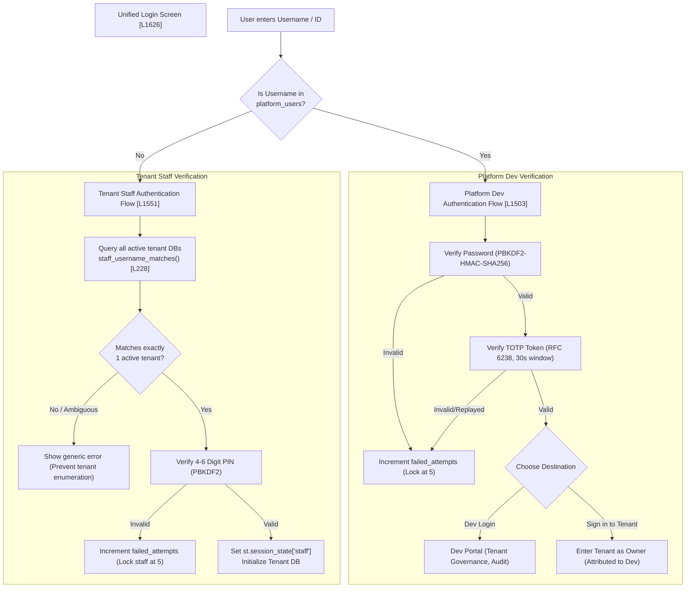
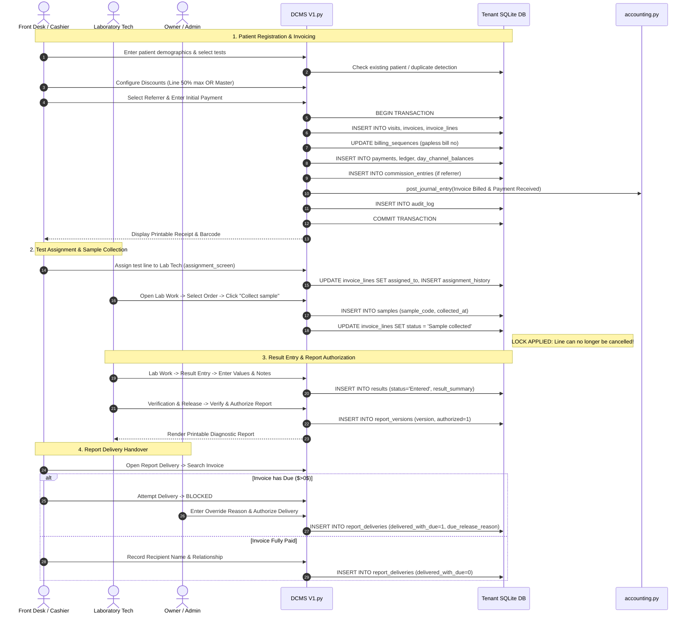
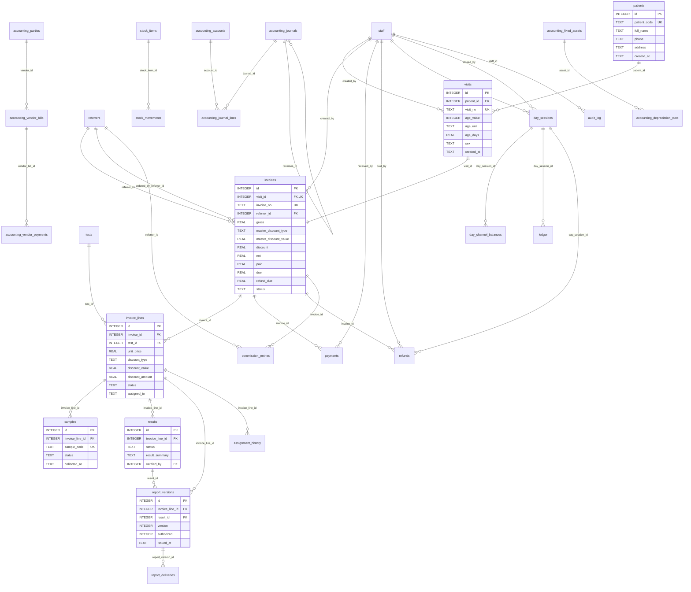

# MedScope / DCMS Current-State Codebase Audit Report

> **Audit Date:** November 6, 2026  
> **Auditor:** Antigravity AI Technical Architecture Assistant  
> **Repository:** `d:\DMS\MedScope`  
> **Target Audience:** Technical Architects, Lead Engineers, and System Developers  
> **Scope:** Full-repository inspection of code, schemas, documentation, architecture, runtime state, and scope alignment without modification or speculative refactoring.

---

## 1. Executive Summary

MedScope is an operational Diagnostic Center Management System (DCMS) designed for small-to-medium diagnostic facilities (with Seba Diagnostic as the canonical pilot center). Currently implemented as a **Streamlit + SQLite monolithic desktop/web application**, it manages the end-to-end operational and clinical lifecycle of diagnostic operations: multi-tenant platform provisioning, patient registration, visit management, test invoicing with complex discount schemes, multi-channel payment processing, sample collection, laboratory result entry and verification, multi-version diagnostic report generation, report handover with financial due controls, consumable inventory movements, cashier day-session opening/closing with drawer reconciliation, referral commission tracking, and a double-entry general ledger accounting module.

The application is structured into two main Python modules:
1. `DCMS V1.py` (6,481 lines): Monolithic presentation layer, domain handlers, tenant lifecycle management, SQLite schema migrations, and front-desk/lab workflows.
2. `accounting.py` (1,688 lines): Double-entry general ledger accounting engine, chart of accounts (34 accounts), period management, vendor bills/payments, fixed asset depreciation, and financial statements.

Together with a custom JavaScript/HTML keyboard-searchable dropdown component (`keyboard_dropdown/index.html`, 210 lines) and custom styling (`theme.css`, 344 lines), the project delivers a functional, locally hostable single-process web application.

### Key Architectural Findings
- **Development Stage:** Advanced Functional Prototype / Alpha Operational Build. The core clinical and front-desk workflows (patient registration $\rightarrow$ billing $\rightarrow$ payments $\rightarrow$ sample collection $\rightarrow$ results $\rightarrow$ authorization $\rightarrow$ report delivery) are functionally complete and execute within tenant-isolated SQLite databases.
- **Data Isolation:** Complete database-level multi-tenancy. A global platform registry (`medscope_data/platform.db`) tracks tenants and platform administrative accounts, while each diagnostic center operates in its own isolated SQLite database (`medscope_data/tenants/<tenant-uuid>.db`).
- **Accounting Integration:** An advanced double-entry accounting engine in `accounting.py` is integrated directly into core operational events (invoice creation, payment receipt, refund issuance, test cancellation, stock purchase, cashier drawer payouts, and commission disbursements).
- **Core Invariant Strictness:** Core billing rules (50% individual discount cap, master discount precedence over line items, strict lockouts on cancelling orders once laboratory samples are collected) are enforced at both UI and database transaction boundaries.
- **Absence of Web Framework & API:** There is no REST API, FastAPI, Flask, Django, React, or Vue layer. All UI is dynamically rendered by Streamlit's script-rerun execution model.
- **Technical Debt & Inconsistencies:**
  1. *Monolithic structure:* `DCMS V1.py` contains 6,481 lines in a single file combining UI widgets, SQL queries, DOM styling, and business rules.
  2. *Monetary representation divergence:* Core billing in `DCMS V1.py` uses floating-point `REAL` (Taka), whereas `accounting.py` converts currency to 64-bit `INTEGER` (paisa) to avoid rounding drift.
  3. *Tenant Schema Drift:* Unmigrated fresh tenant databases (`55696453081a474494e3af73f2c43b86.db` and `9003372ab508458a9267a0e7d5ba984e.db`) lack discount schema columns because schema upgrades run only upon tenant login rather than globally at platform startup.
  4. *Absence of Automated Tests:* There are zero automated unit or integration tests; regression protection relies entirely on manual Streamlit testing and `py_compile`.
  5. *Offline Capability Gap:* Despite detailed offline specifications in `DCMS Final Scope V1.md`, the system is 100% dependent on continuous Streamlit server connectivity with no browser offline storage or queue.

---

## 2. Current Project Status

| Dimension | Assessment | Operational Evidence |
|---|---|---|
| **Development Phase** | Advanced Alpha / Functional Prototype | Full operational happy-paths working; operational pilot data exists in tenant database `b51b4bbbe86540bdabdfe10c5f115003.db`. |
| **Code Stability** | Syntactically Clean | Both `DCMS V1.py` and `accounting.py` compile with 0 syntax errors under Python 3.10+. |
| **Multi-Tenancy** | Fully Functional | 3 distinct tenant databases exist in `medscope_data/tenants/`; platform registry correctly handles tenant creation, renaming, and soft-disabling. |
| **Authentication & RBAC** | Fully Functional | 5 tenant roles (`Owner`, `Admin`, `Receptionist`, `Cashier`, `Lab Tech`) + `Platform Dev` (TOTP MFA + 1hr timeout) fully enforced in navigation and action handlers. |
| **Billing & Invoicing** | Fully Functional | Sequential gapless invoice numbering, line discounts, master discounts, multi-channel payment allocation, and receipt printing. |
| **Laboratory Workflow** | Fully Functional | Sample collection lock, test line status transitions, result entry, verification, multi-version reports, and due-conditional handover. |
| **Cashier Day Operations**| Fully Functional | Business day opening float, multi-channel payment reconciliation, cash payouts, expected vs counted variance, single-open-day DB constraint. |
| **Double-Entry Accounting**| Fully Functional | 34-account chart of accounts, balanced journal postings, reversal tracking, period lockouts, P&L, Balance Sheet, Trial Balance. |
| **Referrer Management** | Fully Functional | Commission calculation (fixed or percentage), referrer merge utility with undo, owner-only commission payout workflow. |
| **Offline Mode** | **Not Implemented (0%)** | Described in `DCMS Final Scope V1.md` (Rule 3.7); absent from codebase. Requires server connection. |
| **Automated Testing** | **Not Implemented (0%)** | Zero test files (`test_*.py`). No unit, integration, or E2E harness. |

---

## 3. Repository Inventory

### 3.1 File & Directory Breakdown

```text
d:\DMS\MedScope\
│
├── .git\                              # Version control repository
├── __pycache__\                       # Compiled Python bytecode cache
├── keyboard_dropdown\                 # Local custom Streamlit component
│   └── index.html                     # (210 lines, 6,815 bytes) Custom searchable dropdown HTML/JS/CSS
├── medscope_data\                     # Runtime operational storage (DO NOT COMMIT)
│   ├── platform.db                    # (28,672 bytes) Platform-wide tenant registry & Dev accounts
│   └── tenants\                       # Directory containing tenant-isolated operational databases
│       ├── 55696453081a474494e3af73f2c43b86.db  # (360,448 bytes) Provisioned tenant database
│       ├── 9003372ab508458a9267a0e7d5ba984e.db  # (360,448 bytes) Provisioned tenant database
│       └── b51b4bbbe86540bdabdfe10c5f115003.db  # (368,640 bytes) Active tenant database with clinical history
├── prompt\                            # Audit and specification prompt instructions
│   └── DCMS_Current_State_Audit_Prompt.md # (350 lines, 9,045 bytes) Instructions driving this audit
├── report\                            # Output report directory
│   └── DCMS_CURRENT_STATE_AUDIT.md    # This audit report document
├── accounting.py                      # (1,688 lines, 76,640 bytes) General ledger accounting module
├── AGENTS.md                          # (207 lines, 8,595 bytes) Agent system rules & architectural constraints
├── DATABASE-DIAGRAM.md                # (766 lines, 17,677 bytes) Markdown ER diagrams & schema documentation
├── DCMS Final Scope V1.md             # (925 lines, 76,845 bytes) 31-module functional specification & business rules
├── DCMS V1.py                         # (6,481 lines, 318,820 bytes) Primary monolithic Streamlit application
├── Dev.ps1                            # (3 lines, 265 bytes) PowerShell helper for platform Dev bootstrap
├── PERMISSIONS.md                     # (87 lines, 6,171 bytes) Tenant and platform role access matrix
├── project-context.md                 # (332 lines, 15,277 bytes) Core system mental model and design invariants
├── Prompt 0 - Intro.txt               # (6 lines, 834 bytes) Context prompt explaining the transition roadmap
├── README.md                          # (144 lines, 8,912 bytes) Installation, configuration, and developer guide
├── requirements.txt                   # (1 line, 22 bytes) Python package dependencies (`streamlit>=1.35,<2.0`)
├── seba_diagnostic.db                 # (208,896 bytes) Legacy seed/template database for initial tenant provisioning
├── Test Price - Copy.csv              # (255 lines, 6,501 bytes) Partial backup copy of test catalog names
├── Test Price.csv                     # (255 lines, 13,910 bytes) 248 diagnostic tests imported on tenant init
├── theme.css                          # (344 lines, 10,117 bytes) Site-wide olive/champagne CSS theme
└── USER_GUIDE.md                      # (142 lines, 10,202 bytes) End-user operational documentation
```

### 3.2 Detailed File Purpose & Roles

| Path | Lines | Size | Purpose & Technical Role |
|---|---|---|---|
| `DCMS V1.py` | 6,481 | 318.8 KB | Main entry point; Streamlit UI; authentication; clinical, laboratory, billing, inventory, cashier, and staff screens; tenant schema definition and migrations. |
| `accounting.py` | 1,688 | 76.6 KB | Double-entry accounting submodule; chart of accounts; journal lines; financial reports; period controls; vendor payables; asset depreciation. |
| `keyboard_dropdown/index.html` | 210 | 6.8 KB | Bi-directional custom Streamlit HTML/JS/CSS component supporting keyboard navigation, option filtering, single/multi-selection, and resize messages. |
| `theme.css` | 344 | 10.1 KB | Global CSS defining color tokens (`--medscope-olive-*`, `--medscope-champagne-*`), typography, custom card borders, focus rings, and print media rules. |
| `requirements.txt` | 1 | 22 B | Declares `streamlit>=1.35,<2.0`. Relies on Python standard library (`sqlite3`, `hashlib`, `hmac`, `secrets`, `datetime`, `re`, `pathlib`, `csv`, `urllib`). |
| `Dev.ps1` | 3 | 265 B | Helper script generating random URL-safe 32-byte bootstrap token into `$env:MEDSCOPE_DEV_SETUP_TOKEN` and starting Streamlit. |
| `Test Price.csv` | 255 | 13.9 KB | Master seed catalog containing 248 medical diagnostic tests across Biochemical, Hematology, Microbiology, Serology, Clinical Pathology, and Ultrasonogram. |
| `Test Price - Copy.csv` | 255 | 6.5 KB | Redundant/backup catalog file containing test codes and names without category/pricing data. |
| `seba_diagnostic.db` | Binary | 208.9 KB | Legacy pre-accounting template database with 23 tables, copied via SQLite Backup API during first platform bootstrap. |
| `medscope_data/platform.db` | Binary | 28.7 KB | Platform database holding `platform_users`, `tenants`, and `platform_audit`. |
| `medscope_data/tenants/*.db` | Binary | ~368 KB | Tenant-isolated operational databases (3 present) holding 35 tables each. |
| `DCMS Final Scope V1.md` | 925 | 76.8 KB | Standing functional specification containing 31 target modules, 68 board decisions, and cross-cutting invariants. |
| `project-context.md` | 332 | 15.3 KB | In-depth operational context, architecture constraints, and rules for coding assistants. |
| `PERMISSIONS.md` | 87 | 6.2 KB | Detailed role capability matrix for Owner, Admin, Receptionist, Cashier, Lab Tech, and Platform Dev. |
| `USER_GUIDE.md` | 142 | 10.2 KB | Workflow guide for front-desk receptionists, cashiers, technicians, and center owners. |
| `DATABASE-DIAGRAM.md` | 766 | 17.7 KB | Markdown documentation containing Mermaid ER diagrams of platform and tenant databases. |

---

## 4. Current Architecture

### 4.1 System Topology & Conceptual Architecture

MedScope operates as a single-host, multi-tenant application served via Streamlit's local web server on port 8501. The browser connects via HTTP and persistent WebSocket connections to Streamlit. All state is maintained in-memory within `st.session_state` on the server for the duration of the browser session.

```mermaid
flowchart TD
    subgraph Browser ["Client Browser / Front-End"]
        UI["Streamlit In-Browser UI (Forms, Metrics, Tables)"]
        Dropdown["keyboard_dropdown/index.html (Custom IFrame Component)"]
        CSS["theme.css (Olive & Champagne Theme)"]
    end

    subgraph AppServer ["Streamlit Python Runtime (DCMS V1.py)"]
        Entry["main() [L6095] - Entry Point & Dispatcher"]
        Auth["Authentication & Session State [L1503-L1692]"]
        Router{"Navigation Page Router [L6614-L6677]"}
        
        subgraph Screens ["Domain UI Screens"]
            S_Dash["Dashboard (Owner, Admin, Front Desk, Lab) [L1695-L2052]"]
            S_Invoice["New Invoice & Patient Intake [L2265-L2982]"]
            S_Search["Invoice Search & Cancellation [L2985-L3118]"]
            S_Lab["Lab Work (Collect, Result, Authorize) [L2055-L2222]"]
            S_Dues["Dues Collection & Refunds [L3121-L3335]"]
            S_Deliv["Report Delivery Handover [L3443-L3531]"]
            S_Inv["Inventory & Stock Movements [L3534-L3650]"]
            S_Day["Cashier Day Open/Close [L3653-L3898]"]
            S_AcctMgt["Staff, Catalog & Referrers [L3901-L4834]"]
            S_Dev["Dev Portal & Tenant Governance [L5409-L6092]"]
        end

        subgraph AccountingModule ["accounting.py Engine"]
            AcctScreen["accounting_screen() [L1694]"]
            JournalEngine["post_journal_entry() [L274] / reverse_journal_entry() [L395]"]
            COA["Chart of Accounts (34 Accounts, Paisa Math) [L77]"]
            FinReports["Financial Reports (P&L, Balance Sheet, Ledger) [L534]"]
        end
    end

    subgraph DataTier ["SQLite Database Storage (medscope_data/)"]
        subgraph PlatformTier ["Platform Storage"]
            PlatformDB[("medscope_data/platform.db\n(platform_users, tenants, platform_audit)")]
        end
        
        subgraph TenantTier ["Per-Tenant Storage"]
            TenantDB[("medscope_data/tenants/<tenant-uuid>.db\n(35 Tables: Clinical, Invoices, Lab, Ledger, Accounting)")]
        end
        
        SeedDB[("seba_diagnostic.db\n(Legacy Template DB)")]
        SeedCSV[("Test Price.csv\n(248 Test Catalog Seed)")]
    end

    UI <-->|WebSocket / DOM Reruns| Entry
    Dropdown <-->|postMessage (setComponentValue)| UI
    CSS -.->|Injected HTML <style>| UI
    
    Entry --> Auth
    Auth --> Router
    Router --> Screens
    Screens -->|Direct In-Process Calls| JournalEngine
    Router -->|Page == 'Accounting'| AcctScreen
    AcctScreen --> JournalEngine
    JournalEngine --> COA
    
    Auth <-->|sqlite3 platform_database()| PlatformDB
    Screens <-->|sqlite3 database() Context Manager| TenantDB
    AcctScreen <-->|sqlite3 accounting_database()| TenantDB
    PlatformDB -.->|Initial Bootstrap Backup| TenantDB
    SeedCSV -.->|import_test_price_catalog()| TenantDB
    SeedDB -.->|Initial Tenant Copy| TenantDB
```

### 4.2 Streamlit Execution & Rerun Model
Streamlit applications execute from line 1 to the end on every user interaction (button press, dropdown change, text entry). In MedScope:
- `main()` (`DCMS V1.py` lines 6095–6677) executes top-down on every rerun.
- Page routing is controlled via `st.session_state["navigation_page"]`.
- To prevent infinite rerun loops or lost inputs, widgets use unique, stable keys (e.g., `key=f"edit_staff_pin_{staff_id}"`).
- A specialized custom HTML component (`keyboard_dropdown/index.html`) is loaded via `st.components.v1.declare_component("keyboard_dropdown", path=...)` at line 44, passing options and selections across the iframe boundary via `window.parent.postMessage`.

### 4.3 Database Access & Transaction Architecture
MedScope does not use SQLAlchemy, Peewee, or any third-party ORM. All database operations use Python's standard `sqlite3` module via Python context managers:
1. `database(db_path=None)` (`DCMS V1.py` L111–L130): Connects to the tenant database specified in `st.session_state["tenant_db_path"]`. Sets `row_factory = sqlite3.Row`, executes `PRAGMA foreign_keys = ON`, commits upon clean exit, rolls back on exceptions, and closes the connection.
2. `platform_database()` (`DCMS V1.py` L134–L146): Connects to `medscope_data/platform.db`, sets `row_factory = sqlite3.Row`, executes `PRAGMA foreign_keys = ON`, commits or rolls back, and closes.
3. `accounting_database()` (`accounting.py` L52–L66): Mirrors `database()` for accounting transactions, ensuring atomicity and foreign key enforcement on tenant accounting tables.

### 4.4 External Services
There are **zero external services or cloud APIs** used by the application:
- No external authentication provider (uses local PBKDF2-HMAC-SHA256 password digests and local TOTP RFC 6238).
- No cloud database connection (all SQLite local files).
- No SMS gateway integration (SMS rules documented in scope are not wired to an HTTP client).
- No external payment gateway SDKs (bKash/Nagad payments are manual transaction reference entries).

---

## 5. Application Startup and Runtime Flow

### 5.1 Startup Sequence

```text
Streamlit Process Launch (python -m streamlit run "DCMS V1.py")
│
├── 1. Global Setup (Top of script)
│   ├── Declare custom component `keyboard_dropdown` (L44)
│   ├── Set Streamlit page config: layout="wide", page_title="MedScope" (L6096)
│   └── Load and inject `theme.css` via st.markdown("<style>...</style>") (L6101)
│
├── 2. Platform Bootstrap Check: initialize_platform() (L157-L216)
│   ├── Create directories `medscope_data/` and `medscope_data/tenants/`
│   ├── Connect to `medscope_data/platform.db`
│   ├── Create tables: `platform_users`, `tenants`, `platform_audit`
│   └── If `tenants` table is empty:
│       ├── If `seba_diagnostic.db` exists in repo root:
│       │   └── Copy `seba_diagnostic.db` -> `medscope_data/tenants/<new_uuid>.db` via sqlite3.backup()
│       ├── Insert initial tenant into `tenants` table
│       └── Run `initialize_database(tenant_db_path, allow_create=True)`
│
├── 3. Session State Resolution (L6106-L6160)
│   ├── Initialize session defaults: `navigation_page`, `staff`, `platform_dev`, `last_invoice`
│   └── Check Platform Dev session expiration (1-hour window) (L6117)
│
├── 4. Authentication Check
│   ├── CASE A: Platform Dev Authenticated (L6162-L6533)
│   │   ├── If in Dev Portal (`st.session_state["dev_access_destination"] == "platform"`):
│   │   │   └── Render `dev_portal(developer)` (no sidebar navigation)
│   │   └── If in Tenant Context (`st.session_state["dev_access_destination"] == "tenant"`):
│   │       ├── Set Owner-equivalent staff context with Dev attribution
│   │       └── Render Tenant Navigation Sidebar with "Return to Dev Module" button
│   │
│   ├── CASE B: Tenant Staff Authenticated (L6535-L6677)
│   │   ├── Connect to tenant database (`st.session_state["tenant_db_path"]`)
│   │   ├── Execute tenant schema check: `initialize_database(tenant_path)` (L6558)
│   │   ├── Resolve role navigation list based on staff role (Owner, Admin, Receptionist, Cashier, Lab Tech)
│   │   ├── Render Sidebar: Diagnostics Center Name, Staff Name, Role Badge, Radio Navigation, Sign Out Button
│   │   └── Dispatch screen function based on `selected_page`
│   │
│   └── CASE C: Unauthenticated (L6128-L6160)
│       └── Render `login_screen()` (unified tenant username/PIN + Master Dev ID login)
```

### 5.2 Required Commands and Environment Variables

To launch the system:
```powershell
# Set optional bootstrap token for first-time Platform Dev account creation
$env:MEDSCOPE_DEV_SETUP_TOKEN = "your-secure-setup-token-here"

# Start the Streamlit development server
python -m streamlit run "DCMS V1.py" --server.address 127.0.0.1 --server.port 8501 --server.headless true --browser.gatherUsageStats false
```

- **Environment Variable:** `MEDSCOPE_DEV_SETUP_TOKEN` is the only environment variable inspected by the codebase. It is checked during `dev_bootstrap_screen()` (`DCMS V1.py` line 1404) to authorize the creation of the first `platform_users` record.

---

## 6. Authentication and Permission Flow

### 6.1 Authentication Architecture

MedScope implements a two-tier authentication architecture:



### 6.2 Password Hashing & Encryption Security
- **Algorithm:** PBKDF2 with HMAC-SHA256, 100,000 iterations, 16-byte cryptographically random salt (`secrets.token_hex(16)`).
- **Format:** `f"{salt_hex}${hash_hex}"` stored in `staff.password_hash` and `platform_users.password_hash`.
- **Comparison:** Constant-time comparison using `hmac.compare_digest()` (`DCMS V1.py` line 838).
- **MFA:** Built-in standard TOTP (HMAC-SHA1, 6 digits, 30-second time step) in pure Python (`DCMS V1.py` lines 1346–1377). Replay protection enforces that incoming counter strictly exceeds `platform_users.last_totp_counter`.

### 6.3 Tenant Role-Based Access Control (RBAC) Matrix

| Module / Page | Role Navigation Filter (`DCMS V1.py` L6582–L6612) | Action Handler Role Verification |
|---|---|---|
| **Dashboard** | Available to all roles (renders role-specific dashboard variant) | None (read-only filtered view) |
| **New Invoice** | Owner, Admin, Receptionist, Cashier | Front-desk validation; cash drawer session check |
| **Invoices (Search & Reprint)**| Owner, Admin, Receptionist, Cashier | None |
| **Cancel Uncollected Test** | Available on Invoice Detail view | Blocked if sample collected (`L894`); staff ID logged |
| **Dues & Refunds** | Owner, Admin, Receptionist, Cashier | Checked against open day session; refund amount capped |
| **Test Assignment** | Owner, Admin, Receptionist, Cashier | Logged to `assignment_history` |
| **Lab Work** | Owner, Admin, Lab Tech | Sample collection, result entry, verification, release |
| **Report Delivery** | Owner, Admin, Receptionist, Cashier | If invoice due > 0, **Owner/Admin override with reason required** (`L3505`) |
| **Inventory** | Owner, Admin, Receptionist, Cashier (View Only for Front Desk; Manage for Owner/Admin) | Edit/Add actions restricted to Owner/Admin |
| **Day Open / Close** | Owner, Admin, Receptionist, Cashier | Day close reconciles drawer; single-open-day enforced |
| **Accounts & Referrers** | Owner, Admin | Commission tab **strictly Owner-only** (`L4730`); staff role edits restricted |
| **Database Management** | Owner, Admin | Referrer merge and database maintenance |
| **User Reports** | **Owner-Only** (`L6599`) | Enforced in `main()` and `user_reports_screen()` (`L5064`) |
| **Audit Trail** | Owner, Admin | Search and export tenant audit events |
| **Accounting** | **Owner-Only** (`L6602`) | Enforced in `main()` and `accounting_screen()` |
| **Platform Dev Portal** | **Platform Dev Only** (No tenant sidebar) | Isolated from tenant role matrix; session expires in 1 hour |

---

## 7. Module-by-Module Implementation Status

Below is the structured audit of all 26 operational modules and 5 provisional modules against the actual codebase evidence:

### Module 1: Login & Who Sees What
- **Status:** **Implemented** (with minor omissions)
- **UI:** `login_screen()` (`DCMS V1.py` L1626–L1692), `dev_bootstrap_screen()` (L1385–L1490)
- **Business Logic:** `tenant_staff_login()` (L1551–L1623), `developer_login()` (L1503–L1548), `tenant_staff_matches()` (L228–L269)
- **Database Tables:** `platform_users`, `staff`
- **Roles:** All tenant roles + Platform Dev
- **Current Workflow:** Unified form takes username and PIN/password. Tenant staff resolved across all active tenant DBs without exposing a tenant directory. 5 failed attempts locks user. Platform Dev requires Master ID, password, and TOTP code.
- **Known Gaps:** Visiting doctors have no login (documented in scope); Doctor profile professional registration number is not stored in `staff`; idle screen auto-lock is not implemented; Small Center Mode toggle is absent.
- **Scope Reference:** Final Scope M1 (D56–D60).

### Module 2: Dashboard
- **Status:** **Implemented**
- **UI:** `dashboard()` (L1695), `owner_dashboard()` (L1793), `admin_dashboard()` (L1882), `lab_tech_dashboard()` (L2003)
- **Business Logic:** Inline SQL aggregates on `invoices`, `payments`, `samples`, `results`, `stock_items`
- **Database Tables:** `invoices`, `payments`, `refunds`, `samples`, `results`, `stock_items`
- **Roles:** All roles have specialized views
- **Current Workflow:** Owner sees financial totals (gross, discount, net, received, dues), pending samples, unverified results, and low stock count. Lab Tech dashboard shows zero financial metrics, displaying only sample/result worklists.
- **Known Gaps:** Daily Android summary push (M2.1) is not implemented; interactive month calendar day-picker (M2.4) is absent; automated anomaly banners are absent.
- **Scope Reference:** Final Scope M2 (D23, D45, D46).

### Module 3: Patient Record
- **Status:** **Implemented**
- **UI:** Embedded within `new_invoice()` (L2288–L2442), `patient_search()` (L5375–L5406)
- **Business Logic:** `patient_search()`, inline SQL lookups
- **Database Tables:** `patients`, `visits`
- **Roles:** Owner, Admin, Receptionist, Cashier
- **Current Workflow:** Search existing patients by contact number, name, or permanent patient code. One mobile number can link to multiple family members. Registering new patient enforces name, phone, address. Age and sex are recorded on the `visits` record.
- **Known Gaps:** No separate full-page patient management/editing screen (must edit through invoice intake).
- **Scope Reference:** Final Scope M3 (D7, D51, D55).

### Module 4: Doctors & Referrers
- **Status:** **Implemented**
- **UI:** `account_management()` (Referrers tab, L4376–L4727), `new_invoice()` (L2620–L2738)
- **Business Logic:** `calculate_commission()` (L867–L870), `commission_description()` (L861–L864)
- **Database Tables:** `referrers`, `commission_entries`, `referrer_merges`, `referrer_merge_records`
- **Roles:** Owner, Admin (Commission settings & payouts strictly Owner-only)
- **Current Workflow:** Add and edit referrers with contact info, default commission type (`Percentage` or `Amount`), and rates. Invoices record both "Referred by" and "Ordered by". Referrers can be merged with developer undo support.
- **Known Gaps:** Commission pool split between two referrers (D39) is not implemented; commission is credited solely to `referrer_id`.
- **Scope Reference:** Final Scope M4 (D36, D39, D41).

### Module 5: Test Catalog & Prices
- **Status:** **Implemented** (Catalog); **Partial** (Price lists & packages)
- **UI:** `account_management()` (Test Catalog tab, L4138–L4375)
- **Business Logic:** `import_test_price_catalog()` (L325–L402)
- **Database Tables:** `tests`, `app_settings`
- **Roles:** Owner, Admin
- **Current Workflow:** 248 tests automatically seeded from `Test Price.csv` on initial setup. Admins can add, edit, activate/deactivate tests, and change unit prices. Referenced tests cannot be deleted.
- **Known Gaps:** Patient-specific or referrer-specific price lists (D5) are not implemented (flat catalog price used); test bundles/packages (D4) are not implemented.
- **Scope Reference:** Final Scope M5 (D4, D5, D36).

### Module 6: Registration & Billing
- **Status:** **Implemented**
- **UI:** `new_invoice()` (L2265–L2982)
- **Business Logic:** Invariant checks on discounts, gross, net, payments; billing sequence generator
- **Database Tables:** `patients`, `visits`, `invoices`, `invoice_lines`, `billing_sequences`, `commission_entries`
- **Roles:** Owner, Admin, Receptionist, Cashier
- **Current Workflow:** Intake demographic data $\rightarrow$ select tests via `keyboard_dropdown` $\rightarrow$ configure line discounts (percent capped at 50% or fixed amount capped at unit price) or toggle Master Discount (overrides line items while preserving them in state) $\rightarrow$ select referrer $\rightarrow$ enter payment $\rightarrow$ commit invoice atomically.
- **Known Gaps:** Doctor consultation visit fees (M28) cannot be billed on invoice.
- **Scope Reference:** Final Scope M6 (D1–D3, D6, D8, D9).

### Module 7: Taking Payment
- **Status:** **Implemented**
- **UI:** Embedded in `new_invoice()` (L2790–L2848), `dues_screen()` (L3134–L3198)
- **Business Logic:** `add_payment()` (L1130–L1192)
- **Database Tables:** `payments`, `invoices`, `ledger`, `day_channel_balances`, `accounting_journals`, `accounting_journal_lines`
- **Roles:** Owner, Admin, Receptionist, Cashier
- **Current Workflow:** Accepts Cash, Card, bKash, Nagad, Bank Transfer. Overpayment blocked (capped at due). Digital payments require a unique transaction reference (enforced via DB unique indexes). Automatically updates invoice paid/due, ledger, cashier day channel balance, and double-entry accounting.
- **Known Gaps:** None.
- **Scope Reference:** Final Scope M7 (D8, D9, D10).

### Module 8: Bill Numbers
- **Status:** **Implemented**
- **UI:** Displayed on invoice creation, search, and receipts
- **Business Logic:** Atomic increment inside `database()` transaction from `billing_sequences` table (L2853–L2862)
- **Database Tables:** `billing_sequences`, `invoices`
- **Roles:** System automated
- **Current Workflow:** Generates gapless sequential bill numbers formatted as `SD-000001`, `SD-000002`... Patient codes use `PID-000001` or timestamp formatting.
- **Known Gaps:** Temporary offline bill IDs (D64) not implemented due to absence of offline mode.
- **Scope Reference:** Final Scope M8 (D51, D52, M8.1, M8.2).

### Module 9: Bill Printing
- **Status:** **Implemented**
- **UI:** Printable HTML receipt generation in `new_invoice()` (L2954) and `invoice_search()` (L3048–L3090)
- **Business Logic:** Embedded HTML/CSS with print triggers (`window.print()`)
- **Database Tables:** `invoices`, `invoice_lines`, `patients`, `payments`
- **Roles:** Owner, Admin, Receptionist, Cashier
- **Current Workflow:** Renders an olive/champagne formatted receipt displaying center title, invoice number, barcode, patient demographics, itemized tests, gross, discount, net, paid, due, and cashier name.
- **Known Gaps:** Direct thermal ESC/POS raw printer driver integration is absent (relies on browser print dialog).
- **Scope Reference:** Final Scope M9 (D62).

### Module 10: Splitting the Work (Test Assignment)
- **Status:** **Implemented**
- **UI:** `assignment_screen()` (L3338–L3440)
- **Business Logic:** Updates `invoice_lines.assigned_to` and `assigned_at`; logs to `assignment_history`
- **Database Tables:** `invoice_lines`, `assignment_history`
- **Roles:** Owner, Admin, Receptionist, Cashier
- **Current Workflow:** Filters unassigned or assigned test lines by department/status; assigns tests to specific laboratory technicians or rooms; audit history tracks previous assignee, new assignee, and reason.
- **Known Gaps:** None.
- **Scope Reference:** Final Scope M10.

### Module 11: Technician Worklist
- **Status:** **Implemented**
- **UI:** `lab_tech_dashboard()` (L2003–L2052), `lab_work_screen()` (L2055–L2222)
- **Business Logic:** `lab_work_orders()` (L1982–L2000)
- **Database Tables:** `invoice_lines`, `samples`, `results`, `invoices`, `patients`
- **Roles:** Owner, Admin, Lab Tech
- **Current Workflow:** Lab Tech sees worklists partitioned into "Awaiting Sample", "Sample Collected / In Progress", and "Completed / Authorized". All financial information is strictly excluded from these screens.
- **Known Gaps:** None.
- **Scope Reference:** Final Scope M11 (M11.3).

### Module 12: Test in Progress (Sample Collection & Locking)
- **Status:** **Implemented** (Locking); **Partial** (Stock deduction)
- **UI:** `lab_work_screen()` ("Collect Sample" tab, L2062–L2114)
- **Business Logic:** `collect_lab_sample()` (L1047–L1083), `cancel_uncollected_test()` (L873–L1044)
- **Database Tables:** `samples`, `invoice_lines`, `audit_log`
- **Roles:** Owner, Admin, Lab Tech
- **Current Workflow:** Tech selects pending test order and clicks "Collect sample". Creates record in `samples` with generated barcode `SMP-<invoice_no>-<line_id>`, updates test line status to `'Sample collected'`. Once a sample exists, `cancel_uncollected_test()` strictly raises `ValueError`, locking the line against cancellation.
- **Known Gaps:** Consumable stock is **not automatically deducted** upon sample collection (must be deducted manually via inventory).
- **Scope Reference:** Final Scope M12 (D13, D14, D15, D17).

### Module 13: Entering Results and the Report
- **Status:** **Implemented**
- **UI:** `lab_work_screen()` ("Result Entry" tab, L2116–L2169)
- **Business Logic:** SQL inserts into `results` table
- **Database Tables:** `results`, `invoice_lines`
- **Roles:** Owner, Admin, Lab Tech
- **Current Workflow:** Tech inputs parameter result values, reference ranges, units of measurement, and clinical notes. Saves as draft or submits for verification.
- **Known Gaps:** Automatic abnormal/critical value flags (M13.1, M13.2) were dropped per scope decision D23/D24; previous-result delta comparison (M13.4) is deferred.
- **Scope Reference:** Final Scope M13 (D23, D24, D25).

### Module 14: Draft to Final (Verification & Report Versions)
- **Status:** **Implemented**
- **UI:** `lab_work_screen()` ("Verification & Release" tab, L2171–L2222)
- **Business Logic:** Inserts into `report_versions`, generates printable report HTML (`printable_report_html()`, L1086–L1123)
- **Database Tables:** `report_versions`, `results`, `invoice_lines`
- **Roles:** Owner, Admin, Lab Tech
- **Current Workflow:** Verifying technician or authorized staff reviews result values and enters findings summary. Authorizing the report creates a new version entry in `report_versions` (`version`, `authorized=1`, `issued_by`, `issued_at`). Renders multi-column printable laboratory report.
- **Known Gaps:** Visiting doctor digital sign-off with registration number attestation (D22/D59) is not formalized in UI.
- **Scope Reference:** Final Scope M14 (D22, D26).

### Module 15: Corrections
- **Status:** **Partial**
- **UI:** Re-verifying results creates an incremented version in `report_versions`
- **Business Logic:** Version tracking exists via `report_versions.version`
- **Database Tables:** `report_versions`, `results`
- **Roles:** Owner, Admin, Lab Tech
- **Current Workflow:** Authorizing updated results appends a new row to `report_versions` with an incremented version number. Older versions remain intact in the database.
- **Known Gaps:** No dedicated "Correction Review" screen allowing side-by-side version comparison or mandatory correction reason capture.
- **Scope Reference:** Final Scope M15 (D26, D27).

### Module 16: Stock (Inventory)
- **Status:** **Implemented** (Stock management); **Partial** (Automation)
- **UI:** `inventory_screen()` (L3534–L3650)
- **Business Logic:** Inserts into `stock_movements`, updates `stock_items.on_hand` and `average_cost_paisa`, posts accounting journal for stock acquisitions
- **Database Tables:** `stock_items`, `stock_movements`, `accounting_journals`, `accounting_journal_lines`
- **Roles:** View: Owner, Admin, Receptionist, Cashier; Manage: Owner, Admin
- **Current Workflow:** Tracks items (Syringe 5ml, EDTA Tube, Plain Tube, Swabs), current quantity, reorder level, and weighted average cost in paisa. Stock movements record delta, cost, movement type (`Purchase`, `Usage`, `Wastage`, `Adjustment`), notes, and actor. Low-stock alerts appear on dashboards.
- **Known Gaps:** Automatic consumption deduction at sample collection is missing (no recipe BOM mapping tests to reagents).
- **Scope Reference:** Final Scope M16 (D30–D35).

### Module 17: Handing Over the Report (Report Delivery)
- **Status:** **Implemented**
- **UI:** `report_delivery_screen()` (L3443–L3531)
- **Business Logic:** Validation on report authorization and invoice outstanding balance
- **Database Tables:** `report_deliveries`, `report_versions`, `invoices`
- **Roles:** Owner, Admin, Receptionist, Cashier
- **Current Workflow:** Front desk searches patient/invoice. System checks if authorized report exists. If invoice has an outstanding due ($> 0$), **receptionist cannot deliver report**; only Owner or Admin can release, requiring a mandatory justification reason (`delivered_with_due=1`, `due_release_reason`). Delivery details (recipient name, relationship) recorded.
- **Known Gaps:** None.
- **Scope Reference:** Final Scope M17 (M17.1–M17.6).

### Module 18: Dues
- **Status:** **Implemented**
- **UI:** `dues_screen()` ("Collect Patient Due" tab, L3134–L3198)
- **Business Logic:** `add_payment()` (L1130–L1192)
- **Database Tables:** `invoices`, `payments`, `ledger`, `day_channel_balances`, `accounting_journals`
- **Roles:** Owner, Admin, Receptionist, Cashier
- **Current Workflow:** Lists all unpaid or partial invoices with search. Cashier enters amount received (capped at due amount). Updates invoice due/paid/status, writes cashier session ledger, updates day channel balances, and posts journal entry debiting Cash/Bank and crediting Accounts Receivable.
- **Known Gaps:** None.
- **Scope Reference:** Final Scope M18 (D9, D11).

### Module 19: Commission
- **Status:** **Implemented**
- **UI:** `account_management()` ("Commission" tab, L4729–L4834), `user_reports_screen()` (L5195–L5235)
- **Business Logic:** `calculate_commission()` (L867–L870), automatic commission reversal in `cancel_uncollected_test()` (L927–L933)
- **Database Tables:** `commission_entries`, `referrers`, `invoices`, `ledger`, `accounting_journals`
- **Roles:** **Strictly Owner-Only** (Hidden from Admin, Receptionist, Cashier, Tech)
- **Current Workflow:** Commission is calculated at invoice creation based on referrer's configured rate (`Percentage` or `Amount` on gross). Rates and balances are hidden from front-desk staff. Reversal occurs automatically if a test is cancelled.
- **Known Gaps:** Two-referrer split (D39) is not implemented.
- **Scope Reference:** Final Scope M19 (D36–D43).

### Module 20: Paying Commission and Handing Over Visit Fees
- **Status:** **Implemented** (Commission); **Missing** (Doctor visit fees)
- **UI:** `account_management()` (Commission Payout sub-view, L4766–L4834)
- **Business Logic:** Validates open day session; writes to `ledger` (direction `'Out'`, entry_type `'Commission payment'`); posts accounting journal (Debit Referral Commissions Payable 2030, Credit Cash/Bank)
- **Database Tables:** `referrers`, `ledger`, `day_channel_balances`, `accounting_journals`, `accounting_journal_lines`
- **Roles:** **Owner-Only**
- **Current Workflow:** Owner reviews accrued vs paid balances for each referrer. Records payout amount and payment channel. Deducts from cashier drawer or bank balance and debits accounting liabilities.
- **Known Gaps:** Doctor visit fee collection and handover (M28) is not implemented.
- **Scope Reference:** Final Scope M20 (D41, D44).

### Module 21: Accounting
- **Status:** **Implemented**
- **UI:** `accounting_screen()` in `accounting.py` (L1694–L1747) with 6 comprehensive tabs
- **Business Logic:** `post_journal_entry()` (L274), `reverse_journal_entry()` (L395), `assert_period_open()` (L262), paisa math conversions
- **Database Tables:** `accounting_accounts`, `accounting_journals`, `accounting_journal_lines`, `accounting_parties`, `accounting_periods`, `accounting_settings`, `accounting_vendor_bills`, `accounting_vendor_payments`, `accounting_fixed_assets`, `accounting_depreciation_runs`
- **Roles:** **Owner-Only**
- **Current Workflow:** Complete double-entry accounting engine with 34 standard accounts. Supports manual journals, automated operational postings, vendor bills and payments, fixed asset straight-line depreciation runs, period locking, and generates real-time Trial Balance, Income Statement, Balance Sheet, and General Ledger.
- **Known Gaps:** Operational billing stores `REAL` Taka while accounting converts to `INTEGER` paisa.
- **Scope Reference:** Final Scope M21 (D49, D50).

### Module 22: Day Open and Close
- **Status:** **Implemented**
- **UI:** `day_management()` (`DCMS V1.py` L3653–L3898)
- **Business Logic:** Session open/close validations; drawer variance calculations; single open day DB constraint
- **Database Tables:** `day_sessions`, `day_channel_balances`, `ledger`, `accounting_journals`
- **Roles:** Owner, Admin, Receptionist, Cashier
- **Current Workflow:** Cashier opens business day by recording opening cash float and channel balances. All cash intake/payouts require an open session. Partial unique index `one_open_business_day` enforces max 1 open session at a time in SQLite. Closing day requires counted cash/balances, records variances, and posts reconciliation journals.
- **Known Gaps:** None.
- **Scope Reference:** Final Scope M22 (D45–D48).

### Module 23: Audit
- **Status:** **Implemented**
- **UI:** `audit_screen()` (L5276–L5372), Dev Portal Platform Audit (L5865–L5905)
- **Business Logic:** `audit()` (L1328–L1343), `platform_audit()` (L279–L284)
- **Database Tables:** `audit_log`, `platform_audit`
- **Roles:** Tenant Audit: Owner, Admin; Platform Audit: Platform Dev
- **Current Workflow:** Append-only log recording `staff_id`, `acting_role`, `action`, `entity_type`, `entity_id`, `before_value`, `after_value`, and ISO timestamp. Searchable by user, date range, action, and text. CSV export limited to 2,000 newest events.
- **Known Gaps:** Read-only view events are not logged (by design).
- **Scope Reference:** Final Scope M23 (D57, D61, M23.1).

### Module 24: Search
- **Status:** **Implemented** (Specialized); **Missing** (Universal Global Search)
- **UI:** Dedicated search interfaces in `patient_search()`, `invoice_search()`, `dues_screen()`, `audit_screen()`
- **Business Logic:** Targeted SQL `LIKE` queries with parameter binding
- **Database Tables:** `patients`, `invoices`, `audit_log`, `referrers`
- **Roles:** Role-appropriate per screen
- **Current Workflow:** Users search patients by phone/name/code, invoices by invoice number/phone/patient name, audit events by keyword.
- **Known Gaps:** A unified universal search bar spanning all entities in one box is not present.
- **Scope Reference:** Final Scope M24.

### Module 25: Special Features
- **Status:** **Partial**
- **UI:** Account lockout messages, duplicate patient warnings, referrer merge tool
- **Business Logic:** 5-attempt failed login counter, duplicate patient matching, unique index constraints
- **Database Tables:** `staff`, `patients`, `referrer_merges`, `referrer_merge_records`
- **Roles:** Owner, Admin, Platform Dev
- **Current Workflow:** Lockouts protect staff and dev accounts; duplicate warnings detect similar patient names and phone numbers; referrer merge combines duplicate referrers while preserving full historical reversal records.
- **Known Gaps:** Automated SMS notifications (D62) are not implemented; automated scheduled database backups (D65) are absent.
- **Scope Reference:** Final Scope M25 (D58, D61, D62, D65).

### Module 26: Reports
- **Status:** **Implemented**
- **UI:** `user_reports_screen()` (L5063–L5273)
- **Business Logic:** SQL aggregation queries over `invoices`, `payments`, `refunds`, `audit_log`, `commission_entries`, `ledger`
- **Database Tables:** `invoices`, `payments`, `refunds`, `audit_log`, `commission_entries`, `ledger`, `staff`
- **Roles:** **Strictly Owner-Only**
- **Current Workflow:** 4 distinct report tabs:
  1. *User Performance:* Invoices billed, net value, tests billed, payments collected, refunds paid, lab actions performed (attributed via audit log).
  2. *Tests by User:* Billed test volume and revenue grouped by invoice creator.
  3. *Referrer Commissions:* Accrued commissions, payouts, and current outstanding balances.
  4. *Financial Activity:* Operational summary of net billing, discounts, receipts, refunds, cash expenses, and commissions paid. CSV download available on all tabs.
- **Known Gaps:** Accrual accounting statements belong to `accounting.py`; operational financial summary is explicitly not a full P&L.
- **Scope Reference:** Final Scope M26.

---

### Provisional Modules (Modules 27 to 31)

| Module | Status | Codebase Findings & Evidence | Scope Discrepancy / Gaps |
|---|---|---|---|
| **Module 27: Serial and Queue** | **Missing (0%)** | No queue, token, or patient call screen in `DCMS V1.py` or database schemas. | Specified as provisional in scope; no queue management implemented. |
| **Module 28: Doctor Visit Fee & Wholesale** | **Missing (0%)** | `invoices` table only supports diagnostic test lines. No visit fee liability line or wholesale pricing. | Consultation fees collected on diagnostic bills are not supported. |
| **Module 29: Cancellation & Refund** | **Implemented (Pre-collection); Missing ("Not Performed" Exception)** | `cancel_uncollected_test()` (L873) and `issue_patient_refund()` (L1195) fully functional for uncollected tests. | Post-collection cancellation with "Not Performed" status and wastage logging is strictly blocked by code. |
| **Module 30: Home Sample Collection** | **Missing (0%)** | No home collection dispatch, address routing, or mobile technician tracking exists. | Provisional module; entirely absent. |
| **Module 31: Outside-Lab Tests** | **Documented Only / Accounting Partial** | `accounting_vendor_bills` supports vendor payables to external labs, but no operational dispatch or tracking exists in `DCMS V1.py`. | Operational workflow for sample outsourcing, courier tracking, and outside lab result entry does not exist. |

---

## 8. End-to-End Workflow Descriptions

### 8.1 Primary Clinical & Diagnostic Workflow



### 8.2 Auxiliary Implemented Workflows

#### A. Pre-Collection Test Cancellation & Refund Workflow
1. Front desk locates invoice in `invoice_search()`.
2. Selects an uncollected test line and provides cancellation reason.
3. `cancel_uncollected_test()` (`DCMS V1.py` L873) executes:
   - Validates that `samples` record does NOT exist for this line.
   - Updates `invoice_lines.status = 'Cancelled'`, setting `cancelled_by`, `cancelled_at`, and `cancellation_reason`.
   - Recalculates invoice gross, discount, and net totals.
   - Adjusts invoice `refund_due`.
   - Reverses corresponding `commission_entries` row (`status = 'Cancelled'`).
   - If initial billing was posted to accounting, posts reversal adjustment journals via `post_journal_entry()`.
   - Records audit event in `audit_log`.
4. Front desk opens `dues_screen()` ("Patient Refunds" tab).
5. Invokes `issue_patient_refund()` (`DCMS V1.py` L1195):
   - Validates that an open cashier day session exists.
   - Inserts row into `refunds` table.
   - Records drawer cash outflow in `ledger` (`direction = 'Out'`, `entry_type = 'Patient refund'`).
   - Deducts from cashier session channel balances in `day_channel_balances`.
   - Posts accounting journal debiting Diagnostic Revenue / Accounts Receivable and crediting Cash/Bank.
   - Updates invoice `refund_due` and updates status to `'Refunded'`.

#### B. Cashier Business-Day Lifecycle Workflow
1. **Day Opening:** Cashier opens `day_management()` (`DCMS V1.py` L3653). Inputs opening cash float. System verifies no open session exists (guarded by `one_open_business_day` unique partial index in SQLite). Inserts into `day_sessions` (`status = 'Open'`) and initializes `day_channel_balances` for all channels (Cash, bKash, Nagad, POS, Bank).
2. **Operating Hours:** Every payment and refund checks for active session ID. Outgoing cash expenses entered via "Cash Payout / Expense" update `ledger` and `day_channel_balances`.
3. **Day Closing & Reconciliation:** Cashier enters physical cash counted and channel balances. System calculates `variance = counted - expected`. Updates `day_sessions` to `'Closed'`, records notes and variances, and posts reconciliation journal entry in accounting.

#### C. Referrer Commission Payout Workflow
1. Invoices with referrers automatically accrue liability in `commission_entries` at billing.
2. Owner opens `account_management()` ("Commission" tab) (`DCMS V1.py` L4729).
3. System aggregates total earned commission vs total paid out per referrer.
4. Owner selects referrer, enters payout amount, payment method, and note.
5. System verifies an open cashier session exists.
6. Writes to `ledger` (`direction = 'Out'`, `entry_type = 'Commission payment'`).
7. Updates `commission_entries.paid_amount`.
8. Posts accounting journal debiting Referral Commissions Payable (Account 2030) and crediting Cash in Drawer / Bank Account (Account 1010/1050).
9. Records audit trail event.

---

## 9. Important Code Map

### 9.1 Key Functions in `DCMS V1.py`

| Function | Lines | Responsibility | Inputs | Outputs | Tables Read | Tables Written | Key Side Effects |
|---|---|---|---|---|---|---|---|
| `database()` | 111–130 | Tenant DB context manager | `db_path=None` | Context generator yielding `connection` | None | None | Enables FKs (`PRAGMA foreign_keys = ON`), commits on exit, rolls back on error. |
| `platform_database()` | 134–146 | Platform DB context manager | None | Context generator yielding `connection` | None | None | Connects to `platform.db`, enables FKs, commits/rolls back. |
| `initialize_platform()` | 157–216 | Bootstrap platform & default tenant | None | None | `platform_users`, `tenants` | `platform_users`, `tenants`, `platform_audit` | Creates data folders; clones `seba_diagnostic.db` if empty. |
| `initialize_database()` | 405–824 | Tenant schema DDL & additive migrations | `db_path=None`, `allow_create=False` | None | `sqlite_master`, `staff`, `visits`, `invoices`, etc. | 23 core tenant tables | Creates tables, triggers schema upgrades, seeds test catalog, calls `ensure_accounting_schema()`. |
| `cancel_uncollected_test()` | 873–1044 | Cancels test line before sample taken | `connection`, `line_id`, `reason`, `staff_id` | Dictionary of updated invoice totals | `invoice_lines`, `samples`, `invoices`, `referrers` | `invoice_lines`, `invoices`, `commission_entries`, `audit_log` | Strictly raises `ValueError` if sample exists; posts accounting reversal journals. |
| `collect_lab_sample()` | 1047–1083 | Locks test and records sample collection | `connection`, `line_id`, `staff_id`, `invoice_no`, `test_name` | Sample record dictionary | `invoice_lines` | `samples`, `invoice_lines`, `audit_log` | Generates sample barcode; permanently locks line against cancellation. |
| `add_payment()` | 1130–1192 | Records invoice payment | `connection`, `invoice`, `amount`, `method`, `reference`, `staff_id`, `session_id` | Payment record dict | `invoices`, `day_sessions` | `payments`, `invoices`, `ledger`, `day_channel_balances`, `audit_log` | Validates reference uniqueness; updates drawer balance; calls `post_journal_entry()`. |
| `issue_patient_refund()` | 1195–1325 | Processes refund for cancelled tests | `connection`, `invoice_id`, `amount`, `method`, `reference`, `reason`, `staff_id`, `session_id`, `retain` | Refund record dict | `invoices`, `day_sessions` | `refunds`, `invoices`, `ledger`, `day_channel_balances`, `audit_log` | Validates open day; records drawer outflow; posts accounting reversal journal. |
| `new_invoice()` | 2265–2982 | Complete patient intake & billing screen | `staff` dict | Streamlit UI | `patients`, `tests`, `referrers`, `billing_sequences`, `day_sessions` | `patients`, `visits`, `invoices`, `invoice_lines`, `billing_sequences`, `payments`, etc. | Complex UI; manages discount rules and session state; commits full billing transaction. |
| `dev_portal()` | 5409–6092 | Platform Dev administration UI | `developer` dict | Streamlit UI | `tenants`, `platform_users`, `platform_audit` | `tenants`, `platform_users`, `platform_audit`, tenant `staff` | Tenant provisioning, tenant renaming, tenant soft-delete, tenant Owner password reset. |
| `main()` | 6095–6677 | Global Streamlit entry point | None | Streamlit UI | `platform_users`, tenant `staff` | None | Manages login routing, session timeouts, role navigation dispatch, and CSS injection. |

### 9.2 Key Functions in `accounting.py`

| Function | Lines | Responsibility | Inputs | Outputs | Tables Read | Tables Written | Key Side Effects |
|---|---|---|---|---|---|---|---|
| `ensure_accounting_schema()` | 77–233 | Accounting DDL & COA seeding | `connection` | None | `sqlite_master`, `accounting_accounts` | 10 `accounting_*` tables | Idempotently creates 10 accounting tables and seeds 34 standard chart of accounts rows. |
| `post_journal_entry()` | 274–366 | Double-entry journal posting engine | `connection`, `journal_date`, `memo`, `lines`, `created_by`, `source_type`, `source_key`, `source_id`, `reverses_id` | Created `journal_id` (int) | `accounting_periods`, `accounting_accounts` | `accounting_journals`, `accounting_journal_lines` | Verifies $\sum Debit == \sum Credit$ in integer paisa; asserts period is open; atomic commit. |
| `reverse_journal_entry()` | 395–436 | Generates exact compensating journal | `connection`, `journal_id`, `reason`, `staff_id` | New reversal `journal_id` | `accounting_journals`, `accounting_journal_lines` | `accounting_journals`, `accounting_journal_lines` | Links `reverses_id`; swaps debit and credit lines; immutable audit preservation. |
| `accounting_screen()` | 1694–1747 | Main accounting UI screen | `staff` dict | Streamlit UI | All accounting tables | All accounting tables | Renders 6 tabs: Reports, Manual Journals, Accounts, Expenses/Payables, Assets, Periods. |

---

## 10. SQLite Database Inventory

### 10.1 Global Database Summary

| Database Path | Purpose | File Size | Tables | Indexes | Triggers | Views | Status & Usage |
|---|---|---|---|---|---|---|---|
| `medscope_data/platform.db` | Platform Registry & Dev Accounts | 28,672 B | 3 | 0 (auto-PK) | 0 | 0 | **Active Platform DB:** Manages all tenants and Dev credentials. |
| `seba_diagnostic.db` | Legacy Pre-Accounting Template DB | 208,896 B | 23 | 5 explicit | 0 | 0 | **Seed Template DB:** Copied during initial platform bootstrap. |
| `medscope_data/tenants/b51b4bbbe86540bdabdfe10c5f115003.db` | Active Tenant 1 (Operational DB) | 368,640 B | 35 | 17 explicit | 0 | 0 | **Active Pilot Tenant:** Fully migrated schema with real clinical rows. |
| `medscope_data/tenants/55696453081a474494e3af73f2c43b86.db` | Tenant 2 (Provisioned) | 360,448 B | 35 | 17 explicit | 0 | 0 | **Provisioned Tenant:** Lacks latest invoice discount columns (unmigrated). |
| `medscope_data/tenants/9003372ab508458a9267a0e7d5ba984e.db` | Tenant 3 (Provisioned) | 360,448 B | 35 | 17 explicit | 0 | 0 | **Provisioned Tenant:** Lacks latest invoice discount columns (unmigrated). |

### 10.2 Platform Database Schema (`medscope_data/platform.db`)

```sql
CREATE TABLE platform_users (
    id INTEGER PRIMARY KEY,
    username TEXT NOT NULL UNIQUE,
    display_name TEXT NOT NULL,
    password_hash TEXT NOT NULL,
    totp_secret TEXT NOT NULL,
    active INTEGER NOT NULL DEFAULT 1,
    failed_attempts INTEGER NOT NULL DEFAULT 0,
    locked INTEGER NOT NULL DEFAULT 0,
    last_totp_counter INTEGER NOT NULL DEFAULT 0,
    created_at TEXT NOT NULL
);

CREATE TABLE tenants (
    id TEXT PRIMARY KEY,           -- 32-character lowercase hex UUID
    slug TEXT NOT NULL UNIQUE,
    name TEXT NOT NULL,
    active INTEGER NOT NULL DEFAULT 1,
    created_at TEXT NOT NULL,
    created_by INTEGER REFERENCES platform_users(id)
);

CREATE TABLE platform_audit (
    id INTEGER PRIMARY KEY,
    platform_user_id INTEGER REFERENCES platform_users(id),
    action TEXT NOT NULL,
    tenant_id TEXT REFERENCES tenants(id),
    details TEXT NOT NULL DEFAULT '',
    created_at TEXT NOT NULL
);
```

### 10.3 Complete Tenant Schema Breakdown (35 Tables in `b51b4bbbe86540bdabdfe10c5f115003.db`)

| # | Table Name | Columns | Primary Key | Foreign Keys | Row Count in `b51b` | Primary Responsibility |
|---|---|---|---|---|---|---|
| 1 | `patients` | 8 | `id` | None | 1 | Master demographic record (patient code, name, phone, address). |
| 2 | `visits` | 9 | `id` | `patient_id->patients(id)`, `created_by->staff(id)` | 1 | Episode of care; holds visit age, age units (years/months), age days, sex. |
| 3 | `invoices` | 16 | `id` | `visit_id->visits(id)`, `referrer_id->referrers(id)`, `ordered_by_referrer_id->referrers(id)`, `created_by->staff(id)` | 1 | Financial header (invoice_no, gross, discount, master discounts, net, paid, due, refund_due, status). |
| 4 | `invoice_lines` | 15 | `id` | `invoice_id->invoices(id)`, `test_id->tests(id)`, `cancelled_by->staff(id)` | 4 | Billed test items (line prices, line discount type/value/amount, status, cancellation details, assigned staff). |
| 5 | `tests` | 6 | `id` | None | 254 | Master diagnostic test catalog (code, name, department, catalog price, active). |
| 6 | `samples` | 5 | `id` | `invoice_line_id->invoice_lines(id)` | 3 | Physical specimens collected (sample barcode, status, collection timestamp). |
| 7 | `results` | 6 | `id` | `invoice_line_id->invoice_lines(id)` | 3 | Clinical findings, parameter summaries, verification status and staff. |
| 8 | `report_versions` | 7 | `id` | `invoice_line_id->invoice_lines(id)`, `result_id->results(id)` | 3 | Multi-version authorized reports (version number, authorization timestamp, findings summary). |
| 9 | `report_deliveries` | 6 | `id` | `report_version_id->report_versions(id)`, `delivered_by->staff(id)` | 0 | Handover tracking (recipient name, relation, delivered_with_due, due_release_reason). |
| 10 | `payments` | 7 | `id` | `invoice_id->invoices(id)`, `received_by->staff(id)` | 2 | Financial payments received (method, transaction reference, amount, cashier session). |
| 11 | `refunds` | 10 | `id` | `invoice_id->invoices(id)`, `day_session_id->day_sessions(id)`, `paid_by->staff(id)` | 2 | Financial refunds issued (amount, method, reference, reason, retained_amount). |
| 12 | `referrers` | 8 | `id` | None | 4 | Medical referrers and doctors (name, phone, commission type, commission rate/amount). |
| 13 | `commission_entries` | 6 | `id` | `invoice_id->invoices(id)`, `referrer_id->referrers(id)` | 0 | Accrued commission records linked to invoices; tracks paid amounts and reversals. |
| 14 | `referrer_merges` | 8 | `id` | `target_id->referrers(id)`, `merged_by->staff(id)`, `undone_by->staff(id)` | 0 | Audit records of combined referrer profiles enabling complete merge reversal. |
| 15 | `referrer_merge_records`| 5 | `id` | `merge_id->referrer_merges(id)` | 0 | Itemized foreign key pointers updated during a referrer merge. |
| 16 | `day_sessions` | 10 | `id` | `opened_by->staff(id)`, `closed_by->staff(id)` | 3 | Cashier business day sessions (opening cash float, expected/counted totals, variance). |
| 17 | `day_channel_balances` | 7 | `id` | `day_session_id->day_sessions(id)` | 18 | Multi-channel breakdown per day session (Cash, bKash, Nagad, POS, Bank). |
| 18 | `ledger` | 10 | `id` | `day_session_id->day_sessions(id)`, `created_by->staff(id)` | 4 | Operational cash drawer ledger tracking intra-day cash intake and payouts. |
| 19 | `stock_items` | 6 | `id` | None | 4 | Consumable inventory items (Syringes, tubes, swabs, current quantity, average cost). |
| 20 | `stock_movements` | 8 | `id` | `stock_item_id->stock_items(id)`, `created_by->staff(id)` | 0 | Inventory transactions (quantity delta, movement type, unit cost in paisa, notes). |
| 21 | `assignment_history` | 7 | `id` | `invoice_line_id->invoice_lines(id)`, `changed_by->staff(id)` | 2 | Tracking audit log of test order departmental routing and technician reassignments. |
| 22 | `staff` | 9 | `id` | None | 3 | Tenant user accounts (username, role, PIN password digest, lockout status). |
| 23 | `billing_sequences` | 2 | `name` | None | 1 | Atomic sequence counters for gapless invoice numbering (`sequence_name='invoice'`). |
| 24 | `audit_log` | 9 | `id` | `staff_id->staff(id)` | 34 | Immutable tenant operational audit log (actor, role, action, entity, before/after values). |
| 25 | `app_settings` | 2 | `setting_key`| None | 1 | Key-value store for tenant-level operational configuration flags (e.g. catalog seeded). |
| 26 | `accounting_accounts` | 8 | `id` | None | 34 | Chart of accounts (account code, name, root account type, cash flow class). |
| 27 | `accounting_journals` | 10 | `id` | `created_by->staff(id)`, `reverses_id->accounting_journals(id)` | 0 | Journal headers (journal_no, journal_date, memo, source_type, reversal pointer). |
| 28 | `accounting_journal_lines`| 8 | `id` | `journal_id->accounting_journals(id)`, `account_id->accounting_accounts(id)` | 0 | Balanced debit and credit entries stored in integer paisa. |
| 29 | `accounting_parties` | 7 | `id` | None | 0 | Vendor and party directory for payables, external labs, and asset suppliers. |
| 30 | `accounting_periods` | 6 | `id` | `closed_by->staff(id)` | 0 | Accounting period lockouts preventing postings into closed fiscal periods. |
| 31 | `accounting_settings`| 2 | `setting_key`| None | 1 | Key-value parameters for accounting preferences and defaults. |
| 32 | `accounting_vendor_bills`| 16 | `id` | `vendor_id->accounting_parties(id)`, `debit_account_id->accounting_accounts(id)`, `stock_item_id->stock_items(id)` | 0 | Accounts payable vendor invoices for supplies, inventory, and outsourced lab costs. |
| 33 | `accounting_vendor_payments`| 8| `id` | `vendor_bill_id->accounting_vendor_bills(id)`, `cash_account_id->accounting_accounts(id)`, `paid_by->staff(id)` | 0 | Disbursements against vendor bills from specified cash/bank accounts. |
| 34 | `accounting_fixed_assets`| 10| `id` | `vendor_bill_id->accounting_vendor_bills(id)`, `created_by->staff(id)` | 0 | Asset registry tracking acquisition cost, residual value, and useful life. |
| 35 | `accounting_depreciation_runs`| 6| `id` | `asset_id->accounting_fixed_assets(id)`, `journal_id->accounting_journals(id)` | 0 | Straight-line depreciation journal execution history. |

### 10.4 Schema Differences Between Databases

1. **`seba_diagnostic.db` (Legacy) vs Tenant Databases:**
   - `seba_diagnostic.db` contains only **23 tables**.
   - Completely lacks all 10 `accounting_*` tables.
   - Completely lacks the 2 referrer merge tables (`referrer_merges`, `referrer_merge_records`).
   - `invoices` table lacks `master_discount_type` and `master_discount_value`.
   - `invoice_lines` table lacks `discount_type`, `discount_value`, and `discount_amount`.
   - `stock_items` lacks `average_cost_paisa`; `stock_movements` lacks `unit_cost_paisa`.

2. **Tenant DB `b51b...` vs Tenant DBs `5569...` and `9003...`:**
   - `b51b4bbbe86540bdabdfe10c5f115003.db` was accessed/logged into after discount features were introduced; its schema was updated by `initialize_database()` additive migrations.
   - `55696453081a474494e3af73f2c43b86.db` and `9003372ab508458a9267a0e7d5ba984e.db` are **missing** `master_discount_type` and `master_discount_value` on `invoices`, and **missing** `discount_type`, `discount_value`, `discount_amount` on `invoice_lines`.
   - *Cause:* `initialize_database()` is invoked when a tenant is signed into, but is not run globally across all existing tenant databases upon platform startup.

---

## 11. Database Schema and Relationship Summary

### Main Operational Tenant Entity-Relationship Diagram



---

## 12. Raw SQL and Data-Access Map

### 12.1 SQL Execution Model
- **Parameterized SQL:** All variable interpolation uses SQLite positional parameters (`?`) or named parameters to prevent SQL injection.
- **Transactions:** Handled by the Python `with database():` context manager. A successful exit executes `connection.commit()`; any unhandled exception invokes `connection.rollback()`.
- **Foreign Keys:** Enabled on every connection via `connection.execute("PRAGMA foreign_keys = ON")`.
- **Row Factory:** Standardized across all connections using `connection.row_factory = sqlite3.Row`, enabling dictionary-style column access (`row["column_name"]`).

### 12.2 SQLite Partial and Expression Indexes
The codebase leverages advanced SQLite-specific index capabilities defined in `initialize_database()` (`DCMS V1.py` L750–L765):
1. **Single Open Day Constraint:**
   ```sql
   CREATE UNIQUE INDEX IF NOT EXISTS one_open_business_day
   ON day_sessions((1)) WHERE closed_at IS NULL;
   ```
   Ensures the database engine physically rejects opening a second business day if an unclosed session exists.
2. **Case-Insensitive Reference Uniqueness:**
   ```sql
   CREATE UNIQUE INDEX IF NOT EXISTS unique_payment_reference_ci
   ON payments(lower(reference)) WHERE reference <> '';
   
   CREATE UNIQUE INDEX IF NOT EXISTS unique_refund_reference_ci
   ON refunds(lower(reference)) WHERE reference <> '';
   ```
   Prevents double-entry or duplicate digital transaction references while ignoring empty cash references.
3. **Substring Date Expression Indexes:**
   ```sql
   CREATE INDEX IF NOT EXISTS invoices_created_date ON invoices(substr(created_at, 1, 10));
   CREATE INDEX IF NOT EXISTS payments_received_date ON payments(substr(received_at, 1, 10));
   CREATE INDEX IF NOT EXISTS audit_log_date_id ON audit_log(substr(created_at, 1, 10), id DESC);
   ```
   Accelerates daily date-range report aggregation without altering ISO string storage.

### 12.3 Data Representation & Formatting

| Data Type | Storage Format | Code Handling | Known Inconsistencies |
|---|---|---|---|
| **Timestamps** | ISO 8601 Strings (`TEXT`) | Generated via `now()` (`datetime.now().astimezone().isoformat()`) | Standardized throughout. |
| **Operational Currency** | `REAL` (Floating Point Taka) | Formatted via `money(amount)` (`f"Tk {amount:,.2f}"`) | **Risk of IEEE-754 floating point drift** in multi-line invoice aggregations. |
| **Accounting Currency** | `INTEGER` (Paisa: 1 Taka = 100 Paisa) | Converted via `money_to_paisa()` and `paisa_to_money()` | **Divergence:** Operational billing is in `REAL` Taka, while accounting general ledger uses `INTEGER` paisa. |
| **Status Fields** | `TEXT` Strings | `'Unpaid'`, `'Partial'`, `'Paid'`, `'Cancelled'`, `'Awaiting collection'`, `'Sample collected'` | String enums without database check constraints in some tables. |
| **Deletion Model** | Soft-delete preferred (`active = 0`) | `foreign_key_reference_count()` blocks hard deletes if references exist | Safely protects referential integrity. |

---

## 13. Session-State and Streamlit Dependency Map

### 13.1 State Key Catalog (78 Keys Identified)

```text
Authentication & Routing Keys:
  platform_dev                      # Holds authenticated Platform Dev user dict
  platform_dev_authenticated_at     # ISO timestamp of Dev login (used for 1-hour expiry)
  dev_access_destination            # "platform" (Dev Portal) or "tenant" (Operating as Owner)
  dev_tenant_selection              # Selected tenant UUID in Dev portal
  dev_tenant_access_selection       # Selected tenant UUID to enter with Owner permissions
  tenant_id                         # Active tenant UUID string
  tenant_db_path                    # Absolute Pathlib object to active tenant SQLite file
  tenant_dev_actor                  # Attribution string indicating actions performed by Platform Dev
  staff                             # Authenticated tenant staff dict (id, username, role, display_name)
  staff_username                    # Preserved username on login page
  navigation_page                   # Active navigation string (e.g., "New Invoice", "Lab Work")
  login_screen                      # Screen state flag for unified login
  login_username                    # Widget key for username input
  login_credential                  # Widget key for PIN / password input
  login_authenticator_code          # Widget key for TOTP 6-digit code

New Invoice & Patient Intake Keys:
  new_invoice_patient_mode          # "Find existing" or "Register new"
  new_invoice_patient_search        # Search query string for existing patient lookup
  new_invoice_selected_patient_id   # Integer ID of selected existing patient
  new_invoice_patient_name          # Form input: patient name
  new_invoice_patient_phone         # Form input: contact phone
  new_invoice_patient_address       # Form input: address string
  new_invoice_visit_age             # Form input: age value
  new_invoice_age_unit              # "years" or "months"
  new_invoice_age_days              # Calculated age in days
  new_invoice_sex                   # "Male", "Female", "Other"
  new_invoice_tests                 # List of selected test IDs / labels
  dropdown_new_invoice_tests        # Custom dropdown component selection state
  new_invoice_referrer_option       # Selected "Referred by" doctor/referrer
  new_invoice_ordered_by_referrer_option # Selected "Ordered by" referrer
  new_invoice_master_discount_enabled # Boolean: whether Master Discount overrides lines
  new_invoice_master_discount_type  # "Percentage" or "Amount"
  new_invoice_master_discount_value_percent # Master discount percentage input
  new_invoice_master_discount_value_amount  # Master discount fixed amount input
  new_invoice_payment_method        # Selected payment method string
  new_invoice_paid                  # Number input: cash/digital amount received now
  new_invoice_payment_reference     # Text input: transaction or voucher reference
  last_invoice                      # Dict of most recently created invoice for receipt display
  reprint_invoice_id                # Invoice ID selected for receipt reprinting
```

### 13.2 Rerun Fragilities & Lifecycle Risks
1. **Dropdown Component State Synchronization:** The custom dropdown communicates asynchronously via iframe `postMessage`. On high-latency reruns or rapid keyboard navigation, Streamlit may render the enclosing form before the component transmits its updated selection, causing stale test selections.
2. **Master Discount vs Line Discount Toggling:** When toggling Master Discount, line discount inputs in `st.session_state` are preserved in memory but hidden from calculations. If a user modifies line items while master discount is active, subsequent deactivation of master discount correctly restores previous line settings, but requires strict key isolation.

---

## 14. Accounting Integration Summary

MedScope features a comprehensive, double-entry general ledger module implemented in `accounting.py` that mirrors enterprise ERP accounting patterns.

### 14.1 Operational Call Sites

Every core operational and financial mutation in `DCMS V1.py` calls `post_journal_entry()`:

```text
DCMS V1.py Event                    Accounting Transaction Posted
─────────────────────────────────── ────────────────────────────────────────────────────────────
New Invoice with Initial Payment    DR Cash/Bank (1010/1050)
  (L2918 & L2936)                   DR Accounts Receivable (1100)
                                    DR Discount Expense (5600) [if discount given]
                                    CR Diagnostic Test Revenue (4010)

Additional Due Payment Collected    DR Cash/Bank (1010/1050)
  (L1163)                           CR Accounts Receivable (1100)

Patient Refund Issued               DR Diagnostic Revenue (4010) or Other Operating Exp
  (L1298)                           CR Cash/Bank (1010/1050)
                                    CR Other Operating Income (4900) [if retained amount]

Uncollected Test Cancellation       DR Diagnostic Test Revenue (4010)
  (L953 & L1016)                    CR Accounts Receivable (1100) or Refund Due

Inventory Stock Purchase            DR Inventory (1200)
  (L3607)                           CR Accounts Payable / Cash (2010/1010)

Cashier Drawer Payout / Expense     DR Operating Expense (5300/5310/5500)
  (L3761)                           CR Cash in Drawer (1010)

Cashier Drawer Day Close Variance   DR/CR Cash Drawer Reconciliation Variance
  (L3868)                           CR/DR Cash in Drawer (1010)

Referral Commission Paid to Doctor  DR Referral Commissions Payable (2030)
  (L4805)                           CR Cash in Drawer / Bank Account (1010/1050)
```

### 14.2 Chart of Accounts Structure (34 Accounts across 5 Root Types)
- **1000 Assets:** Cash in Drawer (1010), Petty Cash (1020), bKash (1030), Nagad (1040), Bank Account (1050), Accounts Receivable (1100), Inventory (1200), Equipment / Fixed Assets (1500), Accumulated Depreciation (1590).
- **2000 Liabilities:** Accounts Payable / Vendors (2010), Accrued Expenses (2020), Referral Commissions Payable (2030), Doctor Visit Fees Payable (2040).
- **3000 Equity:** Owner Capital (3010), Owner Drawings (3020), Retained Earnings (3900).
- **4000 Revenue:** Diagnostic Test Revenue (4010), Consultation Revenue (4020), Other Operating Income (4900).
- **5000 Expenses:** Test Consumables / Reagent Expense (5010), Reagent Wastage (5020), Staff Salaries (5100), Referral Commission Expense (5200), Rent Expense (5300), Utilities Expense (5310), Depreciation Expense (5400), General & Administrative (5500), Discount Expense (5600).

---

## 15. Documentation-versus-Code Differences

| Issue / Topic | Documented Specification | Actual Codebase Implementation | Architectural Severity |
|---|---|---|---|
| **Broken Architecture Link** | `README.md` L138 links to `[Architecture Guide](./ARCHITECTURE.md)`. | `ARCHITECTURE.md` **does not exist** in the repository. | Low (Documentation gap). |
| **Offline Mode** | `DCMS Final Scope V1.md` Rule 3.7 details an offline browser queue, temporary IDs (`T-DEV-001`), and sync resolution. | **Zero offline capability exists.** System is 100% dependent on continuous Streamlit server connectivity. | **Critical:** Complete divergence from stated offline requirement. |
| **Currency Storage Format** | Scope Rule 3.1: *"All amounts are whole taka stored as integers. There are no paisa."* | Operational tables (`invoices`, `payments`, `ledger`) use `REAL` (floating point Taka); `accounting.py` converts to `INTEGER` paisa. | **High:** Inconsistency between billing float and accounting integer. |
| **Automatic Stock Deduction** | Scope Rule 3.3: *"Stock is deducted at the lock event and never restored... Lock event: Sample taken."* | `collect_lab_sample()` creates sample record but **does not touch stock**. Stock can only be deducted manually via `inventory_screen()`. | **High:** Operational automation missing; recipe mapping table absent. |
| **Doctor Roles & Registration** | Scope M1: Doctors have staff profiles with professional registration numbers that print on reports. | `staff.role` only allows Owner, Admin, Receptionist, Cashier, Lab Tech. No `Doctor` login role exists. Registration number not in DB. | Medium. |
| **Two-Referrer Split** | Scope M4 & Decision D39: Commission pool is split between "Referred by" and "Ordered by" referrers. | `invoices` records both IDs, but commission is calculated and paid **strictly to `referrer_id` only**. | Medium. |
| **Doctor Visit Fees** | Scope M20 & M28: Collecting doctor consultation fees on bills held as liabilities for handover. | Diagnostic bills support test catalog items only. No consultation fee line exists. | Medium. |
| **Tenant Migration Execution** | `project-context.md` Section 7 implies tenant databases are initialized safely. | `initialize_database()` is executed when a tenant logs in, but NOT across all tenant databases globally at boot, causing **schema drift**. | **High:** Inactive tenants lag behind latest migrations. |
| **Seba DB Outdatedness** | `DATABASE-DIAGRAM.md` describes tenant schema based on `b51b...db`. | Does not document that `seba_diagnostic.db` in repo root lacks accounting and discount columns. | Low. |

---

## 16. Final-Scope Coverage Matrix (All 31 Modules)

| Module | Status | Existing Code & Database Evidence | Main Missing Parts / Gaps |
|---|---|---|---|
| **M1: Login & Who Sees What** | Implemented | `login_screen()` (`DCMS V1.py` L1626), PBKDF2 hashing, TOTP MFA, 5-attempt lockout, role check. | Doctor/Vendor login roles; idle timeout; registration number storage. |
| **M2: Dashboard** | Implemented | Role-tailored dashboards (`owner_dashboard`, `admin_dashboard`, `lab_tech_dashboard`). | Android summary push; calendar history picker; automated anomaly banners. |
| **M3: Patient Record** | Implemented | `patients` & `visits` tables; duplicate detection; phone/name search. | Standalone patient editing screen. |
| **M4: Doctors & Referrers** | Implemented | `referrers` table; percentage/amount commission; referrer merge with undo. | Two-referrer commission pool split (D39). |
| **M5: Test Catalog & Prices** | Implemented (Catalog); Partial (Pricing) | `tests` table; seeding from `Test Price.csv`; price editing. | Patient/referrer specific price lists; test bundles/packages. |
| **M6: Registration & Billing** | Implemented | `new_invoice()`; line discounts (50% max); master discounts; atomic commit. | Doctor consultation visit fee lines. |
| **M7: Taking Payment** | Implemented | `add_payment()`; multi-channel; unique transaction references; no overpayment. | None. |
| **M8: Bill Numbers** | Implemented | `billing_sequences` table; sequential gapless `SD-000001` format. | Offline temporary bill numbers (D64). |
| **M9: Bill Printing** | Implemented | Formatted HTML/CSS receipt view with browser print triggers. | Direct ESC/POS thermal printer driver integration. |
| **M10: Splitting the Work** | Implemented | `assignment_screen()`; routing to technicians; `assignment_history`. | None. |
| **M11: Technician Worklist** | Implemented | `lab_tech_dashboard()`; `lab_work_orders()`; financial figures hidden. | None. |
| **M12: Test in Progress** | Implemented (Lock); Partial (Stock) | `collect_lab_sample()`; barcode generation; strict cancellation lockout. | Automatic consumable stock deduction at sample collection. |
| **M13: Entering Results** | Implemented | `lab_work_screen()`; `results` table; reference ranges; notes. | Automated critical/abnormal flags (dropped in v1 scope). |
| **M14: Draft to Final** | Implemented | Verification workflow; `report_versions` table; printable HTML report. | Doctor attestation sign-off workflow. |
| **M15: Corrections** | Partial | `report_versions.version` tracks revisions. | Dedicated side-by-side correction comparison and audit reason UI. |
| **M16: Stock** | Implemented | `stock_items`, `stock_movements`; weighted average cost; reorder alerts. | Test-to-consumable recipe BOM mapping; auto-deduction. |
| **M17: Report Delivery** | Implemented | `report_delivery_screen()`; due-block enforcement; owner override reason. | None. |
| **M18: Dues** | Implemented | `dues_screen()`; due list; partial payments; ledger & accounting sync. | None. |
| **M19: Commission** | Implemented | `commission_entries`; secret rates (Owner-only); auto-reversal on cancel. | Two-referrer percentage split. |
| **M20: Paying Commission** | Implemented (Comm); Missing (Fees) | Owner commission payout; ledger outflow; liability debit. | Doctor visit fee handover. |
| **M21: Accounting** | Implemented | Complete `accounting.py` module; 34 COA; journals; periods; statements. | Unification of floating-point billing and integer paisa. |
| **M22: Day Open & Close** | Implemented | `day_sessions`; float; channel balances; single open day DB constraint. | None. |
| **M23: Audit** | Implemented | `audit_log`, `platform_audit`; immutable log; search; CSV export. | None. |
| **M24: Search** | Implemented (Local); Missing (Global) | Specialized search per screen (patients, invoices, audit, dues). | Single universal global search bar. |
| **M25: Special Features** | Partial | Account lockout; duplicate warning; unique reference indexes; referrer merge. | SMS gateway integration; automated backup scheduling. |
| **M26: Reports** | Implemented | Owner reports: User Performance, Tests by User, Commissions, Financials. | None. |
| **M27: Serial and Queue** | **Missing** | No queue or token management code. | Complete module missing. |
| **M28: Doctor Visit Fees** | **Missing** | No consultation fees or wholesale corporate billing. | Complete module missing. |
| **M29: Cancellation & Refund** | Implemented (Pre); Missing (Post) | Pre-collection cancellation and refunds fully functional. | Post-collection "Not Performed" sample exception handling. |
| **M30: Home Collection** | **Missing** | No home collection dispatch or phlebotomist tracking. | Complete module missing. |
| **M31: Outside-Lab Tests** | Documented Only / Acct Partial | Vendor payables exist in accounting; no operational dispatch workflow. | Operational routing and tracking missing. |

---

## 17. Current Bugs, Gaps, and Technical Debt

1. **Massive Monolithic File Size:** `DCMS V1.py` is 6,481 lines long. It mingles UI rendering, HTML generation, CSS styling, business rules, and direct SQL queries within individual procedural functions (e.g., `new_invoice` is over 700 lines long).
2. **Monetary Storage Inconsistency (Float vs Paisa):** Operational tables (`invoices`, `payments`, `ledger`) store currency as `REAL` (floating point Taka). `accounting.py` enforces integer paisa (`INTEGER`). In multi-test invoices with complex percentage discounts, floating-point rounding errors can produce slight mismatches when converted to integer paisa.
3. **Tenant Schema Migration Drift:** `initialize_database()` is invoked when a tenant is loaded into session state. Consequently, tenants provisioned earlier (`5569...` and `9003...`) have not executed the latest additive migrations and are missing discount columns (`master_discount_type`, `discount_type`, etc.).
4. **Missing Automatic Stock Deduction:** Consumable stock is not deducted when laboratory samples are collected. Because there is no recipe/bill-of-materials table linking tests to reagents, stock can only be adjusted via manual inventory entries.
5. **Absence of Offline Support:** The browser offline queue specified in `DCMS Final Scope V1.md` (Rule 3.7) does not exist. Streamlit cannot run offline in a client browser without an active connection to the Python backend process.
6. **Broken Documentation Link:** `README.md` references `ARCHITECTURE.md`, which does not exist in the repository.
7. **Two-Referrer Split Logic Omission:** Despite `invoices` storing both `referrer_id` and `ordered_by_referrer_id`, commission calculation credits 100% of accrued commission to `referrer_id`.
8. **Missing Automated Test Harness:** There are zero automated unit or integration tests, creating substantial regression risk during any architectural modification.

---

## 18. Tests and Validation Currently Available

- **Syntax Compilation:** Verified clean:
  ```powershell
  python -m py_compile "DCMS V1.py" "accounting.py"
  ```
- **Local Startup Check:** Validated via Streamlit CLI:
  ```powershell
  python -m streamlit run "DCMS V1.py" --server.address 127.0.0.1 --server.port 8501 --server.headless true --browser.gatherUsageStats false
  ```
- **Automated Test Suites:** **None.** No `pytest`, `unittest`, or Playwright test suites exist in the repository.

---

## 19. Information That Could Not Be Verified

- **Hardware ESC/POS Thermal Printing:** Physical receipt formatting on 58mm/80mm thermal hardware cannot be verified in this headless execution environment (browser CSS print layout is verified via code inspection).
- **Long-Running High-Concurrency Concurrency Locks:** SQLite multi-user write lock behavior under simultaneous multi-workstation load cannot be directly stressed without an automated multi-client concurrency harness.

---

## 20. Questions Requiring Clarification for Future Architecture

1. **Target Stack Confirmation:** When transitioning to React + FastAPI + PostgreSQL, should the tenant database isolation model (one database per tenant) be preserved, or should a shared PostgreSQL schema with `tenant_id` columns (or PostgreSQL schema-per-tenant) be adopted?
2. **Offline Requirements:** Is a true offline-capable progressive web application (PWA) with browser IndexedDB storage and bidirectional sync actually required, or is a reliable local-network/cloud deployment acceptable?
3. **Currency Invariant:** Should all monetary figures across billing and accounting be strictly standardized to integer Paisa (or integer Taka) in the new PostgreSQL schema?
4. **Doctor Visit Fees & Outside Labs:** Should Modules 27 to 31 (serial queue, doctor visit fees, outside-lab routing) be integrated into the core schema from day one of the redesign?

---

## Direct Answers to the 10 Key Architectural Questions

### 1. What is the project's current development stage?
**Advanced Functional Prototype / Alpha Operational Build.** The core business logic, database transaction flows, role permissions, and accounting ledger are fully working in a single-process Streamlit + SQLite environment, with real operational pilot data in tenant database `b51b...`.

### 2. Which modules are fully working?
- Module 1: Login & RBAC (Tenant PIN + Platform Dev TOTP MFA)
- Module 2: Dashboard (Owner, Admin, Front Desk, and Lab variants)
- Module 3: Patient Intake & Demographics
- Module 4: Doctor & Referrer Management (with Referrer Merge utility)
- Module 6: Invoicing & Billing (Line & Master Discounts)
- Module 7: Multi-Channel Payments & Unique Reference Indexing
- Module 8: Gapless Sequential Bill Numbering
- Module 9: Printable HTML Receipts
- Module 10: Test Assignment & Departmental Routing
- Module 11: Technician Worklists (with financial masking)
- Module 12: Sample Collection & Cancellation Lockouts
- Module 13: Laboratory Result Entry
- Module 14: Verification & Multi-Version Authorized Reports
- Module 17: Report Delivery with Financial Due Controls
- Module 18: Patient Due Collections
- Module 19: Referrer Commission Accrual & Owner Secrecy
- Module 20: Owner Commission Disbursements
- Module 21: Full Double-Entry Accounting Module (`accounting.py`)
- Module 22: Cashier Business-Day Sessions & Drawer Reconciliation
- Module 23: Tenant & Platform Immutable Audit Trails
- Module 26: Owner Financial & Performance Reports

### 3. Which modules are partially working?
- Module 5: Test Catalog (Catalog management works; price lists and packages are missing)
- Module 15: Report Corrections (Version history works; dedicated comparison UI is missing)
- Module 16: Stock/Inventory (Inventory movements work; automatic deduction at sample collection is missing)
- Module 24: Search (Screen-specific search works; global universal search is missing)
- Module 25: Special Features (Lockout and duplicate warnings work; SMS and auto-backups are missing)
- Module 29: Cancellation & Refund (Pre-collection cancellation works; post-collection "Not Performed" is missing)
- Module 31: Outside-Lab Tests (Accounting payables exist; operational sample dispatch is missing)

### 4. Which modules are missing?
- Module 27: Serial and Queue (0%)
- Module 28: Doctor Visit Fees & Wholesale Billing (0%)
- Module 30: Home Sample Collection (0%)
- Offline Mode (Browser IndexedDB queue / temporary IDs specified in Rule 3.7) (0%)

### 5. What are the most important files?
1. `DCMS V1.py` (6,481 lines): Monolithic presentation, routing, operational business logic, and schema migrations.
2. `accounting.py` (1,688 lines): Double-entry general ledger, chart of accounts, and financial statement generator.
3. `medscope_data/platform.db`: Central tenant directory and Dev credentials.
4. `medscope_data/tenants/<tenant-uuid>.db`: Operational databases holding all patient, invoice, and clinical history.
5. `keyboard_dropdown/index.html` (210 lines): Custom Streamlit iframe component for keyboard-driven dropdown searching.
6. `theme.css` (344 lines): Comprehensive olive-and-champagne styling rules.
7. `Test Price.csv` (255 lines): Master test catalog seed file.

### 6. What are the most important database tables?
1. `invoices` & `invoice_lines`: Heart of the billing, discount, status, and cancellation engine.
2. `samples` & `results`: Core clinical operational pipeline and cancellation lock anchor.
3. `report_versions` & `report_deliveries`: Diagnostic report versioning and release gating.
4. `payments` & `refunds`: Financial cash intake/outflow tracking with unique transaction indexes.
5. `day_sessions` & `day_channel_balances`: Cashier drawer open/close reconciliation.
6. `accounting_journals` & `accounting_journal_lines`: Double-entry general ledger records.
7. `audit_log`: Immutable operational audit history.
8. `staff` & `platform_users`: User identities, hashed credentials, and role assignments.

### 7. What are the most important business workflows already implemented?
1. **Intake $\rightarrow$ Bill $\rightarrow$ Sample $\rightarrow$ Result $\rightarrow$ Authorize $\rightarrow$ Deliver:** The complete diagnostic pipeline with strict state transitions and financial due gates.
2. **Pre-Collection Cancellation & Refund:** Complete recalculation of invoice totals, commission reversal, drawer outflow, and accounting adjustment.
3. **Cashier Day Open $\rightarrow$ Drawer Transactions $\rightarrow$ Close $\rightarrow$ Reconcile:** Physical cash count reconciliation with variance tracking and unique database locks.
4. **Referrer Commission Accrual & Payout:** Secret calculation on pre-discount gross, ledger payouts, and accounting liability clearing.
5. **Double-Entry Financial Accounting:** Automatic posting from operational events into balanced debit/credit lines.

### 8. What parts of the current behavior must be preserved?
- **Strict Cancellation Lockout:** Once a sample is collected (`samples` row exists), cancellation must remain strictly forbidden.
- **Discount Invariants:** Line-level percentage discounts must remain capped at 50%; fixed line discounts cannot exceed unit price; Master Discount overrides line items while preserving line state; Gross is strictly the sum of catalog prices.
- **Role Isolation:** Technicians must never see financial numbers; commission rates must remain visible only to Center Owners.
- **Due-Conditional Report Delivery:** Reports with outstanding dues must require an Owner/Admin override with recorded justification.
- **Append-Only Immutability:** Financial payments, refunds, journal entries, report versions, and audit logs must never be edited or physically deleted.
- **Single Open Business Day:** Enforce that only one cashier business day can be active at any given moment.

### 9. What documentation conflicts exist?
- `DCMS Final Scope V1.md` mandates whole-Taka integer currency (Rule 3.1) and a browser offline queue (Rule 3.7); the code stores currency as `REAL` float in billing and has zero offline functionality.
- `README.md` references a missing `ARCHITECTURE.md` file.
- Scope references `Doctor` and `Vendor Support` login roles; the database supports only Owner, Admin, Receptionist, Cashier, and Lab Tech.
- Scope Decision D39 specifies a two-referrer split; the code allocates 100% of accrued commission to the referring doctor only.

### 10. What must another architect understand before planning the next phase?
- **Do not treat the database as a single database:** MedScope is fundamentally a multi-tenant system with separate database instances per tenant. Any PostgreSQL redesign must consciously choose between database-per-tenant, schema-per-tenant, or row-level multi-tenancy.
- **Business logic is currently embedded in Streamlit UI functions:** There is no separate service or domain layer; SQL queries, session-state manipulations, and calculations are intertwined inside UI view functions. A clean backend API (FastAPI) will require extracting domain logic into dedicated service handlers.
- **Accounting is already mature and double-entry:** The existing `accounting.py` module contains a fully designed, balanced double-entry chart of accounts in integer paisa that is already wired into billing events. This domain model should be directly ported to SQLAlchemy models rather than redesigned from scratch.
- **Resolve the Currency Data Type Immediately:** Standardize all financial columns to 64-bit integer Paisa (`BigInteger`) across the entire PostgreSQL schema to bridge the current divergence between operational billing (`REAL`) and accounting (`INTEGER`).

