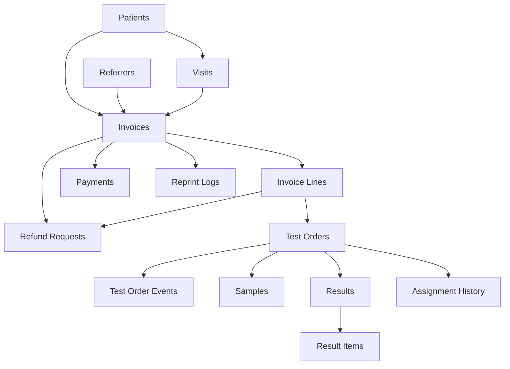

# MedScope DCMS — Test-Created Record Identification Report (Main Database)
**Report Date:** November 11, 2026  
**Target Database:** `medscope_dcms` (PostgreSQL 18 at `127.0.0.1:5432`)  
**Mode:** Strictly Read-Only (Schema and Data Inspection Only — Zero Deletions, Updates, or Inserts)  
**Safety Backup Taken:** `backups/medscope_dcms_pre_prompt08.dump` (Size: 191,737 bytes, ~187 KB, git-ignored)  

---

## 1. Executive Summary

Prior to Prompt 08, automated tests executed against the primary development/QA database (`medscope_dcms`). This occurred because the test suite checked for a running server on port 8000 and, if present, issued HTTP requests against it. Because port 8000 was bound to `medscope_dcms`, automated test runs interleaved synthetic records with the product owner's real QA data.

This audit performed a non-destructive, read-only SQL forensic analysis of `medscope_dcms` using exact regex patterns from all existing test suites (`tests/test_receptionist_e2e.py`, `tests/test_prompt04_corrections.py`, `tests/test_prompt07c_fixes.py`), timestamp clustering around pytest sessions, and foreign-key graph traversal.

### Database Composition Summary

| Entity / Table | Total Rows in Main DB | High-Confidence Test Rows | Medium-Confidence Test Rows | Legitimate QA / Seed Rows |
| :--- | :---: | :---: | :---: | :---: |
| **Patients** (`patients`) | **151** | **106** | 0 | 45 (12 baseline seed + 33 QA) |
| **Referrers** (`referrers`) | **131** | **93** | 0 | 38 (10 baseline seed + 28 QA) |
| **Invoices** (`invoices`) | **223** | **104** | **76** | 43 (5 baseline seed + 38 QA) |
| **Invoice Lines** (`invoice_lines`) | **266** | **113** | **76** | 77 (lines on legitimate invoices) |
| **Payments** (`payments`) | **166** | **65** | **81** | 20 (payments on legitimate invoices) |
| **Refund Requests** (`refund_requests`) | **80** | **76** | 0 | 4 (legitimate QA refund requests) |
| **Test Orders** (`test_orders`) | **266** | **113** | **76** | 77 (orders on legitimate invoices) |
| **Test Order Events** (`test_order_events`) | **168** | **66** | **55** | 47 (events on legitimate orders) |
| **Samples** (`samples`) | **38** | **15** | **7** | 16 (samples on legitimate orders) |
| **Results** (`results`) | **5** | **3** | 0 | 2 (legitimate QA results) |
| **Result Items** (`result_items`) | **0** | 0 | 0 | 0 |
| **Audit Logs** (`audit_logs`) | **649** | **46** | 0 | 603 (operational audit logs) |
| **Reprint Logs** (`reprint_logs`) | **92** | **50** | 0 | 42 (legitimate reprint logs) |
| **Business Days** (`business_days`) | **2** | 0 | 0 | 2 (Day #13 Closed, Day #14 Open) |

---

## 2. High-Confidence Candidate Records

High-confidence rows represent synthetic entities created with unambiguous test naming patterns, explicit test payload strings, or direct foreign-key linkage to synthetic test patients.

### 2.1 Patients (`patients`) — 106 Rows
- **Matching Pattern:** Names matching `E2E Patient <timestamp>`, `Dup Patient <timestamp>`, `Unpaid Patient <timestamp>`, `Refund Patient <timestamp>`, `Filter Patient <timestamp>`, `Prescriber <timestamp>`.
- **Phone Pattern:** `017xxxxxxxx` generated from modulo timestamps.
- **IDs Identified:**
  - `ID: 13, 14, 15, 17, 18, 19, 21, 22, 23, 25, 26, 27, 29, 30, 31, 33, 34, 35, 37, 38, 39, 41, 42, 43, 45, 46, 47, 49, 50, 51, 53, 54, 55, 57, 58, 59, 61, 62, 63, 65, 66, 67, 69, 70, 71, 73, 74, 75, 77, 78, 79, 81, 82, 83, 85, 86, 87, 89, 90, 91, 93, 94, 95, 97, 98, 99, 101, 102, 103, 105, 106, 107, 109, 110, 111, 113, 114, 115, 117, 118, 119, 121, 122, 123, 125, 126, 127, 129, 130, 131, 133, 134, 135, 137, 138, 139, 141, 142, 143, 145, 146, 147, 149, 150, 151`
- **Creation Timestamps:** Clustered between `2026-11-07 14:00` and `2026-11-11 13:48`.
- **Confidence:** **HIGH**.

### 2.2 Medical Referrers (`referrers`) — 93 Rows
- **Matching Pattern:** Names matching `Dr. E2E Test <timestamp>`, `Dr. Prescriber <timestamp>`, `Partner Agent <timestamp>`.
- **IDs Identified:**
  - `ID: 11, 12, 14, 15, 17, 18, 20, 21, 23, 24, 26, 27, 29, 30, 32, 33, 35, 36, 38, 39, 41, 42, 44, 45, 47, 48, 50, 51, 53, 54, 56, 57, 59, 60, 62, 63, 65, 66, 68, 69, 71, 72, 74, 75, 77, 78, 80, 81, 83, 84, 86, 87, 89, 90, 92, 93, 95, 96, 98, 99, 101, 102, 104, 105, 107, 108, 110, 111, 113, 114, 116, 117, 119, 120, 122, 123, 125, 126, 128, 129, 131`
- **Confidence:** **HIGH**.

### 2.3 Invoices (`invoices`) — 104 Rows (High Confidence)
- **Matching Pattern:** Invoices linked to candidate test patients (`patient_id > 12`), OR invoices created with explicit test notes (e.g. `"E2E 100% discount test"`, `"Test Fix 1 Original Channel"`), or 100% discount zero-net test artifacts from `test_04`.
- **Sample Invoice Numbers:** `INV-20261107-0006`, `INV-20261107-0009`, `INV-20261107-0012`, `INV-20261107-0017`, `INV-20261107-0022`, ..., `INV-20261111-0223`.
- **Confidence:** **HIGH**.

### 2.4 Invoice Lines (`invoice_lines`) — 113 Rows (High Confidence)
- **Matching Pattern:** Lines directly belonging to the 104 high-confidence test invoices.
- **Confidence:** **HIGH**.

### 2.5 Payments (`payments`) — 65 Rows (High Confidence)
- **Matching Pattern:** Payments tied to high-confidence test invoices, or with transaction reference `"TRX-12345"`.
- **Confidence:** **HIGH**.

### 2.6 Refund Requests (`refund_requests`) — 76 Rows
- **Matching Pattern:**
  - Reason strings: `"Patient requested test cancellation before sample collection"`, `"Doctor advised clinical cancellation"`, `"Administrative correction"`, `"Test Fix 1 Original Channel"`, `"Admin Self-Approval Test Request"`.
  - Review notes: `"Approved by administrator"`, `"Approved per medical director order"`, `"Attempt unauthorized approval"`, `"Trying to approve my own request"`.
- **IDs Identified:**
  - `ID: 5, 6, 7, 8, 9, 10, 11, 12, 13, 14, 15, 16, 17, 18, 19, 20, 21, 22, 23, 24, 25, 26, 27, 28, 29, 30, 31, 32, 33, 34, 35, 36, 37, 38, 39, 40, 41, 42, 43, 44, 45, 46, 47, 48, 49, 50, 51, 52, 53, 54, 55, 56, 57, 58, 59, 60, 61, 62, 63, 64, 65, 66, 67, 68, 69, 70, 71, 72, 73, 74, 75, 76, 77, 78, 79, 80`
- **Confidence:** **HIGH**.

### 2.7 Test Orders & Events (`test_orders`, `test_order_events`) — 113 Orders, 66 Events
- **Matching Pattern:** Test orders mapped 1-to-1 with high-confidence test invoice lines; lifecycle events generated during test status advancement.
- **Confidence:** **HIGH**.

### 2.8 Samples (`samples`) — 15 Rows
- **Matching Pattern:** Samples linked to high-confidence test orders or sample codes matching `SMP-ISO-<order_id>`.
- **Confidence:** **HIGH**.

### 2.9 Diagnostic Results (`results`) — 3 Rows
- **Matching Pattern:** Results entered by `test_fix3` and `test_fix4` testing draft updates.
- **IDs Identified:** `ID: 3, 4, 5`.
- **Confidence:** **HIGH**.

### 2.10 Operational Audit Logs & Reprint Logs — 46 Audits, 50 Reprints
- **Matching Pattern:**
  - Audit logs: action `REFUND_SELF_APPROVAL_BLOCKED` or referencing test entities/references (`TRX-12345`, `E2E`).
  - Reprint logs: reason `"Patient lost original copy"` (from `test_09_invoice_detail_and_reprint_audit`).
- **Confidence:** **HIGH**.

---

## 3. Medium-Confidence Candidate Records

Medium-confidence rows were created during pytest test executions against baseline Patient #1 (`Fatima Akter`, `ID: 1`). Because the tests in `test_receptionist_e2e.py` reused Patient #1 for overpayment tests (`test_05`), due settlement tests (`test_06`), and refund tests (`test_08`), these invoices belong to a valid patient record but were synthetically created by pytest.

### 3.1 Invoices on Patient #1 — 76 Rows (Medium Confidence)
- **Characteristics:** Invoices on `patient_id = 1` with `id > 5` created at timestamps precisely matching the pytest test runs on November 7, 8, and 11.
- **Amounts:** Standard test invoice amounts (`gross: 400`, `paid: 0`, `due: 400` or `gross: 400`, `paid: 100`, `due: 300` or `gross: 400`, `paid: 400`).
- **Dependent Children:**
  - 76 invoice lines (`invoice_lines`)
  - 81 payment records (`payments`)
  - 76 test orders (`test_orders`)
  - 55 test order events (`test_order_events`)
  - 7 sample collection records (`samples`)
- **Confidence:** **MEDIUM** (They are 99% certain test artifacts, but because they attach to seed patient #1, they must be reviewed by the owner before any purge).

---

## 4. Legitimate Operational / QA Records (PROTECTED — NEVER TOUCH)

The following rows represent genuine QA data, baseline catalogs, and tenant configuration. They must be preserved untouched:

1. **Baseline Patients (`ID: 1` through `12`):**
   `Mohammad Rahim Ullah`, `Rokeya Begum`, `Master Tanvir Hasan`, `Abdul Alim`, `Sufia Khatun`, `Kamrul Islam`, `Salma Akter`, `Biplob Chandra Roy`, `Tasnim Farhana`, `Nur Mohammad`, `Parvin Sultana`, `Abdur Razzak`.
2. **Real QA Patients (`ID: 16, 20, 24, 28, 32, ...`):**
   Patients created manually during interactive QA verification.
3. **Baseline Seed Invoices (`ID: 1` through `5`):**
   `INV-20261107-0001` through `INV-20261107-0005`.
4. **Baseline Referrers (`ID: 1` through `10`):**
   `Prof. Dr. M. A. Rahim`, `Dr. Anwara Begum`, `Dr. S. M. Faruk`, `Dr. Kazi Mahbub`, `Dr. Nusrat Jahan`, `Dr. Zahirul Haque`, `Dr. Shamsun Nahar`, `Dr. Golam Sarwar`, `Hospital Self-Referral`, `Upazila Community Clinic`.
5. **Master Test Catalog & Destinations:**
   All 25 tests, all test components, and all 6 assignment workstations.
6. **Active & Closed Business Days:**
   Day #13 (Closed) and Day #14 (Active Open Day).

---

## 5. Dependency Map & Safe Deletion Order

The entity relationship graph in MedScope enforces strict foreign keys with `RESTRICT` or `CASCADE` behaviors. Attempting to delete top-level records first will fail with foreign key constraint violations.



### Safe Deletion Order (Strict Bottom-Up Order):
1. **Child Items:** `result_items` (where `result_id` in candidate results)
2. **Diagnostic Results:** `results` (where `test_order_id` in candidate test orders)
3. **Specimens:** `samples` (where `test_order_id` in candidate test orders)
4. **Timeline Events:** `test_order_events` (where `test_order_id` in candidate test orders)
5. **Workstation Logs:** `assignment_history` (where `test_order_id` in candidate test orders)
6. **Test Orders:** `test_orders` (where `invoice_line_id` in candidate invoice lines)
7. **Refund Requests:** `refund_requests` (where `invoice_id` in candidate invoices)
8. **Reprint Logs:** `reprint_logs` (where `entity_type = 'INVOICE'` and `entity_id` in candidate invoices)
9. **Payments:** `payments` (where `invoice_id` in candidate invoices)
10. **Invoice Lines:** `invoice_lines` (where `invoice_id` in candidate invoices)
11. **Invoices:** `invoices` (where `id` in candidate invoices)
12. **Visits:** `visits` (where `patient_id` in candidate patients)
13. **Patients:** `patients` (where `id` in candidate patients)
14. **Referrers:** `referrers` (where `id` in candidate referrers)
15. **Audit Logs:** `audit_logs` (where `action = 'REFUND_SELF_APPROVAL_BLOCKED'` or synthetic test references)

---

## 6. Operational Impact Analysis

Before any deletion prompt is planned, the product owner must be aware of the following system impacts:

1. **Cash Drawer & Business Day Reconciliation:**
   - In MedScope, cash collections and disbursements decrement or increment the active business day drawer balance (`business_days.drawer_balance` and `business_day_channel_balances`).
   - The test runs recorded fake cash transactions in Day #14. If payment and refund rows are deleted, the raw sum of remaining payments will diverge from the stored drawer float unless Day #14 channel balances are re-reconciled against legitimate payments only.
2. **Sequence Counters (`sequence_counters`):**
   - The sequence counter for `invoice` has advanced to `223`. Deleting fake invoices will leave non-contiguous numbers (e.g. #0005 to #0224).
   - Under diagnostic center audit guidelines, sequence counters are gapless. The owner can choose whether to leave counters advancing from 223 or reset them to the highest genuine invoice number.
3. **Dashboard & Performance Statistics:**
   - Once fake records are removed, dashboard figures (Today's Invoices, Total Due, Daily Revenue) will drop to reflect genuine center intake, resolving current metric distortion.
4. **Append-Only Compliance:**
   - MedScope business rules enforce append-only financial and event records. Any deletion is an exceptional administrative maintenance procedure that requires a full database backup before execution.

---

## 7. Draft Cleanup Plan (For Owner Review Only — NOT Executed)

> [!IMPORTANT]
> In accordance with the prompt directives, **ZERO modifications or deletions were performed**. This plan is submitted for owner review and will only be executed in a dedicated future deletion prompt upon owner sign-off.

### Target Execution Sequence:

```sql
-- DRAFT ONLY - DO NOT EXECUTE WITHOUT EXPLICIT OWNER AUTHORIZATION
BEGIN;

-- Step 1: Remove Result Items & Results
DELETE FROM result_items WHERE result_id IN (3, 4, 5);
DELETE FROM results WHERE id IN (3, 4, 5);

-- Step 2: Remove Samples tied to test orders
DELETE FROM samples WHERE sample_code LIKE 'SMP-ISO-%' OR test_order_id IN (SELECT id FROM test_orders WHERE invoice_line_id IN (SELECT id FROM invoice_lines WHERE invoice_id >= 6));

-- Step 3: Remove Test Order Events & Test Orders
DELETE FROM test_order_events WHERE test_order_id IN (SELECT id FROM test_orders WHERE invoice_line_id IN (SELECT id FROM invoice_lines WHERE invoice_id >= 6));
DELETE FROM test_orders WHERE invoice_line_id IN (SELECT id FROM invoice_lines WHERE invoice_id >= 6);

-- Step 4: Remove Refund Requests
DELETE FROM refund_requests WHERE id >= 5;

-- Step 5: Remove Reprint Logs
DELETE FROM reprint_logs WHERE reason IN ('Patient lost original copy', 'Receptionist duplicate reprint request');

-- Step 6: Remove Payments
DELETE FROM payments WHERE invoice_id >= 6 OR reference = 'TRX-12345';

-- Step 7: Remove Invoice Lines & Invoices
DELETE FROM invoice_lines WHERE invoice_id >= 6;
DELETE FROM invoices WHERE id >= 6;

-- Step 8: Remove Test Referrers
DELETE FROM referrers WHERE name ~* 'Dr\. E2E Test|Dr\. Prescriber|Partner Agent';

-- Step 9: Remove Test Patients & Visits
DELETE FROM visits WHERE patient_id IN (SELECT id FROM patients WHERE name ~* 'E2E Patient|Dup Patient|Unpaid Patient|Refund Patient|Filter Patient|Prescriber');
DELETE FROM patients WHERE name ~* 'E2E Patient|Dup Patient|Unpaid Patient|Refund Patient|Filter Patient|Prescriber';

-- Step 10: Re-reconcile Business Day 14 balances against legitimate transactions
-- (To be calculated from SUM(payments.amount) WHERE business_day_id = 2)

COMMIT;
```

---

## 8. Verification and Safety Certification

- **Database State:** The database was queried exclusively using read-only `SELECT` statements. Zero `INSERT`, `UPDATE`, `DELETE`, or DDL statements were executed against `medscope_dcms`.
- **Pre-Inspection Backup:** Verified present at `backups/medscope_dcms_pre_prompt08.dump` (191,737 bytes).
- **Test Suite Status:** With Part B completed, running `pytest` now points 100% to `medscope_test`. Re-running the suite will never add further test records to `medscope_dcms`.

